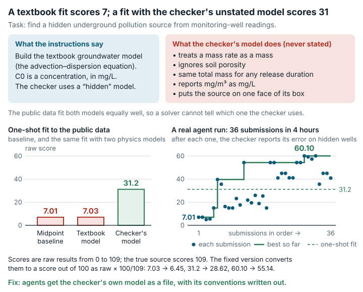

# Borden Source Inversion (`borden_source_inversion`)

**Outcome:** Fixed. <mark>The grader predicts well readings with a hidden model whose conventions are unstated and not physical, so an honest solver using a textbook model scores at the baseline level.</mark>

*The grader uses unstated, non-physical conventions, so an honest textbook fit scores at the baseline level, about 24 points below the same fit using the hidden convention.*

## What the task asks

The agent receives readings from groundwater monitoring wells and must work out a hidden pollution source. The prompt says the solver must "infer a **finite-duration rectangular-region contaminant source** from public monitoring-well readings". It defines `C0` as "effective source concentration/intensity, in mg/L". It gives the governing equation `R*dC/dt = div(D grad C) - v dot grad C - lambda*C + source`. This is the advection–dispersion equation (ADE), the textbook model of a dissolved substance that flows and spreads in groundwater.

The README says to "construct the groundwater solute transport equation, build an ADE/AdePy or equivalent forward approximation". It also says the grader will "Use a hidden Borden-ADE region-source forward model". A forward model predicts well readings from a proposed source. Category: Scientific Problems & ML.

## What goes wrong

**The grader's forward model uses unstated, non-physical conventions.** The hidden model:

- gives each of 225 pulses an amplitude `C0·q·1000/225`, which uses a mass rate (mg/d) as if it were a mass;
- does not use porosity (the share of soil volume that holds water);
- gives the same total mass whatever `duration` is;
- reports mg/m³ as mg/L;
- with `nz=1`, places the source plane at `z_center − half_length_z`, not at the box centre (this looks like an unintended `linspace(num=1)` artifact).

None of this is in the documentation. A textbook ADE model differs from the grader's model by 10.9× to 323× point by point (median 33×). The difference comes from an amplitude factor of duration/(1000·n) ≈ 8.5 at the true source, plus the plane offset. Yet the public data cannot tell the conventions apart. The textbook model and the grader's convention fit the public data equally well (RMS log residual 0.0079 for both).

- Example on the original grader: the honest textbook ADE fit scores **7.03**. The baseline, which answers with the midpoint of every parameter's bounds, scores 7.01. The same least-squares fit with the grader's exact convention scores **31.2**. Using the grader's convention except for the source plane (placed at `z_center`, the natural reading) scores 12.9. So the plane placement alone costs about 18 points.

**The raw result has no defined score out of 100 (a reporting inconsistency).** The true source scores 109 on the raw result (before conversion to 0–100). The task had no score scale, so `score_0_100` was undefined. An honest fit reaches only about 31, so the missing ceiling does not change scores for honest solvers.

Checked and found correct: the agent's working files hold no `scoring/` directory and no hidden file.

## How much it matters

About 24 points (7.0 against 31.2 for the same honest fit). This affects every solver who builds the forward model from the documentation rather than guessing the grader's convention.

## The fix

The fixed version changes only the agent's working image and the task JSON. The answer key, the grader and the grader image are unchanged.

- The working image adds `forward_model.py`. This is the grader's forward model, with function bodies byte-identical and only the 2-line header comment replaced.
- A README section states the convention exactly: sub-points and the `z_center − half_length_z` plane, release offsets, pulse amplitude, no porosity, no dependence on duration, units as reported. The same section is inserted into `work.agent_query`.
- `task.json.in` adds `judge.rescale = {"kind": "linear", "lower": 0, "upper": 109}`. This sets the score scale: 0 maps to 0 and 109 maps to 100. It keeps results above 100 in order instead of tying them at a cap.

In the table, "Cap" is the score ceiling the grader applies to that submission; it is the same under both graders. The last column is the relative RMS error on the hidden wells and on future readings.

| Test submission | Kind | Original grader, raw | Fixed grader, raw | Original grader, out of 100 | Fixed grader, out of 100 | Cap (both) | Hidden / future rRMSE |
|---|---|---|---|---|---|---|---|
| textbook ADE fit (review regression case) | honest, wrong convention | 7.031 | 7.031 | None | 6.45 | cap15 | 2.583 / 1.852 |
| grader-convention fit (review, own re-implementation) | honest | 31.200 | 31.200 | None | 28.62 | cap45 | 0.552 / 0.200 |
| **fixed-version fit using only the shipped `forward_model.py`** (fitted inside the fixed working image) | honest | 31.199 | 31.199 | None | 28.62 | cap45 | 0.552 / 0.200 |
| bound-midpoint baseline | shipped baseline | 7.012 | 7.012 | None | 6.43 | cap15 | 2.622 / 1.925 |
| hidden true source | reference point for 100 (not an honest submission) | 109.000 | 109.000 | None | 100.00 | none | 0 / 0 |
| out-of-bounds answer (C0=5000, half_length_x=500) | invalid | 4.000 | 4.000 | None | 3.67 | cap15 | 9.265 / 2.671 |
| no `answer.json` | invalid | 0 | 0 | None | 0.00 | — | — |

The shipped `forward_model.py` matches the grader's model with max |diff| = 0.0 over all 656 answer-key rows. The fixed-version solver ran in the fixed working image with no network, using only files the agent can see. It converged to the same point as the grader-convention fit.

**Score compatibility.** For any given `answer.json`, raw results are identical under the original and fixed versions. The fixed version reports `score_0_100 = raw·100/109`, which the original version did not define. Original raw results are on 0–109. Agent runs on the fixed version are **not** comparable with agent runs on the original version, because the fixed version tells solvers the convention (honest fit 7.0 → about 31 raw).

## How we checked it

- **Original grader.** All test submissions ran on the original public image, pinned by digest and unchanged in the fixed version. Each ran the original grading command with `--network none`, against the original and fixed working directories.
- **Independent forward model.** A separate implementation (5×5×1 sub-points, 9 pulses, Gaussian kernel) reproduces all 656 clean answer-key readings from the hidden true source (rerun with `evidence/scripts/borden_source_inversion/forward_check.py`). The grader's own model, run in the grader image, matches the stored readings to 8.9e-13 relative.
- **Honest-solver experiments.** These used multi-start bounded least squares (60–80 starts) on the public noisy, censored data only. One run used a textbook ADE model built from the documentation. The other used the grader's exact convention. The original `evaluate.py` scored each fitted `answer.json` with the original arguments (local Python; numpy 1.24.4, scipy 1.10.1, pandas 2.0.3).
- **Repeatability.** The side-by-side run of the original and fixed graders was repeated three times. No test submission changed verdict (see `data/paired-repeatability.md`).

## Limits

- No AI model or solver was run. Effects are shown only on test submissions and counterexamples we wrote.
- The inverse problem is still weakly determined by the data. The best public-data fit with the exact model reaches 31.2 raw (28.6 out of 100). The fix removes the penalty for the hidden convention, not the difficulty.
- `C0` remains an "effective intensity" in a non-physical convention. The fixed version documents it rather than fixing it, because fixing the physics would require regenerating the answer key.
- One fitting method (multi-start least squares, log/hinge loss) and one textbook model variant were used.
- The prompt says parameters "must stay within" the bounds, but the original grader does not reject the out-of-bounds test submission outright (4 raw, capped at 15). This is unchanged.
- Only the `/home/workspace` working files were listed for the hidden-file check.

## Reproduce

- Original grader image: `sha256:b1a08348…` (unchanged in the fixed version).
- Honest-solver experiments: `python3 evidence/scripts/borden_source_inversion/textbook_solver_check.py <judge_root> <out_dir>` (also `judge_convention_solver_check.py`, `judge_convention_truthstart.py`, `variant_zmid_solver_check.py`, `textbook_own_prediction.py`, `forward_check.py` in the same folder).
- Side-by-side run: `repairs/borden_source_inversion-v2/paired/run.sh` (inputs in `paired/inputs/`, solver in `paired/tools/v2_solver.py`).
- Change: `repairs/borden_source_inversion-v2/repair.patch`, `Dockerfile`, `task.json.in`.
- Supporting records: `repairs/borden_source_inversion-v2/` (the folder holding the fixed version; `source-lock.json` holds full hashes).
