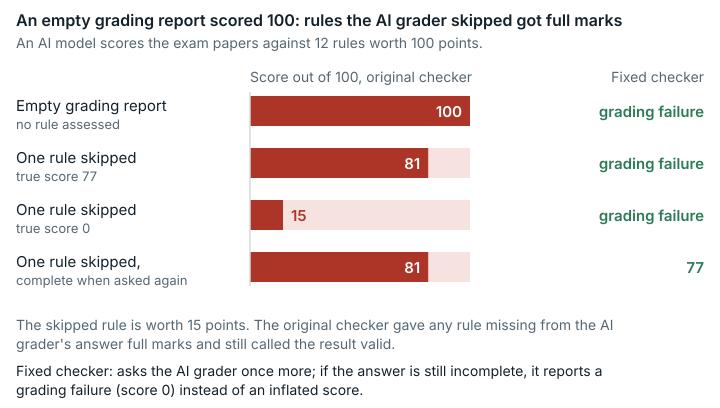

# College English exam bank (`college_english_exam_bank`)

**Outcome:** Fixed. <mark>The original grader gave full marks for any rubric rule that the AI grading model did not assess, and still reported the result as valid.</mark>

*When the AI grader skipped rules, the original grader gave those rules full marks and called the result valid; the fixed version asks again and otherwise reports a grading failure.*

## What the task asks

The solver is told to "Read the complete task instructions in `/home/workspace/task_instruction.md`". Those instructions ask for 22 deliverables: five exam papers (A to E) as Word and PDF files, answer keys and scoring guides, a blueprint workbook and a workbook of repetition rates across papers. An AI grading agent (a large language model) scores the work against `rubrics.json`. That file has 12 rules (R001 to R012) worth 100 points in total. Every rule is `deductive`: it starts at full marks and loses points for faults found. The grader's prompt tells the grading model to use the `rules` array strictly as the scoring list and not to add, delete or merge rules. The docstring of the grader's reconciliation step says "Force result coverage/order/max_score to match rubrics.json". Category: Professional Knowledge Work.

## What goes wrong

**Rules left out get full marks.** When a rule's row is missing from the grading model's JSON answer, the reconciliation step finds no recorded deductions. Because every rule is deductive, the rule keeps its full maximum. The grader writes the reason "Missing deductive detail scores; unreported deduction triggers treated as not triggered." and reports `grader_status: ok`, `valid: true`.

| Fixed model response | Expected | Result on the original grader |
| --- | --- | --- |
| C: `{"scores": []}` (no rule assessed) | grading failure | valid, **100.0** |
| D: response A (77.0) with R009 (15 pts) left out | 77 or failure | valid, **81.0** (R009 → 15/15) |
| E: response B (0.0) with R009 left out | 0 or failure | valid, **15.0** (R009 → 15/15) |

**A self-contradicting row gets full marks.** Case I is a row whose own `score` is 0 but whose checkpoints all report no deduction. The original reconciliation step trusts the checkpoints and awards the rule full marks (15.0 instead of 0).

**When it happens.** The problem needs the grading model to return JSON that parses but lacks some rule rows. One example is a truncated or abandoned assessment of a heavy 22-file submission. The grader's prompt itself anticipates the model running short of time or context. That a solver could cause an omission is plausible but not demonstrated. The fault is in fixed post-processing code owned by the task, which fails open when the model's output is incomplete.

## How much it matters

A score can rise by up to the value of the rules left out; an empty assessment scores 100. For this task the error only pushes scores up, because its rubric has no additive rules (rules that start at zero, which would push scores down instead). Any submission can be affected whenever the grading model returns an incomplete assessment.

## The fix

The fixed version changes only `/home/workspace/scoring/grade_with_codex.py`:

- It rejects score lists that are incomplete, duplicated, unknown or non-numeric. A row may leave out the rule-level score when it has a complete numeric list of checkpoints, which the original version scored correctly. On such a row a rule score written as a plain decimal string, such as `"11"`, is read as that number; booleans and other strings are still rejected.
- It rejects an assessment in which a deductive row reports a deduction (its own score is below the maximum, or a checkpoint is positive) but would still be scored at full marks, as in case I. To decide this it runs the original reconciliation step on the normalised rows, so it looks at exactly the data that produces the score.
- An incomplete assessment becomes a grading failure (`valid: false`, score 0), the channel the original grader already uses for grading-side failures. EdgeBench's harness ranks it as a 0 for that submission (`score_first` does not read `valid`); the run keeps its best other submission. Scoring only the missing rule at zero was not chosen, because it would silently understate an otherwise complete answer.
- The last JSON block with `scores` in the model's output decides, as in the original. If it parses but fails these checks, the fixed version does not score an earlier block, which may be a draft from before the model's own check; it treats the output as incomplete. It falls back to an earlier block only when the last one is truncated or does not parse.
- Because the harness does not retry, the fixed version asks the grading model again before giving up. It makes at most `1 + SEBENCH_CODEX_ASSESSMENT_RETRIES` calls (the variable defaults to 1, so 2 calls), all within the original time budget.

The rubric, reference attachments and work image are unchanged. In `task.json.in` only `judge.image_tag` changes.

| Fixed model response | Role | Original: valid | Original: score | Fixed: valid | Fixed: score | Fixed: model calls | Original = fixed output |
| --- | --- | --- | ---: | --- | ---: | ---: | --- |
| A all 12 rules, one deduction each | correct test submission | true | 77 | true | 77 | 1 | byte-identical |
| B all 12 rules floored to 0 | correct test submission (bad work) | true | 0 | true | 0 | 1 | byte-identical |
| F R009 rule-level score 0, no checkpoints | correct test submission | true | 0 | true | 0 | 1 | byte-identical |
| L A without any rule-level score (complete checkpoints) | correct test submission | true | 77 | true | 77 | 1 | byte-identical |
| C empty `scores` | **shows the problem** | **true** | **100** | false (grading failure) | – | 2 | – |
| D A minus R009 | **shows the problem** | **true** | **81** | false | – | 2 | – |
| E B minus R009 | **shows the problem** | **true** | **15** | false | – | 2 | – |
| G R009 row with no score and no checkpoints | shows the problem (malformed row) | true | 0 | false | – | 2 | – |
| I R009 score 0 with all-zero checkpoints | **shows the problem (caveat b)** | **true** | **15** | false | – | 2 | – |
| H no JSON | invalid test submission | false | – | false | – | 2 | same structured result |
| J D, then A when asked again | asking again recovers | true | 81 | true | 77 | 2 | – |
| K no JSON, then A when asked again | asking again recovers | false | – | true | 77 | 2 | – |
| N A's block, then D's block, in one output | **shows the problem** | **true** | **81** | false | – | 2 | – |
| NA N, then A when asked again | asking again recovers | true | 81 | true | 77 | 2 | – |
| NZ full-marks block, then D's block, in one output | **shows the problem** | **true** | **81** | false | – | 2 | – |
| P A's block, then a truncated block, in one output | correct test submission | true | 77 | true | 77 | 1 | byte-identical |
| QA A with R009's rule score as the string `"11"` | correct test submission | true | 77 | true | 77 | 1 | byte-identical |
| QC A with R009's rule score `true` | malformed row | true | 77 | false | – | 2 | – |

"–" marks a grading failure: the grader reports `valid: false` with score 0. EdgeBench's `score_first` selection does not read `valid` and ranks that 0, which can never beat a graded submission. The harness uses `score_first` selection: the run keeps the submission with the highest score. Under it, the original version picks the inflated round (C at 100, D at 81, I at 15) over the honest one. The fixed version picks the honest one (77, 77, 0).

**Are scores comparable?** The original and fixed versions give the same score for complete, internally consistent assessments (rows A, B, F, L). Those come from byte-identical structured results and one model call. The scores are not comparable when the grading model leaves out, duplicates or invents a rule. They are also not comparable when it returns a row with neither a score nor a complete list of checkpoints, or a deductive row that reports a deduction but would be scored at full marks. They also differ when the output ends with a `scores` block that fails these checks after an earlier block (N, NZ), and when a rule score is a boolean, a string that is not a plain decimal number, or a decimal string on a row without a complete checkpoint list. The original version filled the first cases with full marks and scored the failing last block. It scored rows of the last kind correctly from their checkpoints or rule score (QC: 77), so there the fixed version can turn a correct score into a grading failure when asking again does not help. The fixed version asks again and otherwise reports a grading failure.

**Revision of the fix (2026-10-12).** The first published fixed version decided the deduction check on the raw row, before normalisation. Four rows still got full marks; the Lean model found the first three and a probe of the real code the fourth: a veto stated only in `veto_reason` while `rule_veto_triggered` is false, a deduction in an extra checkpoint beyond the rubric's details, a veto flag on a rule without veto conditions, and floor wording after character 200 of `reason`. The fixed version now reads the normalised rows. A side-by-side run of the original grader, the first fixed version and the revised one gave the same results as the table above for every earlier response. The four rows score 3 or 15 points for the changed rule under the original grader and the first fixed version, and are grading failures under the revised one. A row the first fixed version rejected although the original scores it consistently (a veto, score 0) is now scored 0, as in the original.

| Fixed model response | Original: score | First fixed version | Revised fixed version |
| --- | ---: | --- | --- |
| GA R001 veto stated only in `veto_reason` | 3 (R001 full marks) | valid, 3 | grading failure |
| GB R009 deduction in an extra checkpoint | 15 (R009 full marks) | valid, 15 | grading failure |
| GC R009 veto flag, rule has no veto conditions | 15 (R009 full marks) | valid, 15 | grading failure |
| GD R009 floor wording after character 200 | 15 (R009 full marks) | valid, 15 | grading failure |
| M R001 score 0, negative checkpoint, veto marker | 0 | grading failure | valid, 0 |

**Second revision of the fix (v2.2, 2026-10-13).** An independent review found two behaviours of the revised version that did not follow the contract. When the last JSON block of an output failed the checks, it scored an earlier block that passed, without asking again. That block can be a draft from before the model's own check: a full-marks draft followed by an incomplete final block scored 100. And a rule score written as a numeric string was a grading failure even when the row's checkpoints were complete and consistent, although the original scored that row correctly. Version v2.2 lets the last block decide and reads a plain decimal-string rule score on a row with complete checkpoints as that number. A side-by-side run of the original grader, the revised version (v2.1) and v2.2 on 29 fixed responses gave the same result under v2.1 and v2.2 for every earlier response except N. The changed rows:

| Fixed model response | Original: score | Revised version (v2.1) | Second revision (v2.2) |
| --- | ---: | --- | --- |
| N A's block (77), then D's block (incomplete), in one output | 81 | valid, 77, one call | grading failure after asking again |
| NZ full-marks block, then D's block, in one output | 81 | valid, 100, one call | grading failure after asking again |
| NU A's JSON, then D's JSON, unfenced, in one output | 81 | valid, 77, one call | grading failure after asking again |
| QA A with R009's rule score `"11"` | 77 | grading failure | valid, 77, byte-identical to the original |
| QB A with every rule score a padded string such as `" 11.0 "` | 77 | grading failure | valid, 77, byte-identical to the original |

A boolean rule score (QC), a word (`"twelve"`, QD), a string `"0"` that contradicts all-zero checkpoints (QE) and a string `"0"` on a row without checkpoints (QF) remain grading failures under v2.2. The original scores QC, QD and QF correctly (77, 77, 0) and QE at an inflated 15. When the second answer is complete (NA), v2.2 scores it (77). A truncated last block (P) still falls back to the complete earlier block (77 in all three versions).

## How we checked it

- **Original grader, from the public image pinned by digest.** The original `main()` ran end to end with `--network none --memory 2g --cpus 1`. Only the `codex` executable was replaced, by a stub that prints a fixed model response. No model API or credential was used. The fixed responses were generated from the original `rubrics.json`. They include correct responses, responses for known-bad work and the responses that show the problem (rules left out, an empty score list, malformed rows). The fixed-version runs used the same eval_cmd in the fixed image.
- **Harness check.** EdgeBench's handling of `valid: false` (`sforge/harness/grading.py`, `selection.py`, at `6e4e5f4`) was read and used offline to grade and select on the saved results.
- **Repeatability.** The side-by-side run of the original and fixed graders was repeated three times. No response changed its result (see `data/paired-repeatability.md`). These repeats used the first fixed version. The side-by-side run with the revised fixed version was also run three times (`evidence/runs/college_english_exam_bank-v2-paired-fix2`, `-fix2-rep2`, `-fix2-rep3`); its graded results (`graded.json`) are identical in all three apart from timing fields. The side-by-side run with the second revision (v2.2) was run three times as well (`evidence/runs/college_english_exam_bank-v2-paired-fix3`, `-fix3-rep2`, `-fix3-rep3`); in each, the package's own `materialize.sh` regenerated the v2.2 grader from the pinned image before it was built, and `graded.json` and `graded.md` are byte-identical across the three runs.
- **Formal check.** A Lean 4 model of the normalisation, the reconciliation step and both fixed versions (`evidence/formal/notes/college_english_exam_bank.md`) proves that, for the revised fixed version and for every parsed assessment: an accepted assessment gets exactly the original score; an assessment that leaves out a rule is a grading failure; and a deductive rule whose row reports a deduction never gets full marks. The same model shows that the first fixed version awarded full marks in the four rows above. Text fields are reduced to yes/no facts in the model; the last result does not rely on that reduction, because the check uses the same functions as the score. The model starts from the parsed rows, so it does not cover which JSON block is parsed or the reading of decimal-string rule scores (both tested on the real code; see the second revision above).

## Limits

- No AI solver was run. Effects are shown only on the fixed responses and counterexamples we wrote.
- No live grading model was used. How often real models leave out rows, and whether any past EdgeBench score was inflated, were not measured. The problem is not evidence that past scores were inflated.
- No real 22-file submission was graded. The fixed responses do not read the submission.
- The harness `judge_server` was not run live.
- When a model output holds several JSON blocks, the original grader and the fixed version both let the last `scores` block decide. If that block fails the fixed version's checks, the fixed version asks again even when an earlier block would pass (N, NZ). If the earlier block was honest and the second answer is again incomplete, this costs that submission its score; a draft cannot be told from a final answer, so it is not scored. Whether `codex exec` output in this image ever holds more than one block is not measured. As in the original, a fenced block takes priority over unfenced JSON.
- A rule score that is a boolean or a non-numeric string, or a decimal string on a row without checkpoints, is a grading failure in the fixed version, although the original scores such rows correctly (QC, QD, QF). How often a real model writes them is not measured.
- In production, asking again may cost extra paid grading calls. Whether a second attempt is usually complete is unknown. A model that keeps returning incomplete output still yields no measurement for that submission.
- Other risks of AI graders (prompt injection, grading variance) are out of scope.

## Reproduce

- Grader image: `sha256:8e9eec10…`.
- Fixed-response run on the original grader: `evidence/scripts/college_english_exam_bank/run_fixed.sh`, with `fake_codex.sh` and `make_responses.py` (log: `run_in_judge_image.log`).
- Side-by-side run of the original and fixed graders: `repairs/college_english_exam_bank-v2/paired/run.sh` (`repairs/college_english_exam_bank-v2/` is the folder holding the fixed version). Results are in `paired/results.md`, and the offline harness grading is in `paired/grade.py`.
- Fix: `repairs/college_english_exam_bank-v2/repair.patch`, `Dockerfile`, `source-lock.json`.
- Supporting records: `repairs/college_english_exam_bank-v2/` and `evidence/reviews/college_english_exam_bank.md`.
