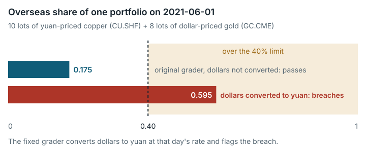

# CTA risk budget optimization (`cta_risk_budget_optimization`)

**Outcome:** Fixed. The 40% overseas-exposure check adds US-dollar (USD) and Chinese-yuan (CNY) position values without converting currency, so overseas USD positions count about seven times too little; the error only ever helps a submission and is worth at most 5 points out of 100.

*The original grader added dollar and yuan values without converting, so a portfolio at 0.595 overseas looked like 0.175 and passed the 40% limit.*

## What the task asks

The agent builds a backtesting engine (a simulator that replays past prices) for futures. The task instructions ask for a "Multi-currency, multi-market, multi-instrument backtesting engine". They also ask for "Handling of … exchange rates" and for "single-instrument/sector/overseas exposure … risk constraints".

The input risk policy (`risk_policy_doc.docx`, in Chinese) sets the overseas limit at 40% ("境外投资比例不超过基金净值的40%"). It also requires that "所有境外品种的仓位计算必须使用实时汇率折算为人民币等值": every overseas position must be converted to its RMB (yuan) equivalent at the live exchange rate. Category: Professional Knowledge Work.

## What goes wrong

**The overseas check skips currency conversion.** The grader recomputes each position's notional value (its face value) as `lots × multiplier × close` from the raw price sheets. All 12 overseas tickers are priced in USD. The grader converts with the USDCNY exchange rate in its profit-and-loss replay and in `_compute_exposure_stats`. The cross-border block leaves the conversion out. This contradicts the policy document's rule that positions be counted in RMB. USDCNY in the data runs from 6.757 to 7.157 (mean 7.004).

- Minimal example (synthetic): 2 lots in CNY and 1 lot in USD, with price and multiplier 1 and USDCNY 7. The overseas share in CNY is 7/9, which breaches 40%. The original grader computes 1/3 and records 0 violations.
- Real data, 2021-06-01: 10 lots CU.SHF plus 8 lots GC.CME give an overseas share in CNY of 0.595. The grader reads 0.175, so this case also passes.
- The task's own reference: converted at USDCNY, the shipped standard-answer positions exceed 40% on 32 of 1565 days, with a maximum of 52.1%. The original check reports 0 violations and full ratio credit.

A separate observation, not fixed: the policy states the limit as "40% of fund NAV" (net asset value). The grader instead uses the overseas share of gross notional value. This is a separate question from the currency issue.

## How much it matters

Up to 5 points out of 100 (4 of 80 raw points), and only in the generous direction. Because USDCNY is above 1, the bug can award ratio credit to a portfolio that breaches the limit. It never penalizes a compliant one. Only solvers holding USD contracts are affected. Other checks can cap or cancel the risk part of the score and hide the swing.

## The fix

The fixed version changes one file, `/home/workspace/scoring/eval_script.py` (+11/−1 lines). Inside the cross-border block, USD-priced tickers are multiplied by USDCNY from the grader's own `fx` data, looked up as of the date. The fallback is 7.0. This is the same series and fallback the existing `fx_for` helper uses.

These are unchanged: the 40% threshold, the day-count rules, the `cb_checks` mapping and the question of NAV against gross notional value. Same-currency portfolios are numerically unchanged. In the task JSON, only `judge.image_tag` changes.

In the table, "violations" counts days over the limit, and `cross_border` (or "cb") is the score of the cross-border check. "cost_fx" is the score of the grader's separate costs-and-exchange-rate check, which the test sets to 0 or 2.

| # | Test submission | Input | Original grader | Fixed grader | Expected |
|---|---|---|---|---|---|
| 1 | **Shows the problem (synthetic)** | 2 lots CNY + 1 lot USD, price and multiplier 1, USDCNY 7. Share is 1/3 unconverted, 7/9 in CNY | violations 0/1; `cross_border` **1** (cost_fx 0) / **5** (cost_fx 2) | violations **1/1**; `cross_border` **0** / **1** | the original grader wrongly passes the 40% limit, the fixed grader fails it ✔ |
| 1b | **Shows the problem (real data)** | 2021-06-01: 10 lots CU.SHF + 8 lots GC.CME. Share is 0.175 unconverted, 0.595 in CNY | violations 0/1; cb **1 / 5** | violations **1/1**; cb **0 / 1** | ✔ |
| 2 | Correct test submission, one currency | domestic only (2 lots CU.SHF) | 0/1; cb 1 / 5 | 0/1; cb 1 / 5 | unchanged ✔ |
| 2b | Correct test submission, mixed currencies, under the limit | real data, 10 CU + 2 GC. Share 0.050 unconverted, 0.269 in CNY | 0/1; cb 1 / 5 | 0/1; cb 1 / 5 | unchanged ✔ |
| 2c | Invalid test submission (over the limit even unconverted) | synthetic 1 CNY + 1 USD (1/2 unconverted, 7/8 CNY); real 10 CU + 30 GC (0.443 / 0.847) | 1/1; cb 0 / 1 | 1/1; cb 0 / 1 | rejected by both ✔ |
| 3 | Shipped reference positions (this check only) | `standard_answer_artifacts.tar.gz` `backtest_results/positions.csv` + `trades.csv`, 1565 days | violations **0/1565**; cb **1 / 5** | violations **32/1565** (2.04%); cb **0 / 1** | changes, explained below |
| 4 | **Full original grader, complete shipped reference** | the whole `standard_answer_artifacts.tar.gz` extracted into `/home/workspace` | TOTAL_SCORE **20.0** (raw 16/80); M1 4, M2 0, **M3 0** ("Veto: annual vol 1.3% outside [5%,20%]"), M4 2, M5 10; valid, pass_rate 1.0, exit 0 | **identical**: 20.0, the same metric breakdown, the same veto. Logs are identical apart from timings | unchanged ✔ |

Row 3 changes as intended. 32/1565 is not below the 2% day-count allowance, so the fixed grader awards 0 ratio checks instead of 2. Row 4 is unchanged because the full grader cancels the whole risk part (M3) of the shipped reference for its annual volatility of 1.3%, before the cross-border score is used. The fix is therefore verified on this check alone, not end to end.

**Score compatibility.** Some submissions hold overseas (USD) contracts whose share, converted at USDCNY, exceeds 40% on at least one day. For those, fixed-version scores are not comparable with original scores. They can lose cross-border ratio credit, up to 4 of 80 raw points (5 points out of 100). Only the `cross_border` part inside M3 can change, and only downward. Same-currency portfolios score identically.

## How we checked it

- **Original grader.** The checks ran on the original public image, pinned by digest, with `--network none --memory 2g --cpus 1`. We imported the installed `eval_script.py` and called the original `_evaluate_risk_constraints`. Two inputs were set so the cross-border block could be reached. The participation check was stubbed to pass. `nav_history` was left out, so the volatility/drawdown cancellation could not fire. The cross-border code itself was not modified. The full original `score.py` also ran on the shipped reference (row 4).
- **Exact arithmetic.** Shares were computed with Python `Fraction`.
- **Lean 4.** Lean 4 is a proof assistant that checks mathematical proofs by machine. `formal/lean/ebv/Ebv/FinanceExcessFx.lean` proves the example shares (1/3 unconverted, 7/9 in CNY). It proves that the unconverted share passes the limit and the CNY share fails it. It also proves that an unconverted share of 2/5 at an exchange rate of 7 hides a CNY share of up to 14/17. No `sorry` (an unproved step) is used. The printed axiom lists (for the two share theorems and the hidden-share bound) contain only the standard axioms; the two pass/fail inequalities have no printed list.
- **Repeatability.** The side-by-side run of the original and fixed graders was repeated three times. No test submission changed verdict (see `paired-repeatability.md`).

## Limits

- No AI model or solver was run. Effects are shown only on test submissions and counterexamples we wrote, and on the shipped reference.
- The test submission that shows the problem was run through the installed grader's `_evaluate_risk_constraints`, with the participation check stubbed and NAV left out. It was not run end to end through `score.py`. The only complete submission in the image is the standard answer, and its risk part is cancelled before the cross-border block.
- How often real solver submissions are affected was not measured.
- The agent's working image was not inspected for a copy of `eval_script.py`.
- The separate "% of NAV vs % of gross notional" deviation was not fixed.

## Reproduce

- Original grader image: `sha256:34258d85…`.
- Reproduction on the original grader: `evidence/scripts/cta_risk_budget_optimization/repro_cross_border.py`. Fixed check: `repro_repaired.py`. Reference positions: `reference_positions_share.py`. Saved outputs are the matching `.out` files.
- Lean proof: `evidence/formal/lean/ebv/Ebv/FinanceExcessFx.lean` (output in `FinanceExcessFx.out`).
- Side-by-side run of the original and fixed graders: `repairs/cta_risk_budget_optimization-v2/paired/run.sh`, results in `paired/results.md`, evidence in `paired/evidence/`.
- Fix: `repairs/cta_risk_budget_optimization-v2/repair.patch`, `Dockerfile`, `source-lock.json`.
- Supporting records: `repairs/cta_risk_budget_optimization-v2/` (the folder holding the fixed version) and `evidence/reviews/cta_risk_budget_optimization.md`.
