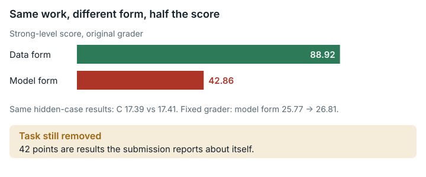

# Dabic Gravity Inversion (`dabic_gravity_inversion`)

**Outcome:** Removed. 42 points come from results the submission reports about itself, which the grader cannot verify; a partial fix removes a second, undisclosed penalty on one of two allowed forms, but does not make the task usable.

*The original grader penalised one of two equivalent forms, and the partial fix cannot save the task because 42 points are results the submission reports itself.*

## What the task asks

The solver implements a D-ABIC gravity inversion: a method that infers underground density from gravity measurements and picks its regularization strength (beta) with Akaike's Bayesian Information Criterion (ABIC). The method can be written in two equivalent forms. The model-space form works with matrices sized by the number of hidden model cells. The data-space form works with matrices sized by the number of data points.

The task text says: "Decide for yourself whether to use the model-space or data-space form, how to compute determinants, and in which space to optimize beta." The starting README (line 48) repeats that the choice is "to be determined by the implementer." README line 5 expands D-ABIC as "Data-space variant of Akaike's Bayesian Information Criterion". Even so, the task text leaves the choice open twice, and no text the solver can see says that the model-space form loses score. Category: Scientific Problems & ML.

## What goes wrong

**42 points are self-reported. This is the reason for removal.** Components B and D (42 points together) are taken from results the submission reports about itself. The grader does not recompute them from hidden data. For an honest solver, these components therefore reflect what the submission reports, not what the grader verifies. Component F, the written report, is scored by keywords.

**An undisclosed requirement to use the data-space form.** The grader decides which form a submission uses from the shape of the square matrices passed to the log-determinant routines it monitors. A model-space submission is marked `is_data_space=false` and `structural_failure=true`. That costs it 3.2 points of raw result (before conversion to 0–100) at every level of quality: these are the E1 behaviour points. It also blocks the uncapped penalty factor of 1.0, so a model-space submission is capped at a factor of 0.5×. By Sylvester's determinant identity, both forms compute the same ABIC curve.

- Example on the original grader: the data and model forms give the same results on the hidden cases (C 17.39 against 17.41), but score 26.82 and 25.77. At this moderate level both received the penalty factor 0.334, so the observed gap is small.
- At a strong level (C ≥ 26, D ≥ 20, F ≥ 10), applying the grader's own penalty function gives about 89 in the data form against about 43 in the model form for the same work (88.92 against 42.86 at C = 26).

## How much it matters

- Self-reported components: 42 points cannot be verified, for every solver.
- Form penalty: up to ~46 points at the strong level, and 3.2 raw points at every level, for solvers who choose the model-space form.

## The fix

The fixed version is partial. It removes the form penalty only. It does not address the reason for removal; what a full fix would need is stated at the end of this section.

The fix changes one file, the grader `eval_dabic_v2.py`, in both places where it sits in the grader image. It adds `is_model_space`, which mirrors the existing data-space check: most captured square matrices have the hidden cell count as their dimension. It then uses `uses_abic_form = is_data_space or is_model_space` for the E1 points and for the `structural_failure` term. Every threshold, the 0.334/0.5/1.0 penalty levels, the other behaviour rules, `valid_for_selection` and all other components are unchanged. The task JSON changes only `judge.image_tag`. The work image and the files the solver sees are unchanged. Mirroring the check, rather than removing it, keeps the requirement that the log-determinant is taken on an ABIC matrix.

The tables below show raw results. The task has no `rescale` section, which would define the score scale, so the maintained harness reports `score_0_100 = None` (`sforge/harness/run_evaluation.py:265`, no clipping). The column label "raw=norm" is kept from the side-by-side results file, because the raw result and the reported score are the same number here.

| Test submission | Submission | Original grader score (raw=norm) | Fixed grader score (raw=norm) | Detail, original → fixed | Valid, original/fixed | Exit code, original/fixed |
|---|---|---|---|---|---|---|
| Shows the problem | honest model-space D-ABIC (`FORM="model"`) | **25.77** | **26.81** | E 4.8 → 8.0; `structural_failure` true → false; raw 77.16 → 80.27 | true/true | 0/0 |
| Correct submission | honest data-space D-ABIC (`FORM="data"`) | **26.82** | **26.84** | E 8.0 / 8.0; raw 80.31 → 80.35 (C 17.39 → 17.43, run noise) | true/true | 0/0 |
| Invalid submission | data form, log-determinant via `np.linalg.det` (`make_invalid_variant.py`) | 26.91 | 26.86 | `uses_bad_det` true, `structural_failure` true in both; E 7.2 / 7.2 | **false/false** | 0/0 |
| Shipped state | the grader image's own workspace (no `outputs/`, nothing submitted) | 0.00 | 0.00 | all components ERROR (files missing) | false/false | 0/0 |

Cap at the strong level. These values are derived, not observed: each grader image's own penalty function is applied to that test submission's real breakdown, with only C replaced. Each cell gives the penalty factor and the resulting score.

| C | Data form, original grader | Model form, original grader | Data form, fixed grader | Model form, fixed grader |
|---|---|---|---|---|
| 20 | 0.5 → 41.46 | 0.5 → 39.86 | 0.5 → 41.46 | 0.5 → 41.46 |
| 26 | 1.0 → 88.92 | **0.5 → 42.86** | 1.0 → 88.92 | **1.0 → 88.92** |
| 30 | 1.0 → 92.92 | 0.5 → 44.86 | 1.0 → 92.92 | 1.0 → 92.92 |

On the original grader, the gap between the data and model forms is 1.05. On the fixed grader it is 0.03, within the measured run noise (repeated runs vary by up to 0.15 in C).

**What a full fix would need.** The grader would have to recompute the B and D components (42 points) from hidden data, instead of reading them from the results the submission reports. Until then the task is removed.

**Score compatibility.** By reading the code, scores from the fixed grader equal scores from the original grader, up to run noise, for every submission classified as data-space. This was measured once: the correct data-space submission went from 26.82 to 26.84. The same holds for submissions whose matrices match neither the hidden data count nor the hidden cell count. Scores are not comparable for model-space submissions, which gain the 3.2 E1 points and, at the strong level, the uncapped penalty factor 1.0. The score scale is unchanged.

## How we checked it

- **Original grader in the original public image, pinned by digest**, using the exact evaluation command with `--network none --cpus 8 --memory 6g`. One honest D-ABIC submission was scored in two forms that differ only in the line `FORM = "data"` / `FORM = "model"`. Fixed input files held the self-reported components (B, D) and the keyword-scored report (F) constant in every test submission, so only the form varied. Their values are not task performance.
- **Source reading** of the behaviour monitor (`BehaviorMonitor.report`) and the penalty function (`structural_penalty_v34`).
- **Effect at the strong level.** The grader's own penalty function was applied to each test submission's real breakdown, with only the hidden-case score C substituted.
- **Side-by-side run of the original and fixed graders** on the same inputs, plus an invalid submission (log-determinant via `np.linalg.det`) and the empty shipped workspace. It was repeated three times, and no test submission changed outcome (see `data/paired-repeatability.md`).
- **Units check.** An independent prism gravity code (Nagy's formula) passed a check against an infinite flat slab (the Bouguer slab). Its output was not saved.

## Limits

- No AI model or solver runs were made. Effects are shown only on test submissions and counterexamples that we wrote.
- One moderate honest implementation was used (C ≈ 17.4/35), with fixed input files for B, D and F. The effect at the strong level is computed with the grader's own penalty function, not observed with a strong submission.
- The form classification still depends on matrix shapes. A correct implementation that computes the log-determinant without passing an N×N or M×M square matrix to a monitored routine (for example a low-rank or iterative estimator) is still marked `structural_failure` in both versions.
- The partial fix does not address the reason for removal: B and D (42 points) still come from results the submission reports about itself, and F is scored by keywords. The fix's README says it "does not make the task retainable on its own".
- The invalid submission is rejected only through the `valid` flag. Its numeric score is not low.
- The hidden cases use the same simulator to generate and to invert the data, which is acceptable for synthetic tests. SimPEG was not compared, and the Xu benchmark constants were not verified.

## Reproduce

- Grader image digest: `sha256:fe3dc290…`.
- Run of the two forms on the original grader: `evidence/runs/dabic_gravity_inversion-forms/run.sh` (inputs in its `inputs/` folder).
- Side-by-side run: `repairs/dabic_gravity_inversion-v2/paired/run.sh` (the folder holding the fixed version), with `make_invalid_variant.py` and `penalty_check.py` in the same folder.
- Prism sanity check: `evidence/scripts/dabic_gravity_inversion/prism_forward_check.py`.
- Change: `repairs/dabic_gravity_inversion-v2/repair.patch`, `Dockerfile`, `task.json.in`.
- Supporting records: `repairs/dabic_gravity_inversion-v2/` (`source-lock.json` holds full hashes).
