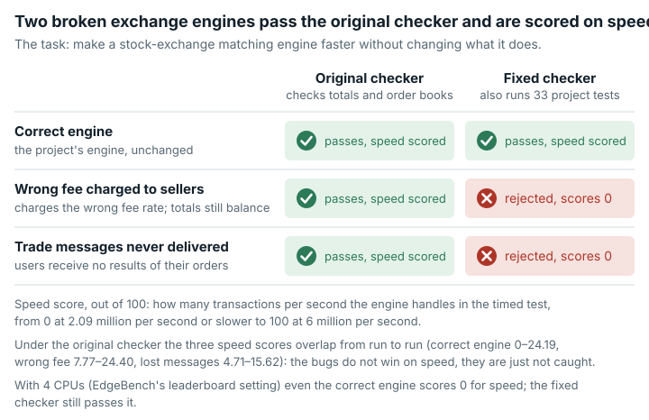

# Exchange Core Throughput (`exchange_core_throughput`)

**Outcome:** Fixed. The original correctness check does not catch wrong fees or lost messages, so incorrect engines receive full credit; the fixed version requires the project's own integration tests to pass and grades without network access.

*The original grader gave broken engines full credit and even higher scores than the correct one; the fixed version scores them 0.*

## What the task asks

The agent speeds up exchange-core, a stock-exchange matching engine (software that pairs buy and sell orders). The goal is to "maximize the throughput (MT/s — millions of transactions per second) of `PerfThroughput#testThroughputPeak`".

The rules say "Do NOT change behavior: `mvn test` must still pass functional assertions". They also say "`CASES_OK = 1` only when `mvn test` exits 0 AND an MT/s line was parsed". The raw result (before conversion to 0–100) is `int(round(Average_MT_s * 1000))`. It is converted to a score out of 100 on a logarithmic scale (`log_max`). The reference point for 0 is 2090.634594076933 and the reference point for 100 is 6000. Category: Systems & Software Engineering.

## What goes wrong

**Incorrect engines pass the correctness check and are rewarded.** The throughput test's correctness check compares only two things. The global balance must be zero, and the L2 order books (the price levels of resting orders) must match. The test source marks the missing comparisons with `// TODO compare events, balances, positions`. Two plausible one-edit changes to the shipped engine show the effect:

- **feeswap.** A copy-paste fee bug: the selling taker (the trader whose order executes immediately) is charged the maker fee instead of the taker fee. The exchange fee ledger books the same wrong amount, so the global balance stays exactly zero. Sellers are over-credited, and the exchange's fee income is under-booked on every sell-taker trade.
- **dropevents.** The results stage no longer forwards command results, trade events, reduce events or reject events to the user's results consumer. The API futures (the calls' return values) still complete.

Under the original grader, both engines passed `testThroughputPeak` in all 50 checked rounds. Maven exited 0, and the grader printed `CASE 0000 OK` and `CASES_OK 1`. Single runs:

| Engine | TOTAL_SCORE (raw result) | Score out of 100 (log_max) |
|---|---|---|
| correct test submission (shipped engine) | 2254 | **7.14** |
| feeswap (wrong balances) | 2704 | **24.40** |
| dropevents (dropped events) | 2465 | **15.62** |

The project's integration tests reject both engines and pass the correct one. With feeswap, 2 of 5 `ITFeesExchangeBasic` tests fail. For example, `shouldProcessFees_BidGtcMaker_AskIocTakerPartial` expected `<199061711100L>` and got `<199063788300L>`. With dropevents, all 28 `ITExchangeCoreIntegrationRejectionBasic` tests fail because the handler receives no command results.

feeswap does the same work as the correct engine. So the ranking among these three is throughput noise, not a speed effect of the bugs. The finding is that incorrect engines receive full credit.

**The original grader cannot grade offline.** The pinned image's `~/.m2` (the local Maven cache) lacks `surefire-junit-platform:3.0.0-M3`. With `--network none`, every submission fails, including the unmodified engine (`CASE 0000 RE score=0 / TOTAL_SCORE 0`). The harness gives the grader container network access, and `internet: false` covers only the agent container. So the original grading depends on reaching Maven Central at grading time.

## How much it matters

Shown: 7.1 → 24.4 out of 100 for a buggy engine. Any solver whose optimization breaks fees or event delivery while keeping the global balance at zero gets full credit instead of 0.

## The fix

Before the unchanged timed test, the fixed grader runs the project's shipped integration tests `ITFeesExchangeBasic` and `ITExchangeCoreIntegrationRejectionBasic` (33 tests) in a separate Maven run. If any of them fails, the submission scores 0 (`WA`, wrong answer). The timed run is unchanged.

The fixed version also pre-loads 30 missing public files from Maven Central (surefire, JUnit platform, opentest4j and apiguardian artifacts) into the image's `~/.m2`, so it grades with no network. For the original-grader runs below, the same files were mounted so that the original grader could run offline. The "v1raw" row shows the original image without them.

| Submission | Role | Original grader | Fixed grader |
| --- | --- | --- | --- |
| unmodified engine, original image without the added files ("v1raw") | setup check | RE, 0 | — |
| unmodified engine (correct test submission, run 1) | valid | OK 2050 | integration tests OK (33 tests), OK 2153 |
| unmodified engine (correct test submission, run 2) | valid | OK 2210 | integration tests OK, OK 2978 |
| `topo21` honest variant | valid | OK 2524 | integration tests OK, OK 2481 |
| `feeswap` (fee swap, balance kept at zero) | **shows the problem** | **OK 2269** | **WA 0 (integration tests failed)** |
| `dropevents` (user events not forwarded) | **shows the problem** | **OK 2234** | **WA 0 (integration tests failed)** |
| `feeleak` | invalid | RE 0 | WA 0 |
| `compileerr` | invalid | RE 0 | WA 0 |

The raw result is MT/s × 1000. RE means a run error. The single-run results in the previous section and the original-grader results here come from separate runs; both are quoted as recorded. The other test submissions are:

- `topo21` is the prompt's own example optimization: 4ME+2RE changed to 2ME+1RE.
- `feeleak` charges the wrong fee without booking it consistently, which breaks the global-balance check.
- `compileerr` does not compile.

**Score compatibility:** correct engines score as under the original version, although throughput is noisy from machine to machine. Incorrect engines that the original version rewarded now score 0. Fixed-version scores are not comparable with original leaderboard entries.

## How we checked it

- **Original grader.** The checks ran on the original public image, pinned by digest. Each submission ran through the task's exact `eval_cmd` in a fresh container with `--network none`, `--cpus 8` and `--memory 6g`.
- **Independent check:** the project's own shipped integration tests (`ITFeesExchangeBasic`, 5 tests, and `ITExchangeCoreIntegrationRejectionBasic`, 28 tests). They ran in the same container with the grader's exact Maven flags.
- **Side-by-side run.** The original and fixed graders scored the same submissions, plus valid and invalid test submissions, both with `--network none`. This was repeated three times. No test submission changed verdict (see `paired-repeatability.md`). Throughput moves between runs, but the integration-test verdicts never change.

## Limits

- No AI model or solver was run. Effects are shown only on test submissions and counterexamples we wrote.
- Throughput varies by about ±20% from run to run on the same machine type: the correct engine ran at 2,050–2,978 raw. The single-run scores out of 100 above are not a comparison controlled for that variation.
- The two integration test classes cover fees, rejections and events. They do not cover every property a correct engine must keep, so an engine with other kinds of wrong behaviour could still pass the fixed grader's test step.
- The fixed version does not compare per-user balances, positions or the event stream against a reference run. It uses the shipped integration tests instead.
- Only two incorrect-engine changes were tested.

## Reproduce

- Original grader image: `sha256:6b1617315cd2…`.
- Original-grader runs with incorrect engines: `evidence/runs/exchange_core_throughput-wrongengine/run.sh`.
- Integration-test check: `evidence/runs/exchange_core_throughput-oracletests/run.sh`.
- Side-by-side run of the original and fixed graders: `repairs/exchange_core_throughput-v2/paired/run.sh`. The variant definitions are in `paired/mutate.py`.
- Fix package: `repairs/exchange_core_throughput-v2/` (the folder holding the fixed version), which contains `Dockerfile`, `repair.patch`, `files/` and `source-lock.json`.
- Supporting records: `repairs/exchange_core_throughput-v2/paired/results.md` and `evidence/reviews/exchange_core_throughput-native.md`.
