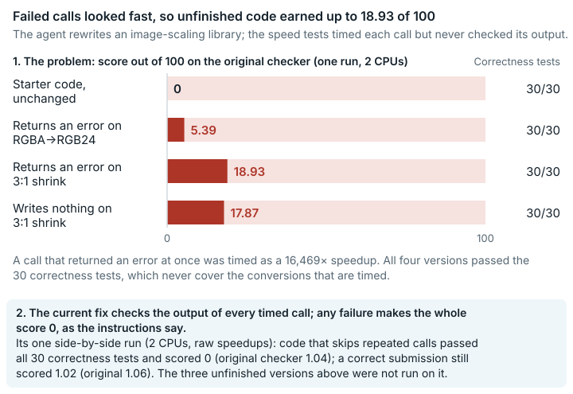

# FFmpeg Swscale Reimplementation (`ffmpeg_swscale_reimplementation`)

**2026-10-13 revision:** v2.2 checks every output and makes any failed workload produce exactly zero total reward. Six native full-scorer arms passed, plus 40 original-helper layout comparisons. The good control finished in 43 seconds; a repeated-call defect passed 30/30 correctness workloads but received zero after timed-output validation. The fix section below describes v2.2 and keeps the historical v2 table for the record. This follow-up does not rerun the Rust submission-build path. See [follow-up](../repairs/ffmpeg_swscale_reimplementation-v2/paired/followup.md).

**Outcome:** Original defect confirmed; v2.2 repair validated on paired native scorer controls. <mark>The timed speed tests were never checked for correctness, so failed or empty calls earned speed credit; the fixed version checks each timed call's return code and output.</mark>

*Calls that failed or did nothing finished instantly, so the original grader paid up to 18.93 points for unfinished code; the fixed version checks each timed call's result and pays nothing for these.*

## What the task asks

The solver re-implements FFmpeg's libswscale, its image-scaling and pixel-format-conversion library, in Zig or Rust as a C-compatible shared library. The task text says the library "must handle conversions between any pair of these formats". It also says: "If correctness fails on any hidden workload, the score is **zero**." Otherwise `reward = geometric_mean(baseline_time / candidate_time)`, the geometric mean of the speedups over the original library.

The raw result (before conversion to 0–100) is converted with the `log_anchor` score scale, a logarithmic scale with one reference point: a raw result of 14.155 (anchor_raw) maps to 43 (anchor_score). A raw result of 1 or less becomes 0. Category: Systems & Software Engineering.

## What goes wrong

**Timed workloads earn speed credit without any correctness check.** The score is computed in two stages:

- **Correctness check.** 30 fixed workloads are compared with the original library using per-plane PSNR (peak signal-to-noise ratio, measured for each colour plane). The threshold is at least 60 dB for same-size conversion and at least 40 dB for scaling.
- **Timing.** 10 *different* workloads are timed. The timing loop ignores the return value of `swscale_process` and never reads the output buffer.

Several timed configurations never appear in the correctness set: RGBA→RGB24, RGB24→BGRA, 3:1 downscales, a 1.5× bicubic upscale, and 1080p and 4K sizes. A call that returns an error, or does nothing, finishes almost instantly. It therefore gets a very large "speedup".

Each variant below models ordinary step-by-step development: a path that is not written yet, or a plain bug. Results on the original grader:

| Variant (honest behaviour modelled) | Correctness | Raw result | Score out of 100 (`log_anchor`) | Workload driving the change |
|---|---|---|---|---|
| Variant 0: shipped starting code, unchanged | 30/30 | 0.4585 | 0 | n/a |
| Variant 1: returns error -3 for RGBA→RGB24 ("not implemented yet") | 30/30 | **1.3938** | **5.39** | rgba→rgb24 4K: 16,469× |
| Variant 2: returns error -3 for 3:1 downscale | 30/30 | **3.2112** | **18.93** | 3:1 bilinear 23,856×, 3:1 nearest 7,032× |
| Variant 3: returns success but writes nothing for 3:1 downscale | 30/30 | **3.0083** | **17.87** | 23,864× / 4,467× |

Example: for Variant 1 the expected outcome is no speed credit on RGBA→RGB24, because the call fails. The original grader instead recorded a 16,469× speedup on that workload. That raised the score out of 100 from 0 to 5.39. Timings vary by about ±20% from run to run. The shifts above, of 3 to 7× in raw result, are far larger.

**The shipped starting code already gets credit for wrong output.** On the timed workload `rgb24 1080p→360p nearest`, the unchanged starting code produces **14.91 dB PSNR, against the 40 dB threshold**. That same workload gives the starting code its largest speedup, 4.65×.

Crashes are handled differently. A Python exception or a NULL context gives that workload 0, and a segfault makes `test.sh` write reward 0. Only error returns and silent no-ops are rewarded. The correctness workloads themselves are checked as stated. They simply never cover the configurations that are timed.

A point that does not change scores: the task text says the starting code "already matches the hidden correctness suite at 30/30", and elsewhere describes it as a candidate "which reached 26/30". The runs on the original grader measured 30/30.

## How much it matters

Up to 18.93 points out of 100 are shown for an honest but unfinished variant. Any solver whose library fails or does nothing on a timed configuration outside the correctness set receives too much credit.

## The fix

The fixed version (v2.2, the current patch) changes only `compute_reward.py`:

- Before each of the 10 warmup and 100 timed calls of a timed workload it clears the whole output buffer, including padding, outside the timer.
- After every call it checks the return code and compares the output with the original library's output, using the correctness workloads' per-plane PSNR thresholds: 40 dB for scaling and 60 dB for same-size conversions. These checks are outside the timer too.
- Any failed timed workload makes the total reward exactly 0, as the task text says ("If correctness fails on any hidden workload, the score is **zero**"). Contexts are destroyed even when a check fails.

Nothing else changes.

Native side-by-side run of v2.2 (job `ffmpeg-native-v2.2-20261013`, ledger `status: exit=0`): the original digest-pinned image and the v2.2 image ran the complete `compute_reward.py` (30 correctness and 10 timed workloads) on the same native C test submissions, in 2-CPU / 4-GiB containers with no network. All six arms exited 0. Values are raw rewards ([`paired/results.md`](../repairs/ffmpeg_swscale_reimplementation-v2/paired/results.md), section "v2.2 native result").

| Test submission | Original grader | Fixed version v2.2 | Correctness original / v2.2 |
| --- | --- | --- | --- |
| forwards every call to FFmpeg (correct) | 1.056386 | 1.020061 | 30/30 / 30/30 |
| **skips the second call of each context** | **1.038559** | **0.000000** | 30/30 / 30/30 |
| always returns an error (bad control) | 0.000000 | 0.000000 | 0/30 / 0/30 |

The correct submission stays positive; 1.056386 against 1.020061 lies within the original image's own run-to-run spread on that submission (0.994937 and 1.056386 in two jobs). The submission that skips a call passes all 30 correctness workloads but now gets exactly 0, because its timed outputs are wrong. 40 native buffer layouts matched the original helpers byte for byte before scoring.

**Historical v2 run.** The first fixed version, v2, compared only the output of the last timed call of each workload and gave a failed workload a speedup of 0 inside the geometric mean, so its totals were small but positive. Its side-by-side run is kept below for the record; v2.2 supersedes it.

| Submission | Role | Original grader | Fixed grader | Note on the fixed grader |
| --- | --- | --- | --- | --- |
| shim forwarding to the original library (each frame once) | correct | 0.967353 | 0.980056 | 30/30, no timed errors |
| shim forwarding to the original library (each frame twice) | correct, about 2× slower | 0.509049 | 0.507032 | 30/30, no timed errors |
| shipped starting code | starting point | 0.447819 | 0.012416 | its 1080p→360p nearest output is below 40 dB |
| errors on 3:1 downscale | **shows the problem** | **2.881761** | **0.000464** | two timed workloads return -3 |
| silent no-op on 3:1 downscale | **shows the problem** | **2.884506** | **0.000463** | two timed outputs below 40 dB |
| errors on RGBA→RGB24 | **shows the problem** | **1.305860** | **0.000451** | timed error + PSNR failure |
| unsupported yuv420p→rgb24 | invalid | 0.0 (28/30) | 0.0 (28/30) | correctness check fails in both |

The values in this table are raw geometric-mean speedups, before conversion to the 0–100 scale. The two shim rows are a thin C wrapper (`ref_shim.c`, source in `repairs/ffmpeg_swscale_reimplementation-v2/paired/results.md`) that forwards every call to the original FFmpeg library, so its output is correct by construction. It is built twice: once processing each frame once, and once processing each frame twice, which is correct but about 2× slower. The two rows are two different correct test submissions, not two runs of one; they are passed to `compute_reward.py` directly, not through `eval_cmd`, and neither is a real solution. This table ran on a different host from the first table, so its raw values for the original grader differ; both are quoted as recorded. The starting code's drop on the fixed grader is correct, because its output on one timed workload really is wrong.

The three variants that show the problem are one-line edits of the starting code, so they inherit its wrong `rgb24 1080p→360p nearest` output, and the starting code alone already scores 0.012416 raw (0 out of 100) on the fixed grader. Their fixed-grader score of 0 therefore does not by itself show that the fix catches the edited workloads. The fixed grader's per-workload errors do: it reports `candidate process returned -3` on `rgba→rgb24 4K` for the RGBA→RGB24 variant and on both 3:1 workloads for the 3:1 error variant, and `timed output below PSNR threshold 40.0` on `rgb24→yuv420p 1080p→360p bilinear` for the silent no-op, each with speedup 0 (`evidence/runs/ffmpeg_swscale_reimplementation-v2-paired-b/result/out/summary_parsed.txt`). No variant was built on a base whose timed outputs are all correct.

**Score compatibility:** correct implementations score as on the original grader, apart from timing noise. Under v2.2 an implementation that produces wrong output, an error or no output on any timed call scores exactly 0. Scores from the fixed grader are not comparable with scores from the original grader.

## How we checked it

- **Original grader in the original public image, pinned by digest.** Four submissions were built from the shipped Rust starting code, each changing a single line of `swscale_process`. They ran through the task's exact `eval_cmd` with `--network none --memory 2g --cpus 2`. That path covers `test.sh`, the source scan, the `cargo build --release` rebuild, `compute_reward.py` and `pytest_shim.sh`.
- **Independent output check.** The original `check_correctness` routine was applied to the 10 timed workloads, with the same PSNR thresholds and the same random-number sequence. The grader itself never runs this check on those workloads.
- **Native side-by-side run of v2.2** on three native C test submissions through the complete `compute_reward.py` (above), after a check that v2.2's buffer snapshot matches the original helpers on 40 layouts.
- **Side-by-side run of the original and historical v2 graders** on the same submissions, with `--network none --memory 4g --cpus 4`. It was repeated three times. No test submission changed outcome, and the test submissions that show the problem stayed near 0 on the fixed grader in every run (see `data/paired-repeatability.md`).

## Limits

- No AI model or solver runs were made. Effects are shown only on test submissions and counterexamples that we wrote.
- On v2.2, any failed timed workload sets the total to exactly 0, as the task text states for correctness failures. The historical v2 only pulled the geometric mean close to 0.
- The v2.2 checks were run on full scorer calls with native C test submissions, not through the task's Rust build and submission `eval_cmd`; that path was run only for the original grader.
- The timed set still differs from the correctness set. The fixed version checks timed outputs but does not add the timed configurations to the 30 correctness workloads.
- Timings depend on the host: the first table ran on a local host in containers limited to 2 CPUs, the side-by-side table on an 8-CPU E2B host in containers limited to 4 CPUs (`env.txt`, `run.sh`).
- The reference point of the score scale (14.155 → 43) should be derived again after the fix. No newly derived reference point is recorded.
- Only the shipped starting code, three one-line variants, one invalid test submission and the wrapper that forwards to the original library were tested. No independent full implementation was built.
- Scorer isolation is outside this release's scope (EdgeBench design choice). The finding above does not depend on it.

## Reproduce

- Grader image digest: `sha256:38b256686afe…`.
- Variants on the original grader:
  - Build the variants with `evidence/scripts/ffmpeg_swscale_reimplementation/make_variants.py`.
  - Run them with `run_variant.sh`, which uses the exact `eval_cmd.sh`.
  - Outputs are in `results_local/<variant>/`.
- Output check on the timed workloads: `evidence/scripts/ffmpeg_swscale_reimplementation/check_bench_outputs.py`. The recorded outputs are `bench_outputs_v0_scaffold.txt` and `bench_outputs_v1_rgba_rgb24_unsupported.txt`.
- Side-by-side run of the original and fixed graders: `repairs/ffmpeg_swscale_reimplementation-v2/paired/run.sh`, with `make_variants.py` in the same folder. `run.sh` compiles `/job/tools/ref_shim.c`; that file is not in the repository, and its source is quoted in `paired/results.md`. The executed job and its outputs are in `evidence/runs/ffmpeg_swscale_reimplementation-v2-paired-b/` (`result/out/`).
- Fixed version: `repairs/ffmpeg_swscale_reimplementation-v2/` (the folder holding the fixed version), which contains `Dockerfile`, `repair.patch`, `materialize.sh` and `source-lock.json`. `files/compute_reward.py` is generated by `materialize.sh`.
- Supporting records: `repairs/ffmpeg_swscale_reimplementation-v2/paired/results.md` and `evidence/reviews/ffmpeg_swscale_reimplementation.md`.
