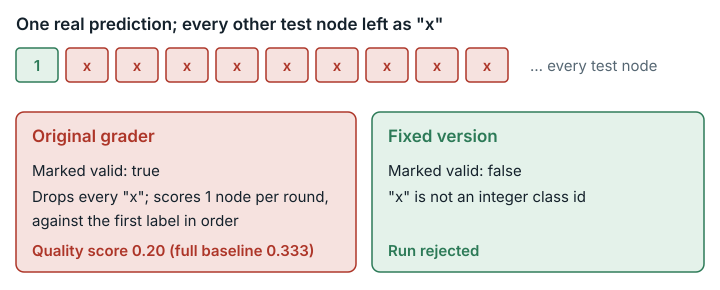

# Graph Node Classification (`graph_node_classification`)

**Outcome:** Fixed. <mark>The original grader silently drops predictions that are not whole numbers and still marks the run valid.</mark>

*The original grader silently dropped non-integer predictions and scored one node as valid; the fixed version rejects the run.*

## What the task asks

The agent predicts a class for every test node (a point in the network) of a graph. The contract says: "`predictions` values must be integer class ids … should cover all test nodes of the current split", and "`confidences` is optional; if provided, values must be in `[0, 1]`."

The score is `overall = 0.4·macro_f1 + 0.3·micro_f1 + 0.2·balanced_accuracy + 0.1·one_minus_ece`, minus time and memory penalties, averaged over 10 splits. F1 and balanced accuracy are accuracy measures. ECE (expected calibration error) measures how well the confidences match actual accuracy. Category: Scientific Problems & ML.

## What goes wrong

**Incomplete predictions are accepted as valid.**

- `_to_int_labels` silently drops prediction values that `int()` cannot convert, such as `"x"`, `None` or NaN.
- `evaluate()` then shortens the answer list to the length of the shorter list.
- The coverage check in `judge_eval.py` compares only dictionary sizes, so it still passes.

So a run can be scored on as little as a single node while it is reported `valid: true`. Strictly, the surviving predictions are paired with the first labels in order, so one bad value early in the file shifts every later prediction onto the wrong node.

- **Small example:** 1000 nodes, where the first prediction is correct and the rest are `"x"`. Result: macro_f1 = micro_f1 = balanced accuracy = 1.0 and ECE 0.
- **Example on the real grader:** the shipped baseline with all but one prediction replaced by `"x"`.
  - Expected: rejected, because the predictions are not integer class ids.
  - Observed: `valid: true`, with every split scored on one node. The first-node guess was right in 2 of 10 splits, giving overall 0.20. That is below the honest 0.333 for this weak baseline.

Why it matters: a submission that breaks the contract gets a valid score computed on the wrong set of nodes.

**Checked and found harmless: NaN or out-of-range confidences.** `_ece()` clips each confidence with `min(1.0, max(0.0, c))`. NaN or a negative value becomes 0, and a value above 1 becomes 1. The score then depends only on the clipped, legal value, so no out-of-range value can score better than a legal one. This is left unchanged.

## How much it matters

The effect adds chance to the score; no expected gain was shown. For each split, the expected value of the one-node gamble depends on accuracy on one fixed node. Whether it raises scores, for example when the best of several submissions is kept, was not established. Only submissions that send non-integer or missing predictions are affected.

## The fix

The fixed version changes only `verifier.py`, in `evaluate`:

1. Every node ID in the answer key must have a prediction.
2. Each prediction is converted strictly. Integers, whole-valued finite floats such as `3.0` and decimal-integer strings such as `"3"` are accepted. Bools, non-whole or non-finite floats, non-numeric strings, `None` and other types are rejected.
3. Answers and predictions are paired by node ID, with no filtering or shortening.

A violation raises an error. The unchanged runner and `judge_eval.py` turn it into their existing failure result (`valid: false`). These are unchanged: confidence clipping, out-of-class integers (still counted as wrong), metrics, penalties, data, splits and baseline. The task JSON changes only `judge.image_tag`.

| Submission | Role | Grader | Marked valid | Final score | Score out of 100 | overall (quality) | macro_f1 | one_minus_ece |
| --- | --- | --- | --- | ---: | ---: | ---: | ---: | ---: |
| baseline (shipped solution.py) | correct test submission | Original | true | 0.292783 | 29.278 | 0.332624 | 0.238512 | 0.925034 |
| baseline | correct test submission | Fixed | true | 0.292702 | 29.270 | 0.332624 | 0.238512 | 0.925034 |
| neighbor (honest neighbour-vote solver, int ids) | correct test submission | Original | true | 0.241002 | 24.100 | 0.281108 | 0.221556 | 0.758336 |
| neighbor | correct test submission | Fixed | true | 0.241044 | 24.104 | 0.281108 | 0.221556 | 0.758336 |
| nanconf (baseline predictions, NaN confidences) | clipping left unchanged | Original | true | 0.271465 | 27.147 | 0.311437 | 0.238512 | 0.713160 |
| nanconf | clipping left unchanged | Fixed | true | 0.271431 | 27.143 | 0.311437 | 0.238512 | 0.713160 |
| shrink (one real prediction, rest `"x"`) | **shows the problem** | Original | **true** | 0.160264 | 16.026 | 0.200000 (each split scored on 1 node) | 0.2 | 0.2 |
| shrink | **shows the problem** | Fixed | **false** | – | – | runner error: `prediction for node '9' is not an integer class id: 'x'` | | |
| missing_half (half the test nodes) | invalid test submission | Original | false | – | – | coverage check: `predictions=520 expected=1041` | | |
| missing_half | invalid test submission | Fixed | false | – | – | runner error: `predictions missing for 521 test node(s)` | | |

For every valid submission, the quality metrics are identical between the original and fixed graders to all printed digits. Final scores differ by at most 8e-5, about 0.008 points out of 100. That difference comes only from the wall-time penalty `0.01·log(time)`.

**Score compatibility:** some submissions give an integer class id for every test node: an int, a whole-valued finite float or a decimal-integer string, not a bool. These score identically under the original and fixed versions, apart from run-to-run timing noise. Bools and non-whole floats, which the original grader converted with `int()`, are invalid in the fixed version. Submissions that omit test nodes, or give non-integer values for any test node, are invalid in the fixed version and are not comparable with their original scores.

## How we checked it

- **Original grader.** The real grading command (`python judge_eval.py`) ran in the original public image, pinned by digest, under `--network none`. It ran with the shipped baseline and variants of it (NaN, 0.0, 7.5 and 1.0 confidences, and the "shrink" case).
- **Independent check of the scoring function.** `verifier.py` was tested as a pure function in three ways: point probes; 20,000 random confidence vectors with 40% special values; and an exhaustive search of all binary cases with n ≤ 3 (84 label/prediction pairs) over a 21-point legal grid plus 5 illegal values. The random vectors gave 0 mismatches against their clipped versions. The exhaustive search found 0 cases where an illegal value beat the best legal one. In the real grader, all-NaN matched all-0.0 (overall 0.31144) and all-7.5 matched all-1.0 (overall 0.26880). Both scored below the baseline's own legal confidences (0.33262).
- **Side-by-side run of the original and fixed graders.** The full 10-split run through the TaskSpec `eval.sh` (`--network none`, 4 CPUs, 6 GB) gave the table above. It was repeated three times with no verdict change ([`data/paired-repeatability.md`](../data/paired-repeatability.md)).

## Limits

- No AI model or solver was run. Effects are shown only on test submissions and counterexamples we wrote.
- Only the shipped baseline, a weak honest neighbour-vote solver and simple contract-breaking variants were run. Stronger solvers were not.
- The expected-value analysis of the shrink case is worked out by hand, backed by one 10-split run. Not checked: how the added chance interacts with the rule that picks a run's best submission (`selection: valid_then_score`).
- No submission with non-string node-ID keys was run. Such a submission becomes invalid in the fixed version.
- The prompt text was read from the grader image's English copy and the Chinese source copy, which agree on the contract sentences. The agent's working image was not pulled.

## Reproduce

- Original grader image: `sha256:518c105e…`.
- Scoring-function checks: `evidence/scripts/graph_node_classification/check_confidence_mapping.py`, `check_invalid_prediction_shrink.py`, and `run_judge_variants.sh` (with `wrapper_solution.py`).
- Side-by-side run: `repairs/graph_node_classification-v2/paired/run.sh` (results in `paired/results.md`).
- Patch: `repairs/graph_node_classification-v2/repair.patch`.
- Supporting records: `repairs/graph_node_classification-v2/` (the folder holding the fixed version: source-lock.json, captured outputs of the side-by-side run).
