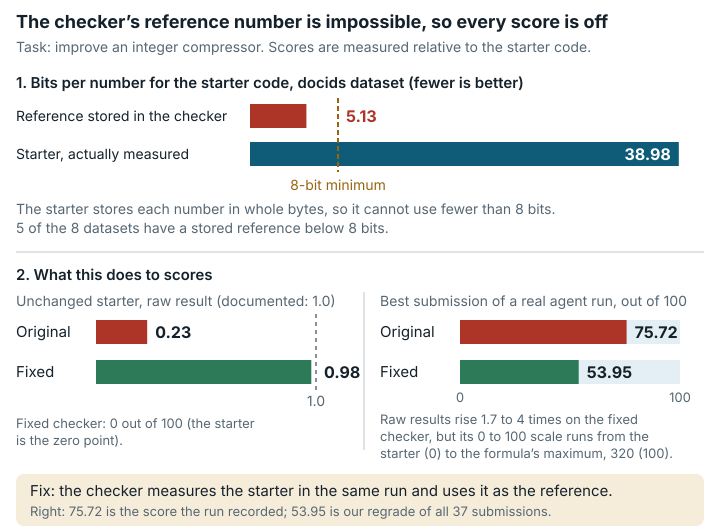

# Integer compression codec (`integer_compression_codec`)

**Outcome:** Fixed. The grader compares submissions against stored baseline numbers that the documented Varint starter cannot produce, so the starter scores about 0.24 instead of the documented 1.0 and the datasets are in effect weighted differently from what is published.

*The original grader compares against stored baseline numbers the starter cannot produce, so it scores 0.24 instead of 1.0; the fixed version measures the starter itself.*

## What the task asks

The solver must "Implement a stronger `libintcompress.so` … to improve both compression ratio and decode throughput on the provided datasets". There are eight datasets. The score on each dataset is defined relative to "the baseline (official Varint) compressed bits-per-integer and decoding throughput": `S_i = min(B_i^0 / B_i, 8.0) × min(T_i / T_i^0, 40.0)`. Varint is a simple format that stores each integer in whole bytes. `scoring_scheme.md` states: "The baseline implementation is the publicly provided Varint starter. Its composite score is defined as `1.0`." Category: Systems & Software Engineering.

## What goes wrong

**The baseline is never measured.** `runner_judge.py` reads `B_i^0` and `T_i^0` from a stored file, `baseline_results.json`, labelled "varint-v1 (reference)". Those values cannot come from the starter that ships with the task. In the table, bpi means bits per integer.

| Dataset | Starter bpi (measured) | Stored "Varint" bpi | Stored / measured |
|---|---|---|---|
| docids | 38.98 | 5.13 | 0.132 |
| ts_sec | 40.00 | 4.86 | 0.121 |
| ts_ns | 39.48 | 8.11 | 0.205 |
| temp | 16.00 | 4.27 | 0.267 |
| grid | 39.50 | 17.54 | 0.444 |
| zipf | 12.63 | 7.32 | 0.580 |
| rand | 39.50 | 32.10 | 0.813 |
| sparse | 38.59 | 6.89 | 0.179 |

A byte-oriented varint needs at least one byte per value, so it always uses at least 8 bits per integer. Five of the stored "Varint" values are below 8, which no byte varint can reach. The stored run log also contradicts itself: for docids, the decode time and the throughput disagree by about 1000×. The stored throughputs come from another machine.

On the original grader:

| Submission | Expected (documented) | Result on the original grader |
|---|---|---|
| unchanged Varint starter | 1.0 | 0.2407 and 0.2455 (two runs) |
| honest delta + zigzag + varint | 6.237 | 0.7590 |
| starter with one corrupted value | 0 | 0.0 (roundtrip mismatch on all 8 datasets) |

Every score is off the documented scale. The distortion differs by dataset, so the datasets are weighted differently from the documentation.

What works correctly: the data regenerate exactly, and the roundtrip check (decoding must return the original integers) rejects a codec that corrupts data. Two small deviations do not matter for honest solvers. The image ships g++ 11.4 instead of the documented 12.2. And "encode + decode ≤ 300 s" is enforced as two separate 300 s limits.

## How much it matters

- All solvers are affected. The starter gets 0.24 instead of 1.0, and the honest codec 0.76 instead of 6.24.
- The distortion per dataset ranges from 0.12 to 0.81. So the effective weights of the datasets differ from the documented weights by up to 6.7× relative to one another. Solutions that trade compression between datasets can rank differently than the documentation implies.
- Within a single dataset, the score still rises with better compression and speed.
- The speed term divides a local measurement by a constant from another machine, so scores also depend on the machine that grades them.

## The fix

The fixed version implements the documented definition: the grader measures the starter in the same run and uses it as the baseline. After the submission builds and passes the symbol check, `runner_judge.py` builds the starter from pristine copies with the shipped Makefile, so the compiler and flags are the same. On each dataset, the starter and the submission run back to back through the same `runner_encode` and `runner_decode`. The starter's measured bpi and decode throughput become `B_i^0` and `T_i^0`.

- Three pristine starter files are added under `internal/baseline/starter/`. They are byte-identical to the starter the solver sees.
- The stored `baseline_results.json` is no longer read.
- If the starter itself fails to build or to pass the roundtrip check, the run reports an error instead of a score.
- The formula, the caps (8×, 40×), the weights, the datasets, the roundtrip check, the score scale (linear 0..100), the work image and all text the solver sees are unchanged. In the task JSON, only `judge.image_tag` changes.

| Role | Submission | Original grader: raw / out of 100 | Fixed grader: raw / out of 100 | Datasets passed, original / fixed | Exit code, original / fixed | Expected | As expected |
|---|---|---|---|---|---|---|---|
| Shows the problem; also a correct test submission | shipped Varint starter (unchanged) | **0.2327 / 0.2327** | **0.9786 / 0.9786** (repeat **1.0155**) | 8/8 / 8/8 | 0 / 0 | original ≠ 1.0, fixed ≈ 1.0 (documented) | yes |
| Honest test submission | delta + zigzag + varint | **0.8253 / 0.8253** | **6.7024 / 6.7024** (repeat **6.9708**) | 8/8 / 8/8 | 0 / 0 | fixed = documented definition (offline rescore of the original grader's logs against its own starter run: 7.43; separate run of the original grader: 6.24) | yes |
| Invalid test submission | starter with one corrupted value | **0 / 0** | **0 / 0** | 0/8 / 0/8 (`roundtrip mismatch`) | 0 / 0 | 0 in both | yes |

Under the fixed version the starter's compression ratio is exactly 1.0 on every dataset, and its speed ratios per dataset range from 0.93 to 1.07. The remaining distance from 1.0 is timing noise. The honest codec's compression terms are exact; for example, ts_sec is 40.00 / 8.00 bpi = 5.0×. The original-grader values in this table differ slightly from those in "What goes wrong" because the speed term varies between runs. The fixed version adds about 20 s per grading (44 s instead of 24 s of wall time).

**Are scores comparable?** Scores from the fixed version are not comparable with scores from the original for any submission. Each per-dataset score changes by the ratio of the measured starter to the stored constants. On the test machine that ratio ranged from about 1.5× (rand) to about 12× (ts_sec), so rankings between solutions that trade off across datasets can change. Failing submissions still score 0. The score scale is kept. Setting new reference points for it, for example with the starter at 0, is a separate decision for the benchmark.

## How we checked it

- **Original grader, from the public image pinned by digest.** The original `eval_cmd` (`python3 runner_judge.py`) ran in the grader image on an 8 vCPU Xeon @ 2.6 GHz, 7 GB host, with `--network none --cpus 4 --memory 6g`, on the three submissions above.
- **Offline rescore** of the run logs under the documented definition, with the starter measured on the same machine (`rescore_documented.py`).
- **Data regeneration.** `gen_data.py --full` inside the image regenerated all 8 shipped data files byte for byte.
- **Bound by construction.** The floor of 8 bits per integer for any byte varint follows directly from one byte per value; no formal tool was needed.
- **Side-by-side runs.** The original and fixed graders were alternated on the same submission, one container at a time, giving the table above. The comparison was repeated three times, and no result changed ([`paired-repeatability.md`](../paired-repeatability.md)).

## Limits

- No AI model or solver was run. Effects are shown only on the test submissions we wrote (the starter, a simple honest codec and a corrupting codec).
- **Dependence on the machine and timing noise remain.** The speed term is now a ratio of wall-clock times on the same machine. Two runs of the fixed version on one machine gave 0.979 and 1.016 for the starter, and 6.70 and 6.97 for the honest codec. The starter's own throughput moved by up to about 18% between runs (grid 0.789 vs 0.646 GB/s), although running the two back to back cancels most of that.
- The baseline is measured once per dataset (best of 5 decodes). Medians over several baseline runs were not used.
- Only one machine type was used. The honest test submission is a simple codec, not a strong solution. No expert reference solution ships with the task.
- The image still has g++ 11.4, not the documented 12.2. This affects both versions equally.

## Reproduce

- Grader image: `sha256:15dffad0…89ac`.
- Offline rescore under the documented definition: `evidence/scripts/integer_compression_codec/rescore_documented.py` (output in `rescore_output.txt`).
- Side-by-side run of the original and fixed graders: `repairs/integer_compression_codec-v2/paired/run.sh` (`repairs/integer_compression_codec-v2/` is the folder holding the fixed version). Summarize with `paired/summarize.py`. Results are in `paired/results.md`, and logs, file hashes and `summary.txt` are in `paired/evidence/`.
- Fix: `repairs/integer_compression_codec-v2/repair.patch`, `Dockerfile`, `source-lock.json`.
- Supporting records: `repairs/integer_compression_codec-v2/` and `evidence/reviews/integer_compression_codec.md`.
