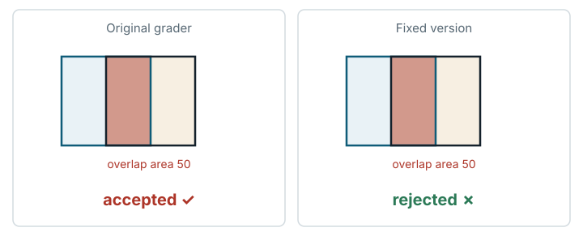

# Jagua Nesting Optimization (`jagua_nesting_optimization`)

**Outcome:** Fixed. <mark>The original grader's validity check accepts large overlaps between shapes, such as identical placements, shapes inside other shapes and shapes slid halfway over others, so it cannot guarantee that a winning layout is possible to cut.</mark>

*The original validity check misses many real overlaps, such as squares slid halfway over each other; the fixed grader measures overlap area and rejects any overlap above one millionth of the smaller shape's area.*

## What the task asks

The solver packs polygon-shaped items into a strip of fixed height and makes the strip as short (narrow) as possible, like cutting parts from a roll of material. This is called nesting. The prompt says: "Keep outputs geometrically valid; the judge independently checks all placements." `SEBENCH_TASK.md` says that "illegal output, missing items, out-of-bounds placement, **overlaps**, timeout, or program crashes all result in a score of 0". Items may touch at their boundaries. No document allows an overlap with positive area. Category: Combinatorial Optimization.

## What goes wrong

**Overlaps are missed.** The original `polygons_overlap` reports an overlap in only two situations: two edges cross properly, or a corner of one polygon lies strictly inside the other. Any overlap with neither property is accepted. This is not a floating-point effect. It happens with exact integer coordinates.

Examples under the original grader (integer coordinates, rotation 0, strip height 20):

- Two identical copies at the same position: expected to be rejected (the overlap is 100% of the item's area); observed **accepted**.
- A square slid halfway along another square of the same height (overlap area 50): **accepted**.
- A rectangle, a triangle and a diamond each placed fully inside a square (overlap area 50 each): **accepted**. The diamond shares no edge with the square.
- Two squares shifted diagonally, where edges cross properly: rejected, as expected.
- A pair sharing an edge (legal contact): accepted, as expected.

Each accepted overlap above is 50–100% of an item's area (areas 50–100 on items of area 100), orders of magnitude above any rounding tolerance.

**Forbidden rotations are not checked.** `validate_solution` never reads `allowed_orientations`, so it accepts rotations that an instance forbids.

This matters because the score depends on strip width (times a runtime multiplier, `evaluate_case`: `score = raw * rt_mult`), not on overlap, and every hidden instance has items needed more than once (demand above 1). A layout with overlapping items can report a smaller width than any feasible packing.

## How much it matters

This changes the score of any submission whose layout contains such an overlap. Infeasible layouts are accepted as valid and can beat every feasible one. This score effect is inferred from the code. It was not measured through the full grader with a submission that uses overlaps. Layouts without overlaps are unaffected.

## The fix

The fixed version changes only `jagua_task_scorer/evaluate.py`:

- **Overlap test.** A new `overlap_area` computes the exact area where two simple polygons intersect, by cutting the plane into vertical strips (slab decomposition). `polygons_overlap` now rejects a pair when the intersection area exceeds 1e-6 × the smaller item's area. Boundary contact has zero area and stays legal.
- **Rotations.** A new `orientation_allowed` check rejects placements whose rotation is more than 1e-3° from every angle in an item's `allowed_orientations` (modulo 360°), when that field is present. Overlap and strip bounds are still checked at the rotation as written.
- **Unchanged:** the bounding-box prefilter, strip bounds, demand checks, score formula, runtime multiplier, reference, assets and work image.

Test layouts, run through each version's `validate_solution`:

| Test layout | Overlap area (exact) | Original grader | Fixed grader |
| --- | ---: | --- | --- |
| valid_adjacent_squares (shared edge) | 0 | accept | accept |
| coincident_squares | 100 (100%) | **accept** | reject `overlap_0_1` |
| half_slid_squares | 50 | **accept** | reject |
| rect_inside_square | 50 | **accept** | reject |
| triangle_inside_square | 50 | **accept** | reject |
| diamond_inside_square | 50 | **accept** | reject |
| diag_shift_squares (proper crossings) | 25 | reject | reject |
| tiny_overlap_1e-6 (relative overlap 1e-7) | 1e-5 | accept | accept (below the 1e-6 relative tolerance) |
| forbidden_rotation_90 (allowed [0]) | – | **accept** | reject `orientation_not_allowed_0` |
| allowed_rotation_minus180 (allowed [0, 180]) | – | accept | accept |

Full original grader (TaskSpec `eval.sh`, `--network none`). "Raw TOTAL_SCORE" is the raw result (before conversion to 0–100). OK, WA and RE count cases scored as correct, wrong answer and runtime error.

| Test submission | Role | Grader | Valid | Raw TOTAL_SCORE | Cases OK / WA / RE | Case lines identical between original and fixed (timings ignored) | Wall time |
| --- | --- | --- | --- | ---: | --- | --- | ---: |
| Shipped baseline (candidate = reference) | correct | original | true | 0.000000 | 0 / 16 / 0 | yes | 200 s |
| Shipped baseline | correct | fixed | true | 0.000000 | 0 / 16 / 0 | yes | 38 s |
| seed_shift (honest: same LBF heuristic, different random-number stream) | correct | original | true | 1.644419 | 6 / 10 / 0 | yes | 117 s |
| seed_shift | correct | fixed | true | 1.644419 | 6 / 10 / 0 | yes | 37 s |
| drop_last_item (one item missing) | incorrect | original | true | 0.000000 | 0 / 16 / 0, all `demand_mismatch` | yes | 191 s |
| drop_last_item | incorrect | fixed | true | 0.000000 | 0 / 16 / 0, all `demand_mismatch` | yes | 37 s |

The baseline's cases are labelled `WA` only because a zero score is labelled WA. Each case reads `ref=X,cand=X,impr=0%`. The task has no score scale, so the score out of 100 equals the raw result. All 16 frozen reference layouts are valid under both versions, with identical widths. Their largest relative overlap between any two items under the fixed version is exactly 0.

**Score compatibility:** valid layouts with no overlap above the tolerance and only allowed rotations pass the check and score identically in the original and fixed versions. Scores differ in three situations:

- A layout contains a positive-area overlap that the original missed. It becomes `WA` with score 0 in the fixed version.
- A layout uses a forbidden rotation (more than 1e-3° from every allowed angle).
- A layout contains a proper edge crossing below the tolerance that the original rejected. The fixed version accepts it, limited to 1e-6 of an item's area.

### Revision v2.1: orientation tolerance

The first fixed version (v2) accepted an allowed angle only within 1e-6°. That value was ours: the original grader does not check rotations at all, and the task does not say how an angle must be written. 1e-6° is finer than the f32 angles jagua-rs works with. A solver that keeps an angle in f32 radians and prints it in f64 degrees writes 90.00000250447816 for 90°, and v2 rejected such a layout on every instance that lists allowed orientations. The current version, v2.1, uses 1e-3°. Every f32 conversion of an allowed angle is within 6.1e-5° of it, so the tolerance leaves a margin of more than 16 times. The closest allowed angles are 90° apart, and the geometry is still checked at the angle as written.

Side-by-side run of the original, v2 and v2.1 on the same submissions (raw TOTAL_SCORE, three identical runs):

| Test submission | Role | Original grader | v2 (superseded) | v2.1 (current) |
| --- | --- | ---: | ---: | ---: |
| seed_shift | correct | 1.644419 | 1.644419 | 1.644419 |
| seed_shift with f32-derived angles (90° written as 90.00000250447816) | correct | 1.644419 | 0.186857 | 1.644419 |
| seed_shift with every angle + 0.01° | incorrect | 0.000000 | 0.186857 | 0.186857 |

With f32-derived angles, v2.1 gives the same result as the original on every case. v2 scored only `swim_cr`, the one instance with free rotation. With every angle 0.01° off, v2 and v2.1 reject all 15 instances that list allowed orientations as `orientation_not_allowed`. On `swim_cr` any angle is allowed. There the original rejects the slightly rotated layout through its edge-crossing test, while both fixed versions accept it because its overlap is below the 1e-6 area tolerance (the leniency listed above). Test layouts 2×, 10× and 45° away from an allowed angle are rejected by v2.1. Baseline, seed_shift and drop_last_item are unchanged under all three graders.

## How we checked it

- **Original grader in the original image, pinned by digest.** The test layouts ran through the unchanged `validate_solution` in the grader image with `--network none --memory 1g --cpus 1`.
- **Independent area checks.** Areas were checked with Shapely 2.2.0 and with exact closed-form areas (the test layouts are integer rectangles, triangles and diamonds). The fixed overlap-area routine was also checked against an exact rational Sutherland–Hodgman clip (a standard polygon-clipping method) on random integer polygons: 0 mismatches in 7526 comparisons, with a largest absolute error of 3.4e-13.
- **Side-by-side run of the original and fixed graders.** The test layouts, the frozen reference outputs on all 16 scored instances, and the full original grader gave the tables above. The side-by-side run was repeated three times with no verdict change ([`data/paired-repeatability.md`](../data/paired-repeatability.md)). The v2.1 revision run (original, v2 and v2.1) was also repeated three times, with identical totals and verdicts.
- **f32 angle resolution.** `evidence/scripts/jagua_nesting_optimization/v2/f32_angles.py` computes, in pure Python with exact f32 rounding, how far f32 conversions of each allowed angle land from it (at most 6.1e-5°).

## Limits

- No AI model or solver was run. Effects are shown only on test submissions and counterexamples we wrote.
- No submission that uses overlaps was run through the full grader. The test layouts that show the problem go through `validate_solution`, the grader's only feasibility check. The score inflation is therefore inferred, not measured.
- The test layouts are hand-made instances, not hidden assets.
- The independent area check covers concave polygons against convex ones. Pairs of concave polygons are covered only by the test layouts and the reference layouts.
- The fixed version uses floating point, as the original does. It is exact only up to rounding, which is far below the tolerance.
- No adversarial or near-tolerance layouts beyond the test layouts were built, and no stronger good-faith solver was run.
- The f32-angle submission rewrites the angles of an ordinary layout after it is solved. No solver whose search itself works on f32-derived angles was run.

## Reproduce

- Original grader image: `sha256:4f029bf7…`.
- Side-by-side run: `repairs/jagua_nesting_optimization-v2/paired/run.sh`; v2.1 revision: `paired/run3.sh` (results in `paired/results.md`).
- Area check and reference-overlap checks: `evidence/scripts/jagua_nesting_optimization/v2/oracle_area_check.py`, `v2/max_overlap.py`.
- Patch: `repairs/jagua_nesting_optimization-v2/repair.patch`.
- Supporting records: `repairs/jagua_nesting_optimization-v2/` (the folder holding the fixed version; source-lock.json, side-by-side run logs).
