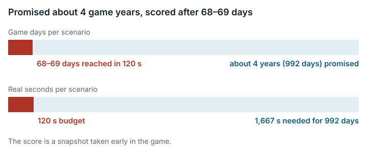

# OpenRCT2 Theme Park AI (`openrct2_theme_park_ai`)

**Outcome:** Fixed. <mark>The prompt promises about 4 game years per scenario, but the 120 s time budget covers about 68 game days, so the score is a snapshot taken early in the game; the fix corrects the prompt.</mark>



*The prompt promised about 4 game years per scenario, but the 120 s budget covers about 69 days, so the score is a snapshot taken early in the game.*

## What the task asks

The solver writes a plugin for OpenRCT2, a theme-park simulation game, that "maximizes **normalized company value** across 3 scenarios". The Rules section of the original prompt says: "The engine runs each scenario for ~4 game years at speed 4 (host --headless)", and that scoring "reads the real in-game `park.companyValue`". The Key APIs section describes `gamesetspeed {speed: 4}` as "max speed (host mode cap is 4)", but the prompt does not require the solver to use speed 4. Category: Interactive Games & Simulators.

## What goes wrong

**The promised length of play cannot be reached.** The wrapper script sets `OPENRCT2_TIMEOUT=120` per scenario and caps the whole run at 1,800 s. The task manifest's `eval_timeout` is 2,400 s. The grader's monitor has `targetDays = 992` and emits `DONE` only at that date. The scoring code uses the last monitor sample and never checks whether `DONE` was reached.

- At speed 4 the engine advances 0.593 to 0.597 game days per wall-clock second. The rate is limited by real time, not by the host's CPU: cutting to 0.25 CPU changed it by about 2%.
- Each 120 s scenario covered 68 to 69 game days, about 7% of the 992-day target, and `DONE` was never seen.
- Reaching 992 days would take about 1,667 s per scenario. That is far beyond the 120 s scenario budget, the 1,800 s wrapper cap and the 2,400 s manifest timeout.

Example on the original grader (120 s, speed 4, medium scenario):

- Expected from the prompt: about 4 game years.
- Observed: the game ran from date 8,4,25 to 8,7,2, which is 69 game days. Company value went from 198,010 to 133,260, and the normalized company value (the task's per-scenario result) was 0.915.
- The average over the three scenarios was 1.038, which the wrapper would print as `TOTAL_SCORE 10384` (computed; the wrapper itself was not run).

**The solver controls the game speed.** `gamesetspeed` is on the list of allowed calls, and the submission's later call overrides the monitor's speed 4. Speed 1 ran at 0.077 days/s and speed 3 at 0.291 days/s. Speed 8 is rejected. A slower game can hold company value near its starting value. In these runs the cap of 1.10 hid this.

Why it matters: the task measures company value after about 2 months, not about 4 years. A solver that plans for the stated length of play is optimizing the wrong thing.

## How much it matters

This was not measured as a score change. The problem changes *what* is measured: value after about 2 months instead of about 4 years. It was not shown to raise or lower any particular solver's score. All solvers that planned for the stated length of play are affected.

Scoring only runs that reach `DONE` is not a fix: under the shipped 120 s budget it would score every submission 0.

## The fix

The fixed version replaces one Rules bullet in `work.agent_query` (the task prompt) with two. The new text says:

- Each scenario runs for "**120 wall-clock seconds**, not to a fixed game date". At speed 4 that covers "only about **70 game days**".
- The score uses the monitor's last sample before the cutoff.
- The plugin may call `gamesetspeed` with speed 1-4, the most recent call takes effect, and a lower speed simulates proportionally fewer days.

The images, `eval_cmd`, timeouts, parser and the reference points of the score scale (linear, 0 to 40000) are unchanged. No other file the solver sees states a length of play.

Side-by-side check (prompt only; copied from `paired/results.md`):

| Check | Status |
|---|---|
| Test submission that shows the problem: the original prompt states a false length of play, the fixed one states the measured one | Checked: table below |
| Correct test submission: score unchanged from original to fixed | Holds by construction. The grader's bytes are unchanged. No new scoring run |
| Invalid test submission: rejected in both | Holds by construction. Not re-run |
| Side-by-side job on E2B (cloud machines) | Not run. Not needed, because nothing executable changed |

```
model speed 1: 0.075 game days / wall-s; 120 s -> 9.0 days
model speed 3: 0.299 game days / wall-s; 120 s -> 35.9 days
model speed 4: 0.598 game days / wall-s; 120 s -> 71.8 days
model: 992 target days at speed 4 need 1658 s

log                          scenario             budget spd t_first t_last  days(samples) d/s   model
run_120s_cpus2.log           scenario_large.park    120   4    4.6  117.8   68(41)   0.595  0.598  DONE=False
run_120s_cpus2.log           scenario_medium.park   120   4    4.5  117.3   69(42)   0.595  0.598  DONE=False
run_120s_cpus2.log           scenario_small.park    120   4    4.7  117.6   68(41)   0.593  0.598  DONE=False
run_60s_speed4_cpus2.log     scenario_small.park     60   4    4.6   59.8   33(20)   0.597  0.598  DONE=False
run_60s_speed4_cpus0.25.log  scenario_small.park     60   4   11.5   57.9   27(17)   0.582  0.598  DONE=False
run_60s_speed1_cpus2.log     scenario_small.park     60   1   27.2   53.0    2(2)    0.077  0.075  DONE=False
run_60s_speed3.log (new)     scenario_small.park     60   3    7.5   59.1   15(10)   0.291  0.299  DONE=False
run_60s_speed8.log (new)     scenario_small.park     60   8    5.0   59.9   33(20)   0.602  0.598  DONE=False
```

**Are scores comparable?**

- **Same grader, same scores.** A given `my_plugin.js` gets the same score under the original and fixed versions, up to the usual run-to-run variation of a real-time game. Runs of the original version already had the same real 120 s length.
- **Not comparable as measures of solver ability** where a solver's strategy depended on the prompt. A solver of the original version may have planned for 4 years. A solver of the fixed version can front-load its strategy or deliberately lower the speed.

## How we checked it

- **Original grader, from the public image pinned by digest.** The original helper's own `validate_plugin`, `run_scenario` and `score_scenario` functions ran in the grader image. The only addition was a tee on the engine's stdout. Runs used `--network none --memory 2g --cpus 2`, and one run used `--cpus 0.25`. Runs covered 120 s on all three scenarios and 60 s at speeds 1, 3, 4 and 8, with a simple test plugin.
- **Independent rate model.** A model built from first principles, using the tick and month constants documented in `openrct2.d.ts`, predicts the measured rates (the "model" column above).
- Nothing executable changed in the fixed version, so there is no side-by-side scoring run to repeat.

## Limits

- No AI model or solver was run. The effects shown are on the test plugins we wrote only, and no effect on the leaderboard is estimated.
- **The incentive to lower the speed remains.** The fixed version states the speed rule honestly but does not stop a plugin from lowering the speed. Removing the incentive needs a change to the grader: re-assert speed 4 every tick, or score at a fixed game date with a long enough budget.
- **About 70 days assumes the engine keeps real time.** Hosts are not pinned. A slower host, an overloaded host or a heavy plugin could fall further behind.
- **Small set of runs.** Each configuration ran once, with one simple test plugin whose staff hiring failed. No competitive plugin was run.
- **Not run through the wrapper.** The full three-scenario sequence ran through the helper's functions, not through `eval_openrct2.py`. The reference point of 40000 on the score scale was not examined.

## Reproduce

- Grader image: `sha256:a5263578…`.
- Driver and test plugins: `evidence/scripts/openrct2_theme_park_ai/driver.py`, `plugin.js` and `plugin_speed1.js`. Saved logs are `run_*.log` in the same folder.
- Length-of-play check, run from `repairs/openrct2_theme_park_ai-v2/paired/`: `python3 -I check_horizon.py ../../../evidence/scripts/openrct2_theme_park_ai/run_*.log logs/run_*.log`
- Prompt diff: `repairs/openrct2_theme_park_ai-v2/repair.patch`, which goes from `orig/agent_query.md` to `files/agent_query.md`.
- Supporting records: `repairs/openrct2_theme_park_ai-v2/` (the folder holding the fixed version: README, `source-lock.json`, `paired/results.md`).
