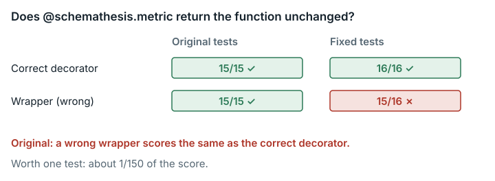

# Schemathesis config modernization (`schemathesis_config_modernization`)

**Outcome:** Fixed. The Phase 3 tests check only that `@schemathesis.metric` returns something callable, not that it returns the function unchanged; the gap is one test item, about 1/150 of the score.



*The original tests could not tell a wrapper from the correct decorator; the fixed tests add one test, worth about 1/150 of the score.*

## What the task asks

The solver modernizes the configuration layer of schemathesis 3.39.16, a tool for testing web APIs. Hidden tests, grouped into phases, grade the result. The task text tells the solver to "Treat `/app/TODO.md` as the authoritative task specification." `TODO.md` Target 3 states that the "**`@schemathesis.metric` decorator**: Registers a metric function into a registry. Returns the function unchanged." A decorator is a function that takes another function and returns a function in its place. `TODO.md` uses the same wording for `@schemathesis.check`. Category: Systems & Software Engineering.

## What goes wrong

**Rule.** The decorator must return the function unchanged. The original test `test_metric_decorator_returns_function` only asserts `callable(another_metric)`. A wrapper that forwards calls to the function therefore scores the same as a correct decorator.

**Example.** Three variants of `metric` were tested on a minimal implementation of Target 3:

- `identity` registers the function and returns it. This is correct.
- `wrapper` returns a forwarding wrapper built with `functools.wraps`. This is plausibly wrong.
- `no_register` never registers the function. This is clearly wrong.

Phase 3 results under the original tests (`orig`) and the fixed tests (`repaired`):

```
variant=identity    tests=orig     :: 15 passed
variant=identity    tests=repaired :: 16 passed
variant=wrapper     tests=orig     :: 15 passed
variant=wrapper     tests=repaired :: 1 failed, 15 passed
variant=no_register tests=orig     :: 3 failed, 12 passed
variant=no_register tests=repaired :: 4 failed, 12 passed
```

Expected under the specification: the wrapper should lose the test item that checks identity. Observed on the original grader: the wrapper passes 15/15, the same as the correct decorator.

**Why it matters, and why only slightly.** In behaviour, the wrapper is almost equivalent to the correct decorator. It keeps `__name__`, registers under the right name, returns the same values, and works with the collector and with `hypothesis.target`. The only differences are `decorated is original` and the presence of `__wrapped__`. The wrong implementation gains no advantage over a correct one; it only avoids losing one item. The authors probably intended identity: the Phase 6 test asserts `result is my_func` for `@check`, but Phase 3 has no such check.

## How much it matters

At most about 1/150 of the total. Phase 3 has weight 1 of 10 and 15 tests, so one test is worth 1/15 × 1/10. Only solvers whose `metric` decorator returns something other than the original function are affected.

## The fix

- `/tests/test_03_metric_system.py` gains `test_metric_decorator_preserves_exact_function_identity`. The test asserts `metric(f) is f` and unregisters the function afterwards.
- `/tests/test.sh` changes `PHASE3_TOTAL` and `PHASE3_EXPECTED` from 15 to 16.

The weights, the parser, the score scale and the other 131 tests are unchanged. In `task.json.in`, only `judge.image_tag` changes.

| Variant | Role | Original grader | Fixed grader | Change | Phase 3, original → fixed |
|---|---|---|---|---|---|
| starter | untouched starting `/app` | 0.031466 | 0.031466 | 0 | 0/15 → 0/16 |
| identity | reviewer's correct Target 3 overlay (`metric` returns `func`) | 0.135313 | 0.135313 | **0** | 15/15 → 16/16 |
| wrapper | plausibly wrong: returns a `functools.wraps` forwarding wrapper | 0.135313 | 0.129063 | **−0.006250 (−1/160)** | 15/15 → 15/16 |
| no_register | invalid test submission: never registers | 0.115313 | 0.110313 | −0.005000 | 12/15 → 12/16 |

In every variant, the only test items whose results differ are the added identity test and, for the wrapper, the Phase 3 "all passed" item (`test_phase_3`), which flips from passed to failed. The other 131 original items keep their result from the original grader. Scores are partial because the overlay implements Target 3 only, not the whole task.

**Score compatibility.** Scores from the original and fixed graders are identical when Phase 3 is fully passed or fully failed. When Phase 3 is partly passed they are not comparable, because the phase has 16 tests instead of 15, and an imperfect phase yields a different fraction.

## How we checked it

- **Original grader in the original public image, pinned by digest.** The grader image holds the unmodified schemathesis 3.39.16 starting code in `/app` and no reference solution. Each variant and the untouched starting code ran through the full original `judge.eval_cmd` (`bash /tests/test.sh` plus the structured parser), in a fresh `--network none` container, under both the original and the fixed tests.
- **Independent check.** The sentence of the specification in `TODO.md` ("Returns the function unchanged") is the reference, and the added test checks it directly. No formal model applies.
- **Repeatability.** The side-by-side run of the original and fixed graders was repeated three times, and no outcome changed (`data/paired-repeatability.md`).

## Limits

- No AI model or solver runs were made. Effects are shown only on test submissions that we wrote.
- The overlay is a minimal implementation of Target 3, not a complete solution to the task, so the absolute scores are partial.
- No historical submissions were examined, so how often real solvers write wrapper decorators is unknown.
- `TODO.md` was not extracted again from the pinned work image.
- The hidden tests are not stored in this repository. They are extracted from the pinned grader image when the check is rerun.

## Reproduce

- Grader image digest: `sha256:ff71a766…`.

1. Run `evidence/scripts/schemathesis_config_modernization/fetch_tests.sh`. It extracts the hidden tests from the pinned grader image and applies the patch.
2. Run `evidence/scripts/schemathesis_config_modernization/run_in_judge.sh` with `metrics_base.py`. The saved output is `observed_output.txt`.

The side-by-side run of the original and fixed graders is `repairs/schemathesis_config_modernization-v2/paired/run.sh`, with results in `paired/results.md` and `paired/raw-summary.md`. The fix itself is in `repairs/schemathesis_config_modernization-v2/repair.patch`, `Dockerfile` and `source-lock.json`.

Supporting records: `repairs/schemathesis_config_modernization-v2/` (the folder holding the fixed version) and `evidence/reviews/schemathesis_config_modernization.md`.
