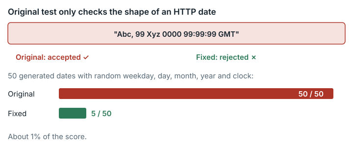

# Schemathesis data-generation pipeline (`schemathesis_datagen_pipeline`)

**Outcome:** Fixed. The hidden test for HTTP dates checks only the shape of the string, so generators that emit impossible dates and clock times pass; the gap is worth about 1% of the score.

*The original date test checked only the string shape, so impossible dates passed 50 of 50; the fixed test accepts 5 of 50.*

## What the task asks

The solver builds data-generation strategies for schemathesis 4.14.3, a tool that tests web APIs. The solver is told to "Treat `/app/TODO.md` as the authoritative task specification." `TODO.md` Target 1 asks for an "**HTTP-date strategy**: Generate valid HTTP-date values in IMF-fixdate format". It adds: "In positive generation mode, all generated values should conform to the protocol grammar." RFC 9110 §5.6.7, the standard for HTTP dates, annotates `time-of-day` as `00:00:00 - 23:59:60 (leap second)`. It leaves the meaning of the date fields to RFC 5322 §3.3, which requires a date-time to be "semantically valid": a real day of the month, a matching weekday and a clock time in range. Category: Systems & Software Engineering.

## What goes wrong

**Rule.** Generated HTTP dates must be valid dates in IMF-fixdate format. The original test checks each string against `^\w{3}, \d{2} \w{3} \d{4} \d{2}:\d{2}:\d{2} GMT$` and nothing else. This pattern does not check:

- that the date exists in the calendar (31 Apr and 29 Feb 2023 do not);
- that the weekday matches the date;
- clock bounds, such as 24:00;
- that the weekday and month names are real names. `\w{3}` accepts any three word characters, so `"Abc, 99 Xyz 0000 99:99:99 GMT"` passes.

**Example.** A realistic generator draws weekday, day, month, year and clock independently (`independent_fields`). It produces impossible dates and mismatched weekdays in about 90% of draws. Of 50 draws with fixed randomness, the original pattern accepted 50/50 and the fixed check 5/50. Expected from the task's specification: the date test should fail. Observed on the original grader: Phase 1 passes this generator at 15/15.

**Why it matters.** A wrong generator gains nothing over a correct one, but both receive the same Phase 1 credit, so the test cannot tell them apart.

## How much it matters

At most about 1% of the total. The date test is 1 of 15 Phase 1 tests, and Phase 1 has weight 2/13, so the effect is −2/195 of the total. Only solvers whose `http_date_values` emits invalid dates or clock times are affected.

## The fix

The fixed version changes one file, `/tests/test_01_header_strategies.py`. The pattern that checks only the shape is replaced by the check `is_imf_fixdate`. That check covers the IMF-fixdate grammar, a real Gregorian date, agreement of the weekday and clock bounds, and allows `:60` only at 23:59. It requires only a year that can be represented (≥ 1), because `TODO.md` states no lowest year. The one date test's `max_examples` goes from 50 to 200. With 50 examples, rare clock defects (hour 24) were caught in only 15/20 random seeds; with 200 they were caught in 20/20. The number of tests, `test.sh`, the weights and the parser are unchanged. In `task.json.in`, only `judge.image_tag` changes.

Test generators: `correct` (`st.datetimes(1970..2100)`); `stdlib_1900` and `stdlib_any_year` (honest generators based on `email.utils.format_datetime`); `independent_fields` and `off_by_one_clock` (plausible but wrong; the latter draws hour 0–24 and minute 0–60); `garbage_shape` (invalid test submission, `"999, 99 888 0000 99:99:99 GMT"`); `rfc850` (test submission in the wrong format); and the untouched starter.

| Generator | Score, original grader | Score, fixed grader | Failures in 20 seeds, original / fixed |
| --- | --- | --- | --- |
| correct | 0.477350 | 0.477350 | — |
| stdlib_1900 | 0.477350 | 0.477350 | 0/20 / 0/20 |
| **stdlib_any_year** | 0.477350 | **0.477350** | 0/20 / 0/20 |
| independent_fields | 0.477350 | 0.467094 | 0/20 / 20/20 |
| off_by_one_clock | 0.477350 | 0.467094 | 0/20 / 20/20 |
| garbage_shape | 0.477350 | 0.467094 | — |
| rfc850 (invalid) | 0.467094 | 0.467094 | — |
| starter | 0.323504 | 0.323504 | — |

Across all generators, `test_http_date_values_grammar` is the only test whose result changes. For the three rejected generators, the `test_phase_1` summary item also flips from passed to failed. All other 97 items are unchanged. Scores are partial because the other targets stay at the starter. No honest generator loses points. Every plausible but wrong generator, and the garbage that only has the right shape, loses 1/15 of Phase 1. The test submission in the wrong format is rejected in both versions.

**Are scores comparable?** The fixed version differs from the original only for submissions whose `http_date_values` emits invalid dates or clock times that the test's 200 sampled examples hit. Those lose 1/15 of Phase 1 (−2/195 of the total). All other submissions score identically.

## How we checked it

- **Original grader, from the public image pinned by digest.** The grader image holds the unmodified schemathesis 4.14.3 starter with hypothesis 6.155.2 (the property-testing library) and no reference solution. Each generator ran under the full original `judge.eval_cmd` and under the fixed version, in fresh `--network none` containers. The single date test was also run with 20 Hypothesis seeds.
- **Independent check.** A pure-Python check ran the original pattern and the fixed check on fixed strings: 31 Apr, 24:00, a wrong weekday, 29 Feb 2023, 29 Feb 2024 and `Sat, 31 Dec 2016 23:59:60`. Calendar validity was checked against Python's Gregorian `calendar`.
- **Repeatability.** The side-by-side run of the original and fixed graders was done three times, and no result changed (`data/paired-repeatability.md`).

## Limits

- No AI model or solver was run. Effects are shown only on the generators we wrote.
- The generators are a minimal overlay for Target 1. No upstream reference generator was available, so the scores are partial.
- Whether a leap second actually occurred is not checked. `:60` is allowed only at 23:59 but is not checked against the real table of leap seconds.
- The property tests remain random. The wrong generators tested were detected in 20/20 seeds, but rarer defects could still pass a given seed.
- How often such bugs occur in real submissions is unknown.

## Reproduce

- Grader image: `sha256:16b21364…`.
- Original vs fixed test: first run `evidence/scripts/schemathesis_datagen_pipeline/fetch_tests.sh`, which extracts the hidden tests from the pinned image.
- Then run `run_in_judge.sh` with `headers_overlay.py`, `run_seed_sweep.sh` and `check_witnesses.py` from the same folder. Saved outputs: `observed_output.txt`, `observed_seed_sweep.txt` and `observed_witnesses.txt`.
- Side-by-side run of the original and fixed graders: run `repairs/schemathesis_datagen_pipeline-v2/paired/run.sh` and `paired/extra.sh` (`repairs/schemathesis_datagen_pipeline-v2/` is the folder holding the fixed version). Results are in `paired/results.md`, `paired/raw-summary.md` and `paired/seed-sweep.txt`. The `stdlib_any_year` row above is the amended result recorded in `paired/results.md`.
- Fix: `repairs/schemathesis_datagen_pipeline-v2/repair.patch`, `Dockerfile`, `source-lock.json`.

Supporting records: `repairs/schemathesis_datagen_pipeline-v2/` and `evidence/reviews/schemathesis_datagen_pipeline.md`.
