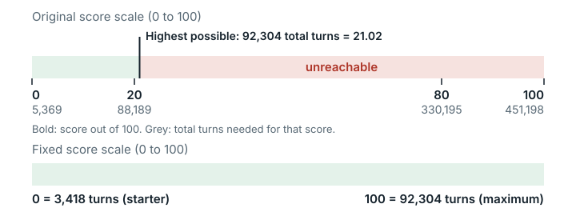

# Treant's Forest (`treant_forest`)

**Outcome:** Fixed. <mark>The original score scale puts its reference points above the most turns the grader allows, so no submission can score above 21.02/100; the fixed version changes only the score scale.</mark>

*The original scale's reference points lie above the turn cap, so no submission can score above 21.02 of 100; the fixed scale ends at the cap, 92,304.*

## What the task asks

The task is a grid puzzle adapted from the AtCoder contest AHC054: "Your solution is scored on **50 fixed test cases**. Final score = sum of individual case scores. **Higher is better.**" Raw results (before conversion to 0–100) are converted to a 0-100 scale. Category: Combinatorial Optimization.

## What goes wrong

**Rule.** Each case's raw result is its turn count, and the grader's tester program caps turns at `max_turns = N*N*2`, where N is the grid size (tester:63, loop at :140). The README does not mention this cap. The original score scale is `piecewise_max` with four reference points: baseline 5,369, rank30 88,189, rank1 330,195 and super 451,198.

**Example.** The sum of 2N² over the 50 shipped cases is **92,304**, an upper bound on the raw result: no submission can exceed it. A submission at that cap should score 100. Under the original score scale it gets **21.02/100** (exactly 2543510/121003), so no submission can score more. Whether any submission reaches the cap on every case is not shown (see Limits).

**Why it matters.** The rank1 reference point (330,195) is **3.58×** the turn cap. So every score above 21.02 out of 100 (nearly all of the 20-80 band and the whole 80-100 band) is out of reach for any submission. The order of submissions is preserved. The origin of the original reference points is unknown; they appear to come from a different scorer or set of cases.

**Checked and fine.** The worst-case runtime is 7 waves × 120 s = 840 s, under the 870 s limit (tight). The tester is deterministic. Solutions that use a wall-clock time budget depend on the CPU available to the 8 parallel workers.

**Note: at the publisher's 4 grader CPUs each case gets about half a CPU.** The README promises "Time limit | 60 seconds / test case" (line 71); the grader allows twice that (`TIME_LIMIT = 120`, `/tmp/eval_treants_forest.py` line 9) and runs 8 cases at once (`max_workers=min(8, len(case_files))`, line 45). The task sets no CPU count. EdgeBench's leaderboard settings give this grader 4 CPUs (the default, with no override for this task; quoted in [`evidence/impact/edgebench-leaderboard-config.md`](../evidence/impact/edgebench-leaderboard-config.md)), so 8 cases share 4 CPUs. Measured on the original grader at `--cpus 4` (`evidence/runs/treant_forest-cpu4v8-a/result/out/summary.txt`, `-b`) with the honest greedy control followed by fixed CPU work: 50 or 58 s of CPU per case passes 50/50 (TOTAL 17,960; the slowest 58 s case took 116.1 s, inside the 120 s limit), the same as at `--cpus 8`. Solutions using up to 58 s of CPU per case therefore pass. One using the README's full 60 s would take about 120.1 s at the measured ratio (116.10 s for 58 s), at the 120 s limit, so the grader's 2× slack only just absorbs the sharing. A solution needing 70 s of CPU per case, beyond the README's 60 s, timed out on 48 of 50 cases at 4 CPUs (TOTAL 17,960 → 1,018; 3.04 → 0 out of 100 on the original scale) and passed at 8 CPUs; it exceeds the promise, so this is not counted as a defect. A solver that stops at a 55 s wall-clock deadline, as the README invites, got a median of 27.4 s of CPU per case at 4 CPUs against 54.9 s at 8 CPUs, so its output, and so its score, can depend on the grader's CPU count. In these runs the answer was fixed, so no score difference was measured. The fixed version does not change this.

## How much it matters

All solvers are affected: every score out of 100 is squeezed into 0–21. The baseline solution that ships with the task (TOTAL_SCORE **3,418**, 50/50 cases OK) maps to 0.

## The fix

Only `judge.rescale` (the score scale) in the task JSON changes. The `piecewise_max` reference points are replaced by `"kind": "linear", "lower": 3418.0, "upper": 92304.0`. The lower point is the shipped baseline's raw result under the original grader. The upper point is Σ 2N² over the shipped cases, the exact upper bound of the tester's score function (its turn cap). The four old reference-point fields are removed: two lie above the cap, and no exact replacements for the rank-based points exist. The grader image, grader, tester, cases, `eval_cmd` and timeouts are unchanged, so raw results are byte-identical.

| Submission | Image | Raw result (`TOTAL_SCORE`) | Cases OK | Grader exit code | Score out of 100, original scale | Score out of 100, fixed scale |
| --- | --- | ---: | --- | --- | ---: | ---: |
| Shipped baseline (`0`, `-1`) | original | 3418 | 50/50 OK | 0 | 0.00 | 0.00 |
| Shipped baseline | fixed | 3418 | 50/50 OK | 0 | 0.00 | 0.00 |
| Honest greedy (lengthens the maze on the grid only) | original | 17960 | 50/50 OK | 0 | 3.04 | 16.36 |
| Honest greedy | fixed | 17960 | 50/50 OK | 0 | 3.04 | 16.36 |
| Invalid: treant on the revealed entrance | original | 0 | 0/50 (all WA) | 0 | 0.00 | 0.00 |
| Invalid: treant on the revealed entrance | fixed | 0 | 0/50 (all WA) | 0 | 0.00 | 0.00 |

(WA = wrong answer.)

End points of the scale, computed with `score_rescale.py` rather than by running a submission:

| Raw result | Original scale | Fixed scale | Fixed scale, exact |
| ---: | ---: | ---: | --- |
| 0 | 0.00 | 0.00 | 0 |
| 3418 (shipped baseline) | 0.00 | 0.00 | 0 |
| 5369 (old `baseline` field of the original version) | 0.00 | 2.19 | 97550/44443 |
| 92304 (= Σ 2N², the score cap) | **21.02** | **100.00** | 100 |
| 330195 (old rank1, exceeds the cap) | 80.00 | 100.00 | 100 |

Raw results were identical in the original and fixed images. Only the score out of 100 changes, and only because of the new score scale.

**Are scores comparable?** Scores out of 100 from the fixed version are not comparable with those from the original for any raw result above the shipped baseline (raw > 3418). Raw `TOTAL_SCORE` values stay comparable across versions. The rank-based reference points no longer exist, so a score of 20 or 80 in the fixed version has no meaning as a leaderboard percentile.

## How we checked it

- **Original grader, from the public image pinned by digest.** The original `eval_cmd` ran in the original grader image and in the fixed image, with `--network none`. The hashes of the grader, tester and cases inside each image matched the pinned values.
- **Exact arithmetic.** The per-case cap 2N² was summed over the 50 shipped case headers twice, by the same one-line formula in two scripts (`paired/normalize.py` on E2B, `check_arith.py` locally); the case files are not in the repository. Its value under the original score scale was computed exactly.
- **Source reading.** The cap is read directly from the tester source (`tools/bin/tester`).
- **Repeatability.** The side-by-side run of the original and fixed versions was done three times, and no result changed (`data/paired-repeatability.md`).

## Limits

- No AI model or solver was run. Effects are shown only on the test submissions we wrote.
- 92,304 is the exact upper bound on the raw result. Reaching it on every case has not been demonstrated. The best honest result on a single case reached 47% of that case's cap (the per-case caps for that run are not saved here).
- A linear scale from the baseline to the cap squeezes realistic strong scores together. That cost comes from using only exactly computable reference points instead of ones taken from a leaderboard.
- The 2N² cap is still not disclosed in the README. Disclosing it would be a separate change to what the solver sees.
- Whether the tester's movement rules match the original AHC054 game was not established, and this fix does not address it.
- The CPU-share note was measured at 4 and 8 CPUs with single-threaded fixed-work and wall-deadline test solutions. No real anytime solver was run, so the size of the deadline effect on scores is not known. Multi-threaded solvers were not tested.

## Reproduce

- Cap arithmetic: `python3 evidence/scripts/_game-tasks-correctness/check_arith.py <treant cases dir>` (saved output: `evidence/scripts/_game-tasks-correctness/check_arith.out.json`).
- Original baseline run: `bash evidence/scripts/_game-tasks-correctness/run_treant_baseline.sh <cases_dir> <shipped_solution.py> <orig_eval_treants_forest.py>`.
- Side-by-side run: `repairs/treant_forest-v2/paired/run.sh`, conversion to 0–100 with `repairs/treant_forest-v2/paired/normalize.py` (`repairs/treant_forest-v2/` is the folder holding the fixed version).
- Pinned identity: grader image `seededge/edgebench.judge.treant_forest@sha256:783e9ca2…` (`sha256:783e9ca2…`, the original version); task JSON sha256 `2fdb98ce1166a1fea4743c2ae1613479bdf9eaf755cab190bfd931bc547a615e`; `eval_treants_forest.py` sha256 `ce2833ac…2048`; `tools/bin/tester` sha256 `6cbb3a72…8551`; 50 cases (sha256 of the sorted listing) `bc256294…`.
- Supporting records: `repairs/treant_forest-v2/` (`README.md`, `repair.patch`, `source-lock.json`, `paired/results.md`).
