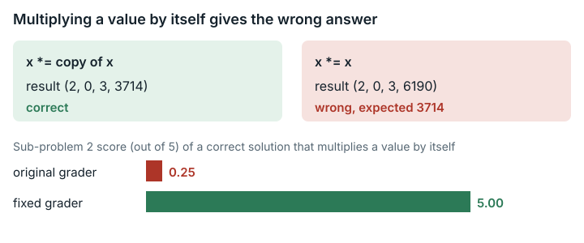

# Tree Block Partitioning (`tree_block_partitioning`)

**Outcome:** Fixed. In sub-problem T2, the grader's library computes an in-place multiply wrongly when a value is multiplied by itself (`v *= v`); the effect is at most 5/100 points, only for solvers that do this, and swapping two lines fixes it.

*The grading library's in-place multiply broke when both operands were the same object, so a correct solution scored 0.25 of 5 points instead of 5.00.*

## What the task asks

The task has six problems of increasing difficulty, worth 5, 5, 10, 15, 25 and 40 points. T2 (P7881) is an interactive problem: the solution calls a library that the grader supplies. It defines `Data` as a monoid, a set of values with an associative multiplication and an identity value. It states: "使用 `x*=y` 可以将 $x$ 修改为 $x*y$", which means "using `x*=y` changes x to x*y". The statement has no rule that the two operands must be distinct objects. It also says the library solvers can download differs from the one used for grading: "下发的交互库和实际测试的交互库不同". Category: Combinatorial Optimization.

## What goes wrong

**Rule.** `x*=y` must set x to x*y, using the old values of both. The grader's library computes `c=(c+1)*(x.c+1)-1;` and then `d=d*(x.c+1)+x.d;`. When `this == &x` (the value is multiplied by itself), the second line reads `x.c` after the first line has already overwritten it. As a result, `d` becomes `d·(c+1)²+d` instead of `d·(c+1)+d`.

**Example under the original library.** The input is `read_Data()` from scalar 1, which gives (1,1,1,1238).

- Product with a copy, `y*=copy`: (2,0,3,3714). This matches an independent calculation.
- Product with itself, `x*=x`: (2,0,3,6190). This is wrong.

Rates: random products of distinct objects that disagree with the independent calculation: 0/1000000. Random products of a value with itself that disagree: 999566/1000000.

**Through the real grader.** A variant of the official reference solution `std.cpp` makes one local change: when the two factors are equal, it multiplies the value by itself, which the statement treats as the same computation. On the original library it scores 1/10 OK, 9 WA (wrong answer), 0.25 points. On the fixed library it scores 10/10 AC (accepted), 5.00. The one case it passes is the only case with no products of a value with itself.

**Why it matters.**

- That `x*=x` is allowed holds only by implication. The statement never mentions it, although ordinary C++ conventions for value types support it.
- No natural solution pattern was found that needs `v *= v`.
- The library solvers can see uses a different monoid, so the problem cannot be found by local testing.

## How much it matters

At most 5 of 100 points (T2), and only for submissions that multiply a non-identity value by itself. The official reference never does this and scores 5/5 on both libraries. The other 95 points are unaffected.

## The fix

The fixed version swaps the two assignments in `P1/T2_P7881/data/interactive_lib.cpp`, so that `d=d*(x.c+1)+x.d;` runs before `c=(c+1)*(x.c+1)-1;`. The file stays 1225 bytes with CRLF line endings, and its binary interface (ABI) is unchanged. The task JSON changes only `judge.image_tag`. The work image and the files solvers can see are unchanged.

"Raw" is the raw result (before conversion to 0–100); the second number is the score out of 100.

| Test submission | Submission | Original grader, raw / out of 100 | Fixed grader, raw / out of 100 | Cases passed per sub-problem T1..T6, original → fixed | Exit code, original/fixed | Pass rate, original → fixed |
|---|---|---|---|---|---|---|
| Correct | Official `std.cpp` for all six sub-problems | **100 / 100** | **100 / 100** | 45/45, 10/10, 20/20, 10/10, 40/40, 10/10 in both | 0/0 | 1.000 → 1.000 |
| Shows the problem | T2 = `std.cpp` variant that multiplies a value by itself (`make_alias_variant.py`); T1, T3–T6 empty | **0.25 / 0.25** (T2 1/10) | **5 / 5** (T2 10/10) | T2 1/10 → 10/10; all others 0 (empty) | 1/1 | 0.005 → 0.050 |
| Incorrect | T2 = `std.cpp` with the second merge factor dropped (`make_invalid_variant.py`); others empty | **0.25 / 0.25** (T2 1/10, 9 WA) | **0.25 / 0.25** (T2 1/10, 9 WA) | unchanged | 1/1 | 0.005 → 0.005 |

The incorrect test submission has a logic error that exercises the merge code path.

**Score compatibility:** scores under the fixed version are comparable with the original for any submission that never calls `x *= x` on a non-identity T2 value. For a submission that does make that call, the fixed version grades it correctly, while the original marks those T2 cases WA. Only T2 (5 points) can differ.

## How we checked it

- **Original grader in the original image, pinned by digest.** The original grader (`eval.py --task T2`) and the full original `eval_cmd` (all six sub-problems) ran in the grader image with `--network none`, using both the original and the fixed library.
- **Independent calculation.** The original library, compiled with the grader's flags, was compared with a separate 64-bit implementation that computes the stated product from the old values. The comparison covered 1,000,000 random products of distinct objects, 1,000,000 random products of a value with itself, and all scalar values 0–1000.
- **Formal check (TLA+, a model checker).** A model of `operator*=` explores all 65,536 starting memory states (fields modulo 4). It covers calls with the same object and with distinct objects, under both statement orders. The property `ResultCorrect` fails only for the same-object call under the original order. The distinct-object original and both fixed configurations show no error, so the fix does not change calls on distinct objects.
- **Repeatability.** The side-by-side run of the original and fixed graders was run three times; no verdict changed (`paired-repeatability.md`).

## Limits

- No AI model or solver was run. Effects are shown only on test submissions we wrote.
- The test submission that shows the problem is built from `std.cpp`. How often real solvers multiply a value by itself is unknown, and probably low.
- A hidden signed-`int` overflow in the c/d products is present in both the original and fixed versions and is not addressed. No effect on scores was seen.
- The TLA+ model is bounded: fields are modulo 4 rather than 2^16. It leaves out the call counter and the overflow behaviour.
- Whether the upstream Luogu P7881 grading library has the same code was not checked.

## Reproduce

- Direct harness: `evidence/scripts/tree_block_partitioning/run_direct.sh` (output `direct-results.txt`)
- Run on the original grader: `evidence/scripts/tree_block_partitioning/run_native.sh` (output `native-results.txt`)
- TLA+ model: `evidence/formal/tla/tree_block_partitioning/DataMul.tla`, run with `run_tlc.sh`
- Side-by-side run: `repairs/tree_block_partitioning-v2/paired/run.sh` (results in `paired/results.md`)
- Patch: `repairs/tree_block_partitioning-v2/repair.patch`
- Pinned identity: grader image `seededge/edgebench.judge.tree_block_partitioning@sha256:6ebbb44a…69d2`; `P1/T2_P7881/data/interactive_lib.cpp` sha256 `0c57271b…c982`.

Supporting records: `repairs/tree_block_partitioning-v2/` (the folder holding the fixed version; source-lock.json, `paired/evidence/`).
