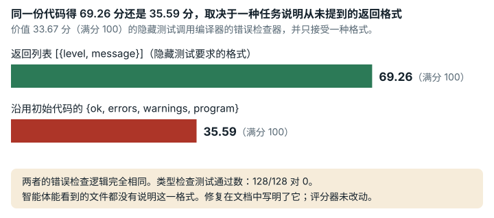

# Arc Compiler Runtime (`arc_compiler_runtime`)

**结论：** 已修复。<mark>隐藏测试要求 `analyze()` 返回一种特定格式，而解题者能看到的文件都没有写这种格式；TASK.md 还写错了初始代码的得分。修复版把这两点都写进了文档，没有改变任何分数。</mark>

*在 Arc Compiler Runtime 中，同一个错误检查器可能得 69.26 分，也可能得 35.59 分（满分 100），差别只在于一种任务说明从未提到的返回格式。智能体要完成一个小型编译器。隐藏测试共 33.67 分，要求错误报告是 {level, message} 的列表；初始代码返回的却是另一种格式，智能体能看到的材料都没有说明哪种才对。修复在任务说明中写明了这一格式。评分器没有改动，所以同一份代码的得分和以前一样。*

## 任务要求

解题者要 "Implement the missing Arc compiler and runtime modules under compiler/src/"（在 compiler/src/ 下实现缺失的 Arc 编译器和运行时模块）。Arc 是一种小型编程语言。任务告诉解题者 "Use CHEATSHEET.md, TASK.md, and the public smoke tests as the language contract."（以 CHEATSHEET.md、TASK.md 和公开冒烟测试作为语言规约。）TASK.md 写着 "Starter expectation `SCORE=0.00`"，problem.md 写着 "Expected stripped starter score: 0.00"（即初始代码预期得零分）。隐藏评分器有 21 个测试套件、448 个用例，共 2970 个权重单位。类别：系统与软件工程。

## 问题出在哪里

没有任何文件记录 `analyze()` 接口。隐藏的类型系统套件调用 `compiler/src/semantic.js` 中的 `analyze()`，期望得到一个由 `{level, message}` 对象组成的数组，消息里必须包含子串 "Undefined"、"Cannot reassign immutable" 和 "expects 2"。随任务提供的初始代码返回的却是 `{ ok, errors, warnings, program }`。解题者能看到的文件都没有给出所需的格式或消息文本。这些套件占 1000/2970 的权重（33.67 分）。

- 在原始评分器上，同一个能正常工作的分析器，返回隐藏测试用的数组格式时得 **69.26** 分，保留初始代码的对象格式时得 **35.59** 分。前一种写法通过 128/128 个类型系统用例，后一种通过 0 个。解题者没有任何线索判断哪种写法才对。

文档写的初始得分也不对。TASK.md 和 problem.md 说初始代码得 0.00 分。在原始工作镜像（智能体工作的容器）中，初始代码在公开测试上得 `SCORE=100.00`（48/48），在隐藏测试上得 35.59 分。这会让解题者误判自己的起点，但不改变任何分数。

一个挂起的套件会让整份提交作废。修复版保留了这一行为，我们在这里写明。21 个隐藏套件各在一个进程中运行，时限 90 秒。只要有一个套件超时或让进程崩溃，评分器就停下来报告 `SCORE_STATUS=INFRA_FAIL`，提交无效，记 0 分。在原始评分器上，初始代码得 35.59 分；在初始代码里加一个单字符拼写错误，让字符串插值在 `{items[0]}` 上无限循环，六次评分六次都判为无效（0 分；三次运行，每次两个副本 `t_hang` 和 `t_hang_rep2`：`evidence/runs/arc_compiler_runtime-hang-suite`、`-rep2`、`-rep3`）。这种写法只出现在一个套件中（`round2-interpreter`，占 100 分中的 1.35 分）；如果只把这个套件记为 0/8，总分会是 34.75。评估器把这种处理记为它的基础设施故障策略，但解题者能看到的文件都没有提到。它只影响确实有不终止缺陷的提交。任务的 `score_first` 选取规则不读取 `valid`（`sforge/harness/selection.py:83-103`），这份提交按 0 分排序，所以它永远不会顶替一份得分高于 0 的提交。

我们还确认了以下几点：评分器恰好运行 448 个用例，每个用例有一个计入的结果；初始代码运行时没有导入失败；期望值在测试文件中以字面量写出。

## 影响有多大

解题者最多会丢掉 33.67 分（类型系统的全部权重），而且得不到任何提示。凡是保留初始代码的返回格式、或者没猜中消息文本的解题者，都会受影响。

## 修复

修复版只改动工作镜像中解题者可见的两个 Markdown 文件：

- `agent-start/TASK.md`：把错误的初始得分行改为实测的 `SCORE=100.00`（48/48），并新增一节 "Semantic analysis interface"（语义分析接口）。这一节写明返回格式（由 `{level, message}` 组成的数组）、三个必需的子串及各自的触发条件，以及隐藏类型系统套件检查哪些类别的规则（以规则的形式陈述，不给出测试程序）。
- `agent-start/problem.md`：把错误的 "0.00" 改为实测值，并指向新的一节。

评分器镜像、评分器、测试、初始代码和任务说明都没有变。`task.json.in` 只改了 `work.image_tag`。我们选择补充文档，没有让初始代码改为返回 `[]`。那样做会把起始分数从 35.59 提高到 47.21，而且消息文本仍然没有说明。

| 测试提交 | 版本 | 公开冒烟测试 | 隐藏测试原始结果（`SCORE`） | 100 分制得分 | 通过率（用例） | valid | exit |
| --- | --- | ---: | ---: | ---: | ---: | --- | ---: |
| (a) 随任务提供的初始代码 | 原版 | 100.00 (48/48) | 35.59 | 35.59 | 0.3728 (167/448) | true | 0 |
| (a) 随任务提供的初始代码 | 修复版 | 100.00 (48/48) | 35.59 | 35.59 | 0.3728 (167/448) | true | 0 |
| (b) 初始代码，`analyze()` 返回 `[]`（仅有文档所述格式） | 原版 | 100.00 | 47.21 | 47.21 | 0.4732 (212/448) | true | 0 |
| (b) | 修复版 | 100.00 | 47.21 | 47.21 | 0.4732 (212/448) | true | 0 |
| (c) 无效：代码生成输出 `var result = null;` | 原版 | 83.33 (40/48) | 25.79 | 25.79 | 0.2879 (129/448) | true | 0 |
| (c) | 修复版 | 83.33 (40/48) | 25.79 | 25.79 | 0.2879 (129/448) | true | 0 |
| (d) 独立编写的正常分析器，文档所述格式 | 原版 | 100.00 | 69.26 | 69.26 | 0.6585 (295/448) | true | 0 |
| (d) | 修复版 | 100.00 | 69.26 | 69.26 | 0.6585 (295/448) | true | 0 |
| (e) 与 (d) 相同的分析器，初始代码格式 `{ok,errors,warnings,program}` | 原版 | 100.00 | 35.59 | 35.59 | 0.3728 (167/448) | true | 0 |
| (e) | 修复版 | 100.00 | 35.59 | 35.59 | 0.3728 (167/448) | true | 0 |

类型系统套件（权重 1000/2970 = 33.67 分）中通过的用例数：

| 测试提交 | round2-type-system /8 | adversarial-1 /40 | adversarial-2 /40 | adversarial-3 /40 |
| --- | ---: | ---: | ---: | ---: |
| (a) 初始代码 | 0 | 0 | 0 | 0 |
| (b) `[]` | 5 | 0 | 0 | 40 |
| (d) 正常分析器，文档所述格式 | 8 | 40 | 40 | 40 |
| (e) 正常分析器，初始代码格式 | 0 | 0 | 0 | 0 |

每个测试提交在原版和修复版下的逐套件计数都逐字节相同。

单份提交的分数可以比较。同一份 `compiler/src/` 在原版和修复版下得分相同（测了 5 个测试提交）。分数刻度（线性 0–100）及其参考点没有变。智能体运行的结果**不能**比较，因为修复版的解题者知道接口和消息文本，原版的解题者不知道。两个版本上的智能体运行不应合并，也不应放在一起排名。

## 我们如何检查

- 原始评分器来自按摘要固定的公开镜像，修复版没有改动它。我们用原始的 `judge.eval_cmd` 在 `--network none` 下运行评分器。每个测试提交评两次分：一次用原始工作镜像中的 `compiler/src/`，一次用修复版工作镜像中的。我们也在两个工作镜像中各运行过一次公开的 `score.sh`。
- 我们把隐藏评分器（`score_hidden.sh`）和隐藏的类型系统测试文件，与解题者可见的每个文件（TASK.md、problem.md、CHEATSHEET、spec/、docs/、公开冒烟测试）逐一对照。
- 我们对隐藏套件做了静态计数（`case_inventory.py`），得到 21 个套件、448 个用例和 2970 个权重单位。
- 我们把原版与修复版的并排对照运行重复了三次，所有测试提交的结果都没有变化（见 `data/paired-repeatability.md`）。

## 局限

- 我们没有运行任何 AI 模型或解题者。影响只在我们写的测试提交和反例上展示。
- 测试提交 (d) 的作者读过隐藏测试。它能说明文档所述的接口已经够用，但说明不了不了解隐藏测试的解题者会做得怎样。
- 仍有一部分分数单凭格式就能拿到。返回 `[]` 能多得 +11.62 分。一个总是返回一条诊断信息的常量分析器得 57.81 分（在替代运行时下测得，不是在镜像中）。原因是有些用例只检查结果是否为空。要解决这一点就得改评分器，而那会改变分数的含义。
- 对抗性类型系统用例（占权重的 32%；没有根据清点结果重新推导）来自 9 个模板。修复版没有改变这一点。
- 我们不声称修复版镜像能逐位重建。我们在一台干净的机器上从零重建过修复包（`evidence/runs/materialize-check-g3`，`status: exit=0`）。`materialize.sh` 原样运行，4 个输出全部与锁定值一致，构建出的镜像中是两个锁定的文件。
- `task.json.in` 中修复版工作镜像的标签 `v2-analyze-contract-docs` 是本地构建标签；修复版镜像没有发布，用户需要自己构建并打标签。
- 有一个细节解释不了，但不影响结论：测试提交 (c) 下 `round2-codegen` 为 5/8，而初始代码为 4/8。
- 修复版保留了评分器对挂起或崩溃套件的全有或全无处理（实测中，初始代码得 35.59 分，有效；同样的初始代码在某个套件的写法上无限循环时无效，0 分；`evidence/runs/arc_compiler_runtime-hang-suite`）。触发条件是我们人为构造的缺陷，不是哪个解题者的代码。我们没有测量接近 90 s 时限的运行是否可重复。

## 复现

- 评分器镜像：`sha256:00a34432…`（修复版中未改动）。
- 并排对照运行：`repairs/arc_compiler_runtime-v2/paired/run.sh`（测试提交在 `repairs/arc_compiler_runtime-v2/controls/`；逐套件计数在 `paired/suites/`）。`repairs/arc_compiler_runtime-v2/` 是存放修复版的文件夹。
- 挂起套件检查：`evidence/runs/arc_compiler_runtime-hang-suite/run.sh`（各组设置在 `mutate.py` 中）。
- 用例清点：`python3 -I evidence/scripts/arc_compiler_runtime/case_inventory.py <evaluator-hidden dir>`。
- 改动：`repairs/arc_compiler_runtime-v2/repair.patch`、`Dockerfile`、`task.json.in`。
- 支撑记录：`repairs/arc_compiler_runtime-v2/`（`source-lock.json` 中有完整哈希）。
