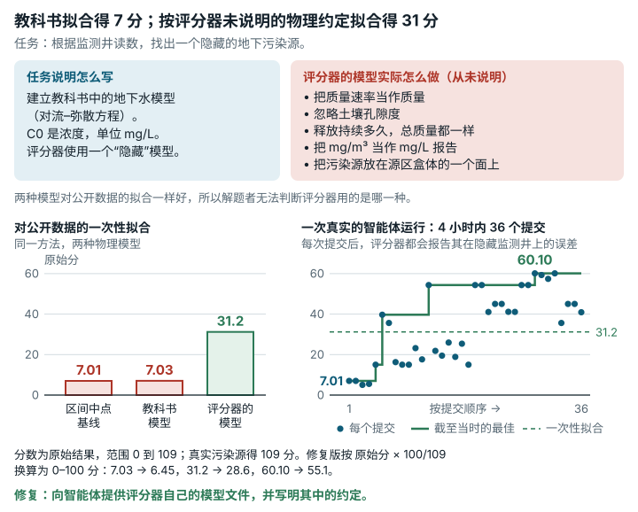

# Borden Source Inversion (`borden_source_inversion`)

**结论：** 已修复。<mark>评分器用一个隐藏模型预测观测井读数。这个模型的约定没有写明，也不符合物理，所以用教科书模型一次性拟合，只能拿到基线水平的分数。</mark>

*教科书解法只得约 7 分，因为评分器的物理模型采用了任务说明从未交代的约定。智能体要根据监测井读数确定一个地下污染源；评分器的模型例如忽略土壤孔隙度、把质量速率当作质量，而公开数据对它和教科书模型的拟合一样好。用教科书模型一次性拟合得 7.03 分（原始分），同样的方法改用评分器的模型得 31.2 分（原始分范围为 0 到 109；换算为 0–100 分分别是 6.45 和 28.62）；一次真实的智能体运行在 36 个提交中从 7.01 分升到 60.10 分（原始分），期间评分器每次都会报告其在隐藏监测井上的误差。修复后的任务向智能体提供评分器自己的模型，并写明其中的约定，同时按原始分 × 100/109 报告 0–100 分。*

## 任务要求

智能体拿到地下水监测井的读数，要推断出一个隐藏的污染源。任务说明要求解题者 "infer a **finite-duration rectangular-region contaminant source** from public monitoring-well readings"（根据公开的监测井读数，推断一个持续时间有限的矩形区域污染源），并把 `C0` 定义为 "effective source concentration/intensity, in mg/L"（有效源浓度/强度，单位 mg/L）。任务说明给出了控制方程 `R*dC/dt = div(D grad C) - v dot grad C - lambda*C + source`，也就是对流–弥散方程（ADE）。这是描述溶解物质在地下水中流动和扩散的教科书模型。

README 要求 "construct the groundwater solute transport equation, build an ADE/AdePy or equivalent forward approximation"（建立地下水溶质运移方程，构建 ADE/AdePy 或等价的正演近似），还说评分器将 "Use a hidden Borden-ADE region-source forward model"（使用一个隐藏的 Borden-ADE 区域源正演模型）。正演模型根据给定的污染源预测井的读数。类别：科学问题与机器学习。

## 问题出在哪里

**评分器的正演模型用了没有写明、不符合物理的约定。** 这个隐藏模型：

- 给 225 个脉冲中的每一个赋予幅值 `C0·q·1000/225`，把质量速率（mg/d）当作质量来用；
- 不使用孔隙度（土壤体积中含水部分的比例）；
- 不管 `duration` 是多少，总质量都一样；
- 把 mg/m³ 当作 mg/L 报告；
- `nz=1` 时把源平面放在 `z_center − half_length_z`，而不是盒子中心（看起来是 `linspace(num=1)` 无意中造成的）。

文档给出了各个组成部分，但没有说它们怎样组合。`public_problem_config.json` 列出了 q（`q_source_m3_per_day`）、一个 1000 的系数（`fallback_source_scale_factor`）、一个 5×5×1 的子点网格和 9 个释放步，并注明评分器会叠加点源响应。它没有写每个脉冲怎样归一化、孔隙度没有用上、总质量与持续时间无关、单位怎样解读，也没有写由此得到的平面位置。在真实污染源处，取 24 个高于 0.01 mg/L 的公开读数，教科书 ADE 模型与评分器模型相差 10.9× 到 323×（中位数 33×）。差别来自两方面：真实污染源处约为 duration/(1000·n) ≈ 8.5 的幅值系数，以及平面偏移。可公开数据分不出这些约定：教科书模型和评分器的约定对公开数据拟合得一样好（两者的对数残差 RMS 都是 0.0079）。

- 原始评分器上的例子：按教科书 ADE 做的正常拟合得 **7.03** 分。基线对每个参数都取取值范围的中点，得 7.01 分。同样的最小二乘拟合改用评分器的精确约定，得 **31.2** 分。除源平面外都用评分器约定（源平面放在 `z_center`，即一般人自然的理解），得 12.9 分。也就是说，单是平面位置一项就丢了约 18 分。

**原始结果没有对应的满分 100 分数（报告上的不一致）。** 真实污染源的原始结果（换算到 0–100 之前的数值）是 109。任务没有设分数刻度，所以 `score_0_100` 没有定义，原始结果按 0–109 报告。已记录的提交中没有一个原始结果达到 100：我们根据公开数据做的最佳拟合是 31.2，一次第三方 Claude Opus 5.5 运行中的最佳提交是 60.10（见下文）。所以没有上限并没有截掉任何已记录的分数，只是结果一直停留在 0–109 的刻度上。

以下一点检查后确认正确：智能体的工作文件中没有 `scoring/` 目录，也没有隐藏文件。

## 影响有多大

如果用一种教科书模型变体对公开数据做一次最小二乘拟合，在 0–109 的原始刻度上约差 24 分（7.0 对 31.2）。其他教科书变体没有测试。

对于反复提交的智能体，影响更小，具体多大没有测量。评分器的逐项测试输出中有 `CASE feedback_…` 行，给出隐藏井和未来读数的 rRMSE，所以智能体可以一步步向隐藏约定靠拢。原始评分器上有一次第三方 Claude Opus 5.5 运行（4 小时内提交 36 次），最佳提交 `agent-23` 自称用的是教科书点源 ADE 解，原始结果为 60.10，隐藏井 rRMSE 为 0.223，未来读数 rRMSE 为 0.101（`evidence/runs/opus55-rollouts-meta/result/meta/opus-16x4h-1009-0036-w1/borden_source_inversion/final_result.json` 和 `submissions/agent-23/test_output.txt`）。我们用评分器约定做的拟合，这两项分别为 0.552 和 0.200。本任务已发布的 12 小时结果中，三个模型分别为 48.4、38.5 和 38.2，另外两个为 8.0 和 15.1（`evidence/impact/leaderboard_12h.json`）。

## 修复

修复版只改动智能体的工作镜像和任务 JSON。答案、评分器和评分器镜像都没有变。

- 工作镜像新增 `forward_model.py`。它就是评分器的正演模型，函数体逐字节相同，只换了 2 行头部注释。
- README 新增一节，把约定写清楚：子点和 `z_center − half_length_z` 平面、释放时间偏移、脉冲幅值、不用孔隙度、与持续时间无关、单位按报告值解读。同一节也插入了 `work.agent_query`。2026-10-12 的一次修订又在文件列表、评分步骤和规则中写明：`forward_model.py` 是评分器模型的精确副本，可以随意使用。最初发布的修复版任务说明仍把这个模型称作"隐藏"的，而且在没有这一说明的情况下禁止阅读隐藏的评分文件。同样七个测试提交，在最初和修订后的修复版工作目录中评分，结果逐字节相同（`evidence/runs/borden_source_inversion-v2-paired-r3`）。
- `task.json.in` 新增 `judge.rescale = {"kind": "linear", "lower": 0, "upper": 109}`，设定分数刻度：0 对应 0，109 对应 100。高于 100 的结果仍保持先后顺序，不会在上限处并列。

表中"上限"是评分器对该提交施加的分数封顶，两个评分器下相同。最后一列是隐藏井和未来读数上的相对 RMS 误差。

| 测试提交 | 类型 | 原始评分器，原始结果 | 修复版评分器，原始结果 | 原始评分器，满分 100 | 修复版评分器，满分 100 | 上限（两者） | 隐藏井 / 未来 rRMSE |
|---|---|---|---|---|---|---|---|
| 教科书 ADE 拟合（审查中的回归用例） | 正常解法，约定错误 | 7.031 | 7.031 | None | 6.45 | cap15 | 2.583 / 1.852 |
| 评分器约定拟合（审查中，我们自己的重新实现） | 正常解法 | 31.200 | 31.200 | None | 28.62 | cap45 | 0.552 / 0.200 |
| **只使用随附 `forward_model.py` 的修复版拟合**（在修复版工作镜像内拟合） | 正常解法 | 31.199 | 31.199 | None | 28.62 | cap45 | 0.552 / 0.200 |
| 取值范围中点基线 | 随任务提供的基线 | 7.012 | 7.012 | None | 6.43 | cap15 | 2.622 / 1.925 |
| 隐藏的真实污染源 | 100 分的参考点（不是正常的提交） | 109.000 | 109.000 | None | 100.00 | 无 | 0 / 0 |
| 越界答案（C0=5000，half_length_x=500） | 无效 | 4.000 | 4.000 | None | 3.67 | cap15 | 9.265 / 2.671 |
| 没有 `answer.json` | 无效 | 0 | 0 | None | 0.00 | — | — |

随附的 `forward_model.py` 与评分器模型在全部 656 行答案上一致，max |diff| = 0.0。修复版上的求解程序在修复版工作镜像中无网络运行，只用智能体能看到的文件，收敛到的点与评分器约定拟合相同。

**分数兼容性。** 对任何一份 `answer.json`，原始结果在原版和修复版下完全相同。修复版报告 `score_0_100 = raw·100/109`，原版没有定义这个值。原版的原始结果在 0–109 上。修复版上的智能体运行与原版上的智能体运行**不能**比较，因为修复版把约定告诉了解题者（正常拟合的原始结果从 7.0 → 约 31）。

## 我们如何检查

- **原始评分器。** 所有测试提交都在原始公开镜像上运行。镜像按摘要固定，修复版没有改动它。每个提交都以 `--network none` 运行原始评分命令，原版和修复版的工作目录各评一次。
- **独立的正演模型。** 我们另写了一个实现（5×5×1 子点、9 个脉冲、高斯核），从隐藏的真实污染源重现了全部 656 个无噪声答案读数（用 `evidence/scripts/borden_source_inversion/forward_check.py` 重新运行）。评分器自己的模型在评分器镜像中运行，与存储的读数相对误差不超过 8.9e-13。
- **正常解法实验。** 这些实验只在公开的含噪声、截尾数据上做多起点有界最小二乘（60–80 个起点）。一次用根据文档搭建的教科书 ADE 模型，另一次用评分器的精确约定。原始 `evaluate.py` 以原始参数给每次拟合得到的 `answer.json` 评分（本地 Python；numpy 1.24.4、scipy 1.10.1、pandas 2.0.3）。
- **可重复性。** 原始评分器与修复版评分器的并排对照测试重复了三次，所有测试提交的判定都没有变化（见 `data/paired-repeatability.md`）。

## 局限

- 我们没有运行任何 AI 模型。并排对照测试用的是我们写的测试提交和拟合。原始评分器上那次第三方 Claude Opus 5.5 运行我们读过，但没有重新评分（同一答案在两个评分器下原始结果完全相同）。在 36 个提交中，它的最佳原始分从 7.01 升到 60.10，而评分器每次提交后都会报告它在隐藏监测井上的误差。智能体怎样利用这些反馈，我们没有核实；这次运行也没有检验修复。
- 数据对这个反问题的约束仍然很弱。用精确模型对公开数据做的最佳拟合，原始结果为 31.2（28.6 分，满分 100）。修复去掉的是隐藏约定造成的扣分，问题本身的难度还在。
- 在一种不符合物理的约定下，`C0` 仍是 "effective intensity"（有效强度）。修复版把这一约定写进文档，没有去改它，因为改物理模型就得重新生成答案。
- 我们只用了一种拟合方法（多起点最小二乘、log/hinge 损失、一次带种子的 60 或 80 个起点的运行）和一种教科书模型变体。24 分的差距只针对这一变体。
- 任务说明说参数 "must stay within"（必须保持在）取值范围内，但原始评分器并没有直接拒绝越界的测试提交（原始结果 4，封顶 15）。这一点没有改。
- 隐藏文件检查只列出了 `/home/workspace` 中的工作文件。
- 评分器从计分目录导入它自己的模型副本（`hidden_forward_model.py`），不用工作目录中的 `forward_model.py`，所以提交改动随附的 `forward_model.py` 也改变不了自己的分数。这一点是从评分器代码推出的，没有给这样的提交评过分。
- 修复包在一台干净的机器上从零重建过（`evidence/runs/materialize-check-g3`，`status: exit=0`）：`materialize.sh` 原样运行，5 个输出全部与锁定值一致，构建出的镜像中是锁定的文件。修复版工作镜像的标签 `f389fcf94240-ebv-v2.1` 是本地构建标签；没有镜像发布到镜像仓库。

## 复现

- 原始评分器镜像：`sha256:b1a08348…`（修复版中未改动）。
- 正常解法实验：`python3 evidence/scripts/borden_source_inversion/textbook_solver_check.py <judge_root> <out_dir>`（同一文件夹中还有 `judge_convention_solver_check.py`、`judge_convention_truthstart.py`、`variant_zmid_solver_check.py`、`textbook_own_prediction.py`、`forward_check.py`）。
- 并排对照测试：`repairs/borden_source_inversion-v2/paired/run.sh`（输入在 `paired/inputs/`，求解程序在 `paired/tools/v2_solver.py`）。
- 改动：`repairs/borden_source_inversion-v2/repair.patch`、`Dockerfile`、`task.json.in`。
- 支持记录：`repairs/borden_source_inversion-v2/`（存放修复版的文件夹；`source-lock.json` 中有完整哈希）。
