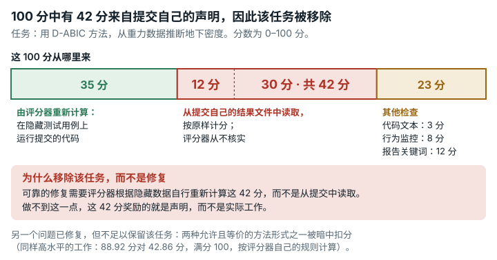

# D-ABIC Gravity Inversion (`dabic_gravity_inversion`)

**结论：** 已移除。<mark>有 42 分来自提交自己报告的结果，评分器无法核实。部分修复去掉了第二个问题，即评分器暗中给两种允许写法中的一种扣分；但这不能让任务变得可用。</mark>

*100 分中有 42 分取自提交对自己工作报告的数值，评分器从不核实，因此我们移除了该任务。智能体要实现 D-ABIC 重力反演方法。评分器只有 35 分是在隐藏测试用例上运行代码后重新算出的；另有两部分（分别为 12 分和 30 分）直接按提交自己的结果文件计分。可靠的修复需要评分器根据隐藏数据自己重新计算这 42 分。我们还修复了另一个问题，但这不足以保留该任务。任务允许两种等价的方法形式，评分器却暗中给其中一种扣分（按评分器自己的规则计算，同样高水平的工作在 C = 26 时得 88.92 分对 42.86 分，满分 100；差距随 C 增大）。*

## 任务要求

解题者要实现 D-ABIC 重力反演。这是一种根据重力测量推断地下密度的方法，用赤池贝叶斯信息准则（ABIC）选择正则化强度（beta）。方法有两种等价的写法：模型空间形式用到的矩阵，大小由隐藏模型的单元数决定；数据空间形式用到的矩阵，大小由数据点数决定。

任务文本写道："Decide for yourself whether to use the model-space or data-space form, how to compute determinants, and in which space to optimize beta."（自行决定用模型空间形式还是数据空间形式、怎样计算行列式、在哪个空间中优化 beta。）初始 README（第 48 行）也重申这一选择 "to be determined by the implementer."（由实现者决定。）README 第 5 行把 D-ABIC 展开为 "Data-space variant of Akaike's Bayesian Information Criterion"（赤池贝叶斯信息准则的数据空间变体）。尽管如此，任务文本两次把选择权交给解题者，解题者能看到的文本中也没有一处说评分器会给模型空间形式扣分。类别：科学问题与机器学习。

## 问题出在哪里

有 42 分是自报的，这是移除任务的原因。B 和 D 两部分（共 42 分）取自提交自己报告的结果，评分器不会根据隐藏数据重新计算。所以，即使解题者如实报告，这两部分反映的也只是提交报告了什么，而不是评分器核实了什么。F 部分是书面报告，按关键词评分。

评分器还有一项没有公开的要求，即必须用数据空间形式。它监控对数行列式例程，根据传进去的方阵形状判断提交用的是哪种形式。评分器把模型空间形式的提交标为 `is_data_space=false` 和 `structural_failure=true`。这样一来，不论质量高低，它在乘扣分系数之前的总分都少 3.2 分，这就是 E1 行为分。它也拿不到不封顶的扣分系数 1.0，所以模型空间形式的提交最多只能乘 0.5× 的系数。按 Sylvester 行列式恒等式，两种形式算出的是同一条 ABIC 曲线。

- 在原始评分器上，数据空间形式和模型空间形式在隐藏用例上的结果，在运行噪声范围内相同（C 为 17.39 对 17.44），得分却分别为 26.82 和 25.77（`repairs/dabic_gravity_inversion-v2/paired/evidence/logs/{data,model}-v1.structured.json`）。在这个中等水平上，两者的扣分系数都是 0.334，所以看到的差距很小。
- 在高水平上（C ≥ 26、D ≥ 20、F ≥ 10），套用评分器自己的扣分函数，同样的作品用数据空间形式约得 89 分，用模型空间形式约得 43 分（C = 26 时为 88.92 对 42.86）。

## 影响有多大

- 自报的部分：每个解题者都有 42 分无法核实。
- 形式扣分：选择模型空间形式的解题者，按评分器自己的规则计算，在高水平上 C = 26 时差 46.06 分、C = 30 时差 48.06 分（差距随 C 增大）；在每个水平上，扣分前总分都少 3.2 分。

## 修复

修复版只是部分修复。它只去掉形式扣分，没有解决移除任务的原因；完整修复需要什么，见本节末尾。

修复只改动一个文件，即评分器 `eval_dabic_v2.py`。这个文件在评分器镜像中存放在两处，两处都改了。修复新增 `is_model_space`，与现有的数据空间检查对称，判断条件是监控器捕获的方阵中多数的维度等于隐藏单元数。然后由 `uses_abic_form = is_data_space or is_model_space` 决定 E1 分和 `structural_failure` 项。所有阈值、0.334/0.5/1.0 三档扣分、其他行为规则、`valid_for_selection` 和其他各部分都没有变。任务 JSON 只改了 `judge.image_tag`。工作镜像和解题者能看到的文件都没有变。我们对称地增加一项检查，而没有删掉原有检查，这样"对数行列式必须在 ABIC 矩阵上计算"这一要求仍然保留。

下表是原始结果。任务没有定义分数刻度的 `rescale` 部分，所以 EdgeBench 的评测框架报告 `score_0_100 = None`（`sforge/harness/run_evaluation.py:265`，不截断）。列标签 "raw=norm" 沿用自并排对照的结果文件，因为这里原始结果与报告的分数是同一个数。每个分数等于扣分前总分乘以扣分系数（数据空间形式为 80.31 × 0.334 = 26.82；`paired/evidence/summary.txt`）。

| 测试提交 | 提交内容 | 原始评分器分数（raw=norm） | 修复版评分器分数（raw=norm） | 明细，原版 → 修复版 | 有效，原版/修复版 | 退出码，原版/修复版 |
|---|---|---|---|---|---|---|
| 展示问题 | 正常实现的模型空间 D-ABIC（`FORM="model"`） | **25.77** | **26.81** | E 4.8 → 8.0；`structural_failure` true → false；扣分前总分 77.16 → 80.27 | true/true | 0/0 |
| 正确的提交 | 正常实现的数据空间 D-ABIC（`FORM="data"`） | **26.82** | **26.84** | E 8.0 / 8.0；扣分前总分 80.31 → 80.35（C 17.39 → 17.43，运行噪声） | true/true | 0/0 |
| 无效的提交 | 数据空间形式，用 `np.linalg.det` 计算对数行列式（`make_invalid_variant.py`） | 26.91 | 26.86 | 两者中 `uses_bad_det` 都为 true，`structural_failure` 都为 true；E 7.2 / 7.2 | **false/false** | 0/0 |
| 随任务提供的状态 | 评分器镜像自带的工作区（没有 `outputs/`，什么也没提交） | 0.00 | 0.00 | 所有部分均为 ERROR（文件缺失） | false/false | 0/0 |

下表是高水平上的封顶。这些值是推导出来的，不是观察到的。我们把每个评分器镜像自己的扣分函数套用到该测试提交的真实分数明细上，只替换 C。每格给出扣分系数和由此得到的分数。

| C | 数据空间形式，原始评分器 | 模型空间形式，原始评分器 | 数据空间形式，修复版评分器 | 模型空间形式，修复版评分器 |
|---|---|---|---|---|
| 20 | 0.5 → 41.46 | 0.5 → 39.86 | 0.5 → 41.46 | 0.5 → 41.46 |
| 26 | 1.0 → 88.92 | **0.5 → 42.86** | 1.0 → 88.92 | **1.0 → 88.92** |
| 30 | 1.0 → 92.92 | 0.5 → 44.86 | 1.0 → 92.92 | 1.0 → 92.92 |

在原始评分器上，数据空间形式与模型空间形式相差 1.05；在修复版评分器上相差 0.03，在实测的运行噪声范围内（重复运行时 C 最多波动 0.15）。

完整修复需要评分器根据隐藏数据重新计算 B 和 D 两部分（42 分），不能从提交报告的结果中读取。做到这一点之前，任务保持移除。

从代码看，凡是评分器判为数据空间形式的提交，修复版评分器的分数在运行噪声范围内都等于原始评分器的分数。我们实测过一次，正确的数据空间提交从 26.82 变为 26.84。矩阵大小既不等于隐藏数据点数、也不等于隐藏单元数的提交，情况相同。模型空间形式的提交分数不能比较，因为它们拿到 3.2 分的 E1 分，在高水平上还能拿到不封顶的扣分系数 1.0。分数刻度没有变。

## 我们如何检查

- 原始评分器来自按摘要固定的原始公开镜像，评估命令原样不动，参数为 `--network none --cpus 8 --memory 6g`。我们把一份正常实现的 D-ABIC 提交按两种形式各评一次，两份代码只有 `FORM = "data"` / `FORM = "model"` 这一行不同。自报部分（B、D）和按关键词评分的报告（F）在每个测试提交中都用固定的输入文件，所以只有形式在变。这些值不代表任务表现。
- 我们读了行为监控器（`BehaviorMonitor.report`）和扣分函数（`structural_penalty_v34`）。
- 为了估计高水平上的影响，我们把评分器自己的扣分函数套用到每个测试提交的真实分数明细上，只替换隐藏用例分数 C。
- 我们用相同的输入做了原始评分器与修复版评分器的并排对照运行，另加一份无效提交（用 `np.linalg.det` 计算对数行列式）和随任务提供的空工作区。我们重复了三次，所有测试提交的结果都没有变化（见 `data/paired-repeatability.md`）。
- 作为单位检查，一个独立的棱柱体重力代码（Nagy 公式）通过了与无限平板（Bouguer 平板）的对照检查。我们没有保存它的输出。

## 局限

- 我们没有运行任何 AI 模型或解题者。影响只在我们写的测试提交和反例上展示。
- 我们只用了一个中等水平的正常实现（C ≈ 17.4/35），B、D 和 F 用的是固定的输入文件。高水平上的影响是用评分器自己的扣分函数算出来的，没有用一份高水平提交实际观察。
- 形式判断仍然依赖矩阵形状。一个正确的实现如果计算对数行列式时没有把 N×N 或 M×M 方阵传给被监控的例程（例如用低秩或迭代估计），两个版本仍都会把它标为 `structural_failure`。
- 部分修复没有解决移除任务的原因：B 和 D（42 分）仍来自提交自己报告的结果，F 仍按关键词评分。修复的 README 写明它 "does not make the task retainable on its own"（单靠它并不能让该任务得以保留）。
- 评分器只用 `valid` 标志拒绝无效的提交，它的数值分数并不低。
- 隐藏用例用同一个模拟器生成数据、再做反演，这对合成测试来说可以接受。我们没有与 SimPEG 对比，也没有核实 Xu 基准常数。

## 复现

- 评分器镜像摘要：`sha256:fe3dc290…`。
- 在原始评分器上运行两种形式：`evidence/runs/dabic_gravity_inversion-forms/run.sh`（输入在其 `inputs/` 文件夹中）。
- 并排对照运行：`repairs/dabic_gravity_inversion-v2/paired/run.sh`（存放修复版的文件夹），同一文件夹中还有 `make_invalid_variant.py` 和 `penalty_check.py`。
- 棱柱体合理性检查：`evidence/scripts/dabic_gravity_inversion/prism_forward_check.py`。
- 改动：`repairs/dabic_gravity_inversion-v2/repair.patch`、`Dockerfile`、`task.json.in`。
- 支撑记录：`repairs/dabic_gravity_inversion-v2/`（`source-lock.json` 中有完整哈希）。
