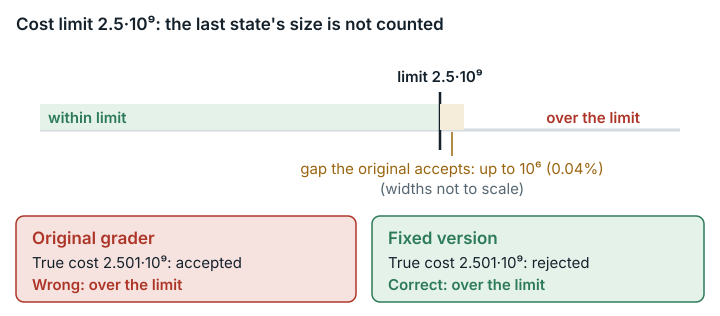

# Equivalence Class Divide And Conquer (`equivalence_class_divide_and_conquer`)

**结论：** 已修复。<mark>子问题 T3 的评分器在求代价总和时漏算了最后到达的邻域的大小，所以代价只要不超过"上限加这个大小"就会被接受。超出的部分很小（至多 10⁶，即预算的 0.04%），我们也没有找到能借此多得分的例子。改三个记号就能修好。</mark>

*原始检查器漏掉了最后到达的邻域的大小，因此会接受略高于 2.5·10⁹ 的代价（至多 0.04%）；修复版检查器拒绝它们。*

## 任务要求

这个任务有六道难度递增的题，分值分别为 5、5、10、15、25 和 40 分。问题出在 T3（P8204，"有向邻域"），占 100 分中的 10 分。题面规定了代价预算："你需要保证操作的总代价不超过 2.5×10^9"，也就是总代价不超过 2.5·10⁹。操作 1 的代价是邻域大小的变化量，其他操作不计代价。输入规模为 n, m ≤ 10⁶。类别：组合优化。

EdgeBench 把任务交给一个 AI 智能体，智能体最多工作 12 小时，再由一个隐藏的评分器程序给每份提交打分。每道题都有一个检查器程序，判定每个输出是否正确。

## 问题出在哪里

**最后的代价求和漏掉了最后一个状态。** T3 检查器最后对状态 0..tt−1 的代价求和，漏掉了最后创建的状态 `t[tt]`。这个状态的净系数为 +1，所以算进去的代价等于真实代价减去 |N_last|，N_last 是最后一次操作 1 的目标。与上限的比较本身（`w <= W`，W = 2.5e9）符合题面。

- 原始检查器下的例子：我们构造了一个输出，真实代价为 2.501·10⁹，超过上限，检查器却接受了它（"ok Correct"）。在同一输出末尾加一步零代价操作，检查器就拒绝了。可见判定结果只取决于最后的目标有没有算进去，这不是有意留的容差。
- 界：能被接受的真实代价至多为 2.5·10⁹ + |N_last| ≤ 2.5·10⁹ + 10⁶。这个区间最多占预算的 0.04%。
- 在 30 个官方 T3 输入上，参考解法最多用掉预算的 35%（最大真实代价为 871,274,246，在用例 19 上）。一种朴素策略在 30 个输入中的 24 个上超出上限，每次至少超出 116,912,620。这个问题没有改变其中任何一个判定。

检查器另有两处偏差，方向相反：它比较的是 (x, depth) 对，不是集合，所以会拒绝一些题面允许的输出。这些偏差不可能抬高分数，我们没有改动。

## 影响有多大

影响有上界，只涉及 T3，而且修复版只可能让分数降低。T3 只有 30 个用例全部通过才给满 10 分；否则每通过一个用例得 0.5·10/30 分（评分器镜像中 `eval_common.py` 第 56–61 行的 `task_score_fraction`）。

- 如果有一个官方用例落在这个区间内，原始评分器给 T3 10 分，修复版最多给 0.5·29/30·10 = 4.83 分，相差 100 分中的 5.17 分。
- 差异的上限是 100 分中的 9.67 分；在官方用例集上这个上限能否同时达到，没有得到证实。用例 29（n = 1）和 30（m = 1）不可能超出上限：操作至多 5m 次，每次代价至多为 n，所以真实代价不超过 5·10⁶。用例 1–28 的 n, m ≈ 10⁶（`official_results.txt`），但这不说明每个用例上都有合法输出能落进接受区间。如果某个解法在这 28 个用例上都落在区间内，在用例 29–30 上正确，它在原始评分器下得 10 分，在修复版下得 0.5·2/30·10 = 0.33 分。
- 9.67 是这样算出来的。T3 在 100 分中占 10 分。按 `task_score_fraction`，30 个用例全部通过时 T3 得 10 分；通过 k < 30 个时得 0.5·k/30·10 分，系数 0.5 就是这条部分得分规则。修复只会把落在区间内、原本被接受的用例改判为拒绝；用例 29 和 30 永远不会落在区间内，两个版本的判定相同。所以差异最大的情形是：原始评分器给满 10 分（30 个用例全部通过），修复版只通过用例 29 和 30（k = 2）：10 − 0.5·2/30·10 = 10 − 1/3 = 29/3 ≈ 9.67。如果原始评分器本来就没有让 30 个用例全部通过，它最多给 0.5·29/30·10 = 4.83 分，差异更小。这个上限假设有一个处处正确、又在 28 个大用例上全都落进区间的解法；这样的解法是否存在，没有得到证明。

只有真实代价恰好落在上限之上 |N_last| 以内的解题者才会受影响。我们没有找到落在这个区间内的实际解法，**也没有展示出任何分数收益**。

## 修复

修复版只改动一个文件 `T3_P8204/data/checker.cpp`。`std::iota(oq, oq+tt, 0)` 和 `std::sort(oq, oq+tt, …)` 都改为 `oq+tt+1`，循环边界 `i<tt` 改为 `i<=tt`。数组本来就放得下下标 tt。时间、内存、输出和其他限制都没有变。任务 JSON 只改了 `judge.image_tag`。

下表中，AC（accepted，通过）表示检查器接受输出，WA（wrong answer，答案错误）表示拒绝。"原始分"是原始结果（换算到 0–100 之前的数值）。

| 测试提交 | 提交 / 输入 | 原始评分器 | 修复版评分器 | 预期 |
|---|---|---|---|---|
| **展示问题** | `naive.cpp` 在构造输入 B 上（星形，n=10⁶，m=2501；真实代价 2.501·10⁹ > 上限） | **AC**，原始分 10（T3 1/1） | **WA "Operation cost exceeded"**，原始分 0 | 原始版错误，修复版正确 ✔ |
| 正确，恰好等于上限 | `naive.cpp` 在构造输入 A 上（m=2500；真实代价恰好 2.5·10⁹） | AC，原始分 10 | AC，原始分 10 | 两者都接受 ✔ |
| **正确（整个任务）** | T1–T6 的官方 `std.cpp` | **原始分 100 / 100 分制下 100 分**；T1 5/5、T2 10/10、**T3 30/30**、T4 25/25、T5 20/20、T6 30/30（通过的用例数）；退出码 0；通过率 1.000 | **原始分 100 / 100 分制下 100 分**；每道子问题的计数相同；退出码 0；通过率 1.000 | 不变 ✔ |
| 不正确 | `naive.cpp` 作为 T3，其他题为空，在 30 个官方输入上 | 原始分 1 / 100 分制下 1 分；T3 6 AC / **24 WA**（代价超限）；退出码 1；通过率 0.020 | 原始分 1 / 100 分制下 1 分；逐用例相同的 6 AC / 24 WA；退出码 1；通过率 0.020 | 两者都拒绝 ✔ |

直接在构造的输出上运行检查器：

| 情形 | 原始检查器 | 修复版检查器 |
|---|---|---|
| A 恰好等于上限 | ok | ok |
| B 超出 n | **ok** | **WA** |
| C 超出 2n | WA | WA |
| D（B 末尾再加一步零代价操作） | WA | WA |
| E 高效策略 | ok | ok |

按原始评分器的设置、不改任何限制，参考解法在原始检查器和修复版检查器下都通过了全部 30 个 T3 输入。

**分数兼容性：** 真实代价 ≤ 2.5·10⁹ 或 > 2.5·10⁹ + |N_last| 的输出，原始版和修复版分数相同。只有落在区间内的输出结果不同：原始版错误地接受，修复版拒绝。只有 T3 可能出现差别。

## 我们如何检查

- **原始评分器镜像中的原始检查器，按摘要固定。** 未修改的 T3 检查器用测试框架自己的编译选项（`g++ -std=c++17 -Ofast -pipe -I prob -I data`）编译，以 `--network none` 运行。我们在一棵 n = 10⁶ 的星形树上构造了五个输出让它检查：恰好等于上限、刚刚超出、超出更多、同一超限输出末尾加一步零代价操作，以及一种高效策略。
- **暴力检查。** 我们生成了 329 棵随机小树（n ≤ 7）和合法的操作序列。每棵树都由一个独立程序直接按题面定义算出真实代价，再与一个对所有状态求和的插桩检查器、以及上限可调的原始检查器对照。结果：329 个用例中 0 处不一致。在 307 个用例中（即所有最后目标非空的用例），把上限设为真实代价 − 1，原始检查器仍然接受输出。
- **官方输入。** 我们在全部 30 个官方 T3 输入上运行了官方参考解 `std.cpp` 和一种朴素的合法策略。
- **原始评分器与修复版评分器的并排对照运行**，使用原始的 `eval.py` 命令，参数为 `--network none --memory 3g --cpus 3`。参考提交覆盖了整个六题任务。重复了三次，所有测试提交的判定都没有变化（见 `data/paired-repeatability.md`）。

## 局限

- 我们没有运行任何 AI 模型或解题者。影响只在我们写的测试提交和反例上展示。
- 展示问题的测试提交用的是一个构造的输入（n = 10⁶ 的星形树），作为额外的 T3 用例加入。在官方输入上，已知的解法都不会落进这个区间。
- 在上限附近只试了两种策略：参考解法和朴素策略。原则上，不能排除某个解题者在某个官方用例上离上限不到 10⁶。
- 只深入检查了 T3。并排对照运行给参考提交评了全部六道题，结果完全相同。
- **未经验证的部分及其原因：六道题的逐题评分器检查。** Issue #2 要求在六道题（T1–T6）上分别检查原始评分器和修复版评分器，并把 T2 的参考对照与 T3 的检查器修正分开。实际只有参考提交在全部六道题上评过分（两个版本结果相同）；T1、T2、T4、T5 和 T6 都没有运行逐题的测试提交。修复只改动 `T3_P8204/data/checker.cpp`，所以其他题的检查器就是原始文件。这一点作为已记录的局限保留。
- 比较数对带来的过严问题没有改。题面的条件读起来是集合相等，但说出题者本意是数对相等，也讲得通。

## 复现

- 原始评分器镜像：`sha256:f793d805…`。
- 脚本：
  - `evidence/scripts/equivalence_class_divide_and_conquer/run_crafted.sh`
  - `run_random.sh`（配合 `random_oracle.py`）
  - `run_official.sh`
  - `run_strictness.sh`
- 并排对照运行：`repairs/equivalence_class_divide_and_conquer-v2/paired/run.sh`（结果在 `paired/results.md`）
- 补丁：`repairs/equivalence_class_divide_and_conquer-v2/repair.patch`
- 支撑记录：`repairs/equivalence_class_divide_and_conquer-v2/`（存放修复版的文件夹；source-lock.json、`paired/evidence/`）。
