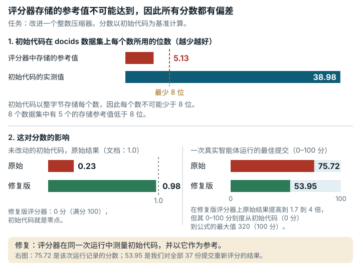

# Integer compression codec (`integer_compression_codec`)

**结论：** 已修复。<mark>评分器拿提交与一组存储的基线数值比较，而文档所说的 Varint 初始代码根本产生不了这些数值。因此初始代码只得约 0.23，而不是文档所说的 1.0；各数据集的实际权重也与公布的不同。</mark>

*评分器把每份提交与存储的初始代码参考值做比较，而初始代码根本达不到这个值，所以所有分数都有偏差。任务是改进一个整数压缩器。在 docids 数据集上，存储的参考值是每个数 5.13 位，低于任何整字节格式所需的 8 位；初始代码实际用 38.98 位（8 个数据集中有 5 个的存储值低于 8）。结果，未改动的初始代码原始分数只有 0.23，而不是文档所说的 1.0；每个原始结果都偏低，偏低的倍数因数据集而异。修复版评分器在同一次运行中测量初始代码（初始代码的原始分数为 0.98），它的 0 到 100 分刻度把初始代码定为 0 分，把公式的最大值 320 定为 100 分。一次真实 Claude Opus 5.5 运行的最佳提交在我们的机器上重新评分，原始评分器下为 71.93 分（满分 100），修复版评分器下为 53.95 分（该运行自己记录的是 75.72 分）。*

## 任务要求

解题者要 "Implement a stronger `libintcompress.so` … to improve both compression ratio and decode throughput on the provided datasets"（实现一个更强的压缩库，在所给的数据集上同时提高压缩率和解码吞吐量）。共有八个数据集。每个数据集的分数相对于 "the baseline (official Varint) compressed bits-per-integer and decoding throughput"（基线，即官方 Varint 的每整数压缩位数和解码吞吐量）定义：`S_i = min(B_i^0 / B_i, 8.0) × min(T_i / T_i^0, 40.0)`。Varint 是一种简单的格式，把每个整数存成若干个整字节。`scoring_scheme.md` 写道："The baseline implementation is the publicly provided Varint starter. Its composite score is defined as `1.0`."（基线实现是公开提供的 Varint 初始代码，其综合分数定义为一。）类别：系统与软件工程。

## 问题出在哪里

评分器从来没有实测过基线。`runner_judge.py` 从存储的文件 `baseline_results.json` 中读取 `B_i^0` 和 `T_i^0`，这个文件标注为 "varint-v1 (reference)"。这些数值不可能来自随任务提供的初始代码。表中 bpi 指每个整数的位数。

| 数据集 | 初始代码 bpi（实测） | 存储的 "Varint" bpi | 存储值 / 实测值 |
|---|---|---|---|
| docids | 38.98 | 5.13 | 0.132 |
| ts_sec | 40.00 | 4.86 | 0.121 |
| ts_ns | 39.48 | 8.11 | 0.205 |
| temp | 16.00 | 4.27 | 0.267 |
| grid | 39.50 | 17.54 | 0.444 |
| zipf | 12.63 | 7.32 | 0.580 |
| rand | 39.50 | 32.10 | 0.813 |
| sparse | 38.59 | 6.89 | 0.179 |

按字节编码的 varint 每个值至少要一个字节，所以每个整数至少占 8 位。存储的 "Varint" 值中有五个低于 8，任何字节 varint 都做不到。存储的运行日志本身也自相矛盾，docids 的解码时间与吞吐量相差约 1000×。存储的吞吐量是在另一台机器上测的。

下表是原始评分器上的结果。

| 提交 | 预期（文档所述） | 原始评分器上的结果 |
|---|---|---|
| 未改动的 Varint 初始代码 | 1.0 | 0.2407 和 0.2455（两次运行） |
| 正常的 delta + zigzag + varint | 6.24（一次离线重新评分；在修复版上六次运行为 6.70–8.27） | 0.7590 |
| 改坏了一个值的初始代码 | 0 | 0.0（全部 8 个数据集往返校验不一致） |

每个分数都偏离了文档所述的刻度。偏离程度因数据集而异，所以各数据集的权重与文档不同。

有些部分工作正常。数据能精确重新生成，往返校验（解码必须还原出原始整数）能拒绝破坏数据的编解码器。有两处小偏差对正常解题者没有影响：镜像中提供的是 g++ 11.4，而不是文档所述的 12.2；评分器把 "encode + decode ≤ 300 s" 实现为两个各 300 s 的独立时限。

## 影响有多大

- 所有解题者都受影响。按原始结果，初始代码得约 0.24 而不是 1.0，正常的编解码器得约 0.8 而不是约 6–8（取决于计时；见下表）。
- 单看压缩项，各数据集的失真系数就在 0.12 到 0.81 之间，数据集之间最多相差 6.7×。速度项还会叠加它自己在各数据集上的失真。两者合起来，未改动的初始代码在原始评分器上的逐数据集分数本应全是 1.0，在已发布的并排对照运行中却从 0.078（ts_sec）到 0.647（rand）不等，相差 8.3×；两次重复分别为 8.9× 和 7.5×（`paired/evidence/summary.txt` 以及 `-rep2`、`-rep3` 运行）。所以在测量用的机器上，各数据集的实际权重彼此之间与文档所述相差约 7–9×。在不同数据集之间取舍压缩效果的解法，排名可能与文档暗示的不同。
- 在同一个数据集内，压缩率和速度提高，分数仍会上升。
- 速度项用本地测量值除以在另一台机器上测得的常数，所以分数还取决于用哪台机器评分。

## 修复

修复版按文档所述的定义实现，评分器在同一次运行中测量初始代码，以它为基线。提交构建成功并通过符号检查后，`runner_judge.py` 用随附的 Makefile 从原样副本构建初始代码，所以编译器和编译选项相同。在每个数据集上，初始代码和提交用相同的 `runner_encode` 和 `runner_decode` 紧接着先后运行。初始代码实测的 bpi 和解码吞吐量就是 `B_i^0` 和 `T_i^0`。

- 在 `internal/baseline/starter/` 下新增三个原样的初始代码文件，与解题者看到的初始代码逐字节相同。
- 不再读取存储的 `baseline_results.json`。
- 如果初始代码本身构建失败或没通过往返校验，运行报告错误，不给分数。
- 分数刻度从线性的 0..100 改为线性的 1.0..320：初始代码（文档所述分数为 1.0）对应 0，公式允许的最大结果（8 × 40 = 320）对应 100。不改的话，真实提交会把刻度顶满（见下文"真实智能体提交"）。一个正确但不如初始代码的编解码器（原始分低于 1.0），在修复后的刻度上得 0 分，与失败的提交一样；未改动的初始代码本身得 0.00 到 0.02 分（六次运行中原始分为 0.97 到 1.06）。
- 公式、上限（8×、40×）、权重、数据集、往返校验、工作镜像以及解题者能看到的所有文本都没有变。任务 JSON 中改动的是 `judge.image_tag` 和分数刻度。

| 作用 | 提交 | 原始评分器：原始分 / 100 分制 | 修复版评分器：原始分 / 100 分制 | 通过的数据集，原版 / 修复版 | 退出码，原版 / 修复版 | 预期 | 是否符合预期 |
|---|---|---|---|---|---|---|---|
| 展示问题；同时也是正确的测试提交 | 随附的 Varint 初始代码（未改动） | **0.2327 / 0.2327** | **0.9786 / 0.00**（重复：**1.0155 / 0.00**） | 8/8 / 8/8 | 0 / 0 | 原版 ≠ 1.0，修复版 ≈ 1.0（文档所述） | 是 |
| 正常的测试提交 | delta + zigzag + varint | **0.8253 / 0.8253** | **6.7024 / 1.79**（重复：**6.9708 / 1.87**） | 8/8 / 8/8 | 0 / 0 | 修复版 = 文档所述定义（用原始评分器日志对照其自身的初始代码运行做离线重新评分：7.43；另一次原始评分器运行：6.24） | 是 |
| 无效的测试提交 | 改坏了一个值的初始代码 | **0 / 0** | **0 / 0** | 0/8 / 0/8（`roundtrip mismatch`） | 0 / 0 | 两者都为 0 | 是 |

在修复版下，初始代码在每个数据集上的压缩比恰好为 1.0；逐数据集的速度比在这次运行中为 0.93 到 1.07，在全部六次修复版初始代码运行中为 0.84 到 1.14。剩下与 1.0 的差距是计时噪声。正常编解码器的压缩项是精确的，例如 ts_sec 为 40.00 / 8.00 bpi = 5.0×。这张表中原始评分器的值与"问题出在哪里"中的略有不同，因为速度项在各次运行之间有波动。修复版让每次评分多花约 20 s（墙钟时间 44 s，原来是 24 s）。

任何提交在修复版下的分数都不能与原版比较。每个逐数据集分数都按"实测初始代码与存储常数之比"变化。在已发布的并排对照运行中，这个比值从约 1.5×（rand，1/0.647）到约 13×（ts_sec，1/0.078）不等，所以在不同数据集之间做取舍的解法，相互排名可能改变。失败的提交仍得 0 分。表中修复版评分器的 100 分制分数，是我们用修复后的分数刻度（1.0..320）根据记录的原始结果算出的。

我们还重新评了真实智能体的提交。一次公开的 Claude Opus 5.5 运行（16 个任务，每个 4 小时，以 `adafadaq/edgebench-opus-5-5-xhigh-rollouts` 发布在 Hugging Face 上）在本任务上记录的分数为 **75.72**。这是原始评分器给它最佳提交（agent-20）的原始结果，在原有的线性 0..100 刻度上也就是满分 100 的分数。我们给这次运行重新评了两次分，每次都在同一台机器上用两种评分器，所以有两组数字：

- 第一次重新评分覆盖两份提交，各评一次（`evidence/runs/opus55-regrade/`）。agent-20 在原始评分器上原始分为 66.31，在修复版上为 160.76；一份更早的提交（agent-3）分别为 31.11 和 114.19。在原有的 0..100 刻度上，两个修复版结果都会截到 100，这就是刻度必须改的原因；在修复后的刻度上，它们分别得 50.08 和 35.48 分。
- 第二次重新评分覆盖全部 37 份提交，前 6 份在不同机器上各评三次（`evidence/runs/opus55-regrade2-summary/summary.json`）。按这次运行自己的规则（取最高分），在每种评分器下选出最佳提交。原始评分器下的最佳为原始分 71.93（auto-3），修复版评分器下的最佳为原始分 173.10（agent-26），在修复后的刻度上为 **53.95** 分。agent-20 本身在三次重复中，在原始评分器上的原始分为 59.21 到 72.17，在修复版上为 124.27 到 171.26（38.64 到 53.37 分）。

所以，在我们的机器上按同样条件比较（第二次重新评分），这次运行保留的分数从原始评分器下的 71.93 变为修复版下的 53.95。这次运行在它自己的机器上记录的是 75.72。第一次重新评分的 66.31 → 50.08，是一份提交（agent-20）在一台机器上评一次的结果。两次重新评分结果不同，一是机器之间有计时噪声（见“局限”；第一次重新评分中 agent-20 的 160.76 落在它第二次重新评分的范围内），二是第二次重新评分给每份提交都评了分，选出的最佳提交可能是另一份。

## 我们如何检查

- 原始评分器来自按摘要固定的公开镜像。我们在评分器镜像中用原始的 `eval_cmd`（`python3 runner_judge.py`）给上述三份提交评分，主机为 8 vCPU Xeon @ 2.6 GHz、7 GB，参数为 `--network none --cpus 4 --memory 6g`。
- 我们按文档所述定义离线给运行日志重新评分，初始代码在同一台机器上测量（`rescore_documented.py`）。
- 我们在镜像中运行 `gen_data.py --full`，逐字节重新生成了全部 8 个随附数据文件。
- 有一个按构造得出的界：任何字节 varint 每个整数至少 8 位，这个下限直接来自每个值至少一个字节，不需要形式化工具。
- 在并排对照运行中，原始评分器和修复版评分器在同一份提交上交替运行，每次一个容器，得到上表。对照重复了三次。判定一次也没变（修复版下初始代码约为 1.0，破坏数据的编解码器为 0，通过的数据集分别为 8/8 和 0/8），但依赖计时的分数在各次运行之间最多变动 25%（[`data/paired-repeatability.md`](../data/paired-repeatability.md)）。并排对照运行用的是原有的 0..100 刻度；表中修复后刻度的值根据记录的原始结果算出。

## 局限

- 我们没有运行任何 AI 模型。影响在我们写的三份测试提交（初始代码、一个简单的正常编解码器和一个破坏数据的编解码器）以及一次第三方 Claude Opus 5.5 运行上展示：全部 37 份提交都用两种评分器重新评分，排名前 6 的在不同机器上各评三次（第一次重新评分只覆盖两份提交，各评一次）。
- 对机器的依赖和计时噪声仍然存在。速度项现在是同一台机器上墙钟时间之比。三个独立作业中修复版共运行六次（每个作业两次），初始代码得 0.97 到 1.06，正常编解码器得 6.70 到 8.27（围绕 7.42 约 ±10%）；原始评分器给初始代码 0.23 到 0.30。初始代码自身的吞吐量在各次运行之间最多变动约 18%（grid 为 0.789 对 0.646 GB/s），不过两者紧接着先后运行，抵消了其中大部分。
- 真实提交上也有计时噪声。在对第三方运行的第二次重新评分中（37 份提交用两种评分器评分；前 6 份在不同的 E2B 工作机上各评三次），同一份提交的原始分在不同机器之间可能波动 ±20%（例如在原始评分器下从 55.4 到 73.0），因为每个数据集的解码只计时几毫秒（这些提交约为 3 到 35 ms）。两种评分器都是如此，原因在评分器的计时方法，修复没有改变它。修复的方向是一致的，每份提交在修复版评分器下的得分都是原来的 1.7 到 4 倍（`evidence/runs/opus55-regrade2-codec-a/`、`-codec-b/`、`-reps2/`、`-reps3/`；汇总在 `evidence/runs/opus55-regrade2-summary/summary.json`）。
- 每个数据集的基线只测一次（5 次解码取最佳），没有用多次基线运行的中位数。
- 我们只用了一种机器。正常的测试提交是一个简单的编解码器，不是强解法。任务没有附带专家参考解。
- 镜像中仍是 g++ 11.4，而不是文档所述的 12.2。这对两个版本的影响一样。

## 复现

- 评分器镜像：`sha256:15dffad0…89ac`。
- 按文档所述定义离线重新评分：`evidence/scripts/integer_compression_codec/rescore_documented.py`（输出在 `rescore_output.txt`）。
- 原始评分器与修复版评分器的并排对照运行：`repairs/integer_compression_codec-v2/paired/run.sh`（`repairs/integer_compression_codec-v2/` 是存放修复版的文件夹）。用 `paired/summarize.py` 汇总。结果在 `paired/results.md`，日志、文件哈希和 `summary.txt` 在 `paired/evidence/`。
- 修复：`repairs/integer_compression_codec-v2/repair.patch`、`Dockerfile`、`source-lock.json`。
- 支撑记录：`repairs/integer_compression_codec-v2/` 和 `evidence/reviews/integer_compression_codec.md`。
