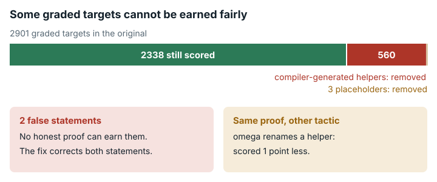

# Lean Analysis Proofs (`lean_analysis_proofs`)

**结论：** 修复在组件对照上得到验证；完整的发布集成尚待完成。<mark>解题者要证明的陈述中有两个是错的；原始评分器还给编译器生成的辅助声明计分，所以同一个定理的正确证明，换一种证明风格，得分可能不同。</mark>



*两个必证陈述是错误的，560 个隐藏的编译器生成辅助项也被计分，其中一些的计分方式取决于证明风格；修复版更正了这些陈述，并为 2338 个目标计分。*

## 任务要求

这个任务是用 Lean 4（一种让机器检验数学证明的语言）把陶哲轩的教科书 *Analysis I* 形式化。任务说明要求解题者 "finish **all** sorries in this folder"（完成此文件夹中的所有 sorry；`sorry` 是表示证明缺失的占位符）。它说 "we value minor progress"（我们重视小的进展），并提醒："do not modify the signature of existing lemma/theorem/def as these changes will not pass the judge evaluation."（不要修改现有 lemma/theorem/def 的签名，否则无法通过评测。）评分器（`eval_lean.py` 配合任务的 `ListDeclAxiom.lean`）把基线仓库中每个依赖 `sorryAx` 的声明都当作一个 1 分的目标。提交中同时满足两点，目标才得分：第一，同名声明只用公理 `propext`、`Classical.choice` 和 `Quot.sound`；第二，它打印出的类型文本与基线文本完全相同。原版共有 2901 个目标。类别：形式化数学与定理证明。

## 问题出在哪里

**1. 有两个目标陈述是错的。** 在安装好的环境中，任务自带的 Lean 打印出：

```
@Chapter11.MajorizesOn.anti_symm : ∀ {f g : ℝ → ℝ} {I : Chapter11.BoundedInterval},
  ∀ x ∈ ↑I, f x = g x ↔ Chapter11.MajorizesOn f g I ∧ Chapter11.MajorizesOn g f I
@Chapter11.PiecewiseConstantOn.div : ∀ {f g : ℝ → ℝ} {I : Chapter11.BoundedInterval},
  Chapter11.PiecewiseConstantOn f I → Chapter11.PiecewiseConstantOn f I → Chapter11.PiecewiseConstantOn (f / g) I
```

- 在 `anti_symm` 中，绑定符 `∀ x ∈ I,` 管到了整个 `↔`。于是这个陈述说的是：在一个点上相等，等价于两个函数在整个 `I` 上互相控制（都不小于对方）。反例：I = Icc 0 1，f = 0，g = id，x = 0。
- 在 `div` 中，两个假设都是关于 `f` 的，`g` 不受任何约束。反例：I = Icc 1 2，f = 1，g = id。
- 预期：按原意陈述写出的正确证明应该得分。实际：它打印出的类型不同，被判为 "type changed"（类型已改变）。不含 `sorry` 的提交都拿不到这两分。在别处用这些错误引理也得不了分，因为公理检查会追踪每一个依赖。

**2. 编译器生成的辅助目标让评分取决于证明风格。** Lean 编译一个定义或实例时，还会生成一些名字自动生成的隐藏辅助声明，例如 `X._proof_N`、`X._simp_N`、`X.eq_N` 和 `X.match_N`。父声明含 `sorry` 时，这些辅助项也依赖 `sorryAx`，所以评分器把它们单独列为目标。2901 个目标中有 559 个带有这样的名字（`evidence/scripts/lean_aux_names/aux_targets.txt`）；修复版的过滤器排除了 560 个，即这 559 个加上 `Chapter5.ExtendedReal._sizeOf_inst`，其父声明 `Chapter5.ExtendedReal` 是一个目标。任务从来没提过它们。只有正确的构建恰好生成一个**名字相同、打印类型也相同**的辅助项，这个辅助项才得分，而这取决于父声明是怎么证明的：

- **同样的事实，不同的策略。** setoid 的自反性和对称性用项模式或策略模式证明时，`PreInt.instSetoid._proof_1` 得分。同样的事实改用 `omega` 证明时，`omega` 先生成了自己的辅助项，原来的证明义务挪到了 `_proof_3`，这个目标被判为 "type changed"。两种证明都对，`omega` 那一种少得 1 分。
- **试过的每种风格都丢分。** 父声明 `Int.equivInt` 得了分，但 `Int.equivInt._proof_1..4` 在每个变体中都丢分：在 T、S、W 和 X 中为 "type changed"，在 U 中为三个 "type changed" 加一个 "disappeared"（已消失）。有的重新编号，有的合并成一个辅助项，还有一个把绑定符打印成 `∀ (h : PreInt) (b : PreInt)`，而不是 `∀ (a b : PreInt)`。
- **怎么证都拿不到。** 有 35 个目标的基线类型文本里含有 `sorry`（32 个辅助项加 3 个占位陈述，例如 `Chapter3.empty_function_bijective_iff : … ↔ sorry`），所以任何不含 `sorry` 的解法都会改变它们的类型。另外至少还有 12 个辅助项漏了一个分情形假设，记录的类型本身就是错的。

在单个模块（Section_4_1）上的抽样（原始评分器）：

| 变体 | 证明风格 | 分数 | 得分的目标 | `type_changed` | `disappeared` |
|---|---|---|---|---|---|
| orig（正确的测试提交） | 初始代码未改动 | 0 | 0/2901 | 0 | 0 |
| T | 项模式（`Iff.rfl`、`fun _ => rfl`、`⟨…, …⟩`）；equivInt 通过 `omega` | 26/2901 | 26 | 4 | 0 |
| S | 策略模式（`constructor`、`rw`、`omega`） | 26/2901 | 26（与 T 相同的集合） | 4 | 0 |
| U | 同 T，但 equivInt 的同余性不用 omega 证明；逆元律保留为 sorry | 25/2901 | 25 | 3 | 1 |
| W | 同 T，但 setoid 的 refl/symm 用 `omega` 证明 | 25/2901 | 25 | 5 | 0 |
| X | 同 T，另外证明了 `Int.decidableRel` 的空缺 | 28/2901 | 28 | 7 | 0 |

每个被正确证明的父声明都拿到了自己的分。变体 X 完成了 8 个父声明，它们带有 15 个辅助目标，X 拿到了这 15 个中的 8 个。父声明还没完成时，辅助项也可能得分，所以 T 有 11 个辅助项得分（包括 `Int.instCommRing._proof_8`、`_proof_9` 和 `Int.decidableRel._proof_4`），而它们并不都在已完成的父声明之下（`evidence/scripts/lean_aux_names/results.txt`；`evidence/reviews/lean_aux_name_scoring.md`）。

## 影响有多大

- 错误陈述：每个解题者都会丢掉 2901 分中的 2 分。单看这一点，分数上限为 2899/2901 = 99.93%；再算上下面的辅助目标，上限最多为 2852/2901 = **98.31%**（`evidence/reviews/lean_aux_name_scoring.md`）。
- 总的来说，即使解法完全正确、完整，**也至少有 2901 分中的 49 分（1.69%）拿不到**（类型中含 `sorry` 的 35 个、漏了假设的 12 个，以及 2 个错误陈述）。实际数字更可能在 57 分左右（1.96%）。
- 定义类父声明下最多有 466 个辅助分，原则上可能因证明风格而得失。抽样中，15 个里有 3 个因此丢分。这一点没有在整个仓库范围内测量。

## 修复

修复版在源码中改了两处，每处一个记号，并在评分器中加了一个目标过滤器。

- `Section_11_3.lean` 现在写作 `(∀ x ∈ (I:Set ℝ), f x = g x) ↔ …`。
- `Section_11_2.lean` 改为带有 `(hg: PiecewiseConstantOn g I)`（陶哲轩，引理 11.2.8）。
- 两处改动都同时写进评分器的基线仓库和解题者的初始代码。
- 评分器排除名字中带编译器生成部分（以 `_` 开头，或为 `match_N`、`eq_N`、`eq_def`、`congr_simp` 或 `proof_N`）的目标，也排除基线类型中含 `sorry` 的目标。每个被排除的辅助项都有一个仍是目标的父声明；父声明的公理检查会追踪每一个依赖，所以这些辅助项仍在检查范围内。
- 3 个占位陈述作为不计分的练习留在初始代码中。如果给它们计分，填进任何陈述都会被接受，包括平凡的陈述。
- 除此之外，类型匹配、允许的公理列表和分母规则都没有变。计分集合为 **2338 个目标**：2901 − 560 个生成项 − 3 个占位陈述。

| 变体 | 内容 | 版本 | `lake build` | 原始结果（得分目标的比例） | 得分 / 目标 | `type_changed` |
|---|---|---|---|---|---|---|
| orig | 未改动的初始代码（正确的测试提交） | 原版 | ok | 0 | 0/2901 | 0 |
| | | 修复版 | ok | 0 | 0/2338 | 0 |
| **A**（展示问题，带检查） | 证明了更正后的 div 和 anti_symm；证明了 `MajorizesOn.trans`；`ConstantOn.const_eq` 通过含 sorry 的 `Constant.const_eq` "证明" | 原版 | ok | 0.000345 | 1/2901（仅 trans） | 2（anti_symm、div） |
| | | 修复版 | ok | 0.001283 | 3/2338（anti_symm、div、trans） | 0 |
| BAD（无效） | 复合顺序颠倒的 `MajorizesOn.trans`（类型错误） | 原版 | **rc=1** | 无分数 | – | – |
| | | 修复版 | **rc=1** | 无分数 | – | – |
| T | 正确证明的 Section_4_1，项风格 | 原版 | ok | 0.008962 | 26/2901（15 个父声明 + 11 个辅助项） | 4 |
| | | 修复版 | ok | 0.006416 | 15/2338 | 0 |
| S | 正确证明的 Section_4_1，策略风格 | 原版 | ok* | 0.008962 | 26/2901（15 + 11） | 4 |
| | | 修复版 | ok | 0.006416 | 15/2338 | 0 |
| W | 正确证明的 Section_4_1，setoid 通过 `omega` | 原版 | ok* | 0.008618 | 25/2901（15 + 10） | 5 |
| | | 修复版 | ok | 0.006416 | 15/2338 | 0 |

\* 原版的 S 和 W 行来自单独的运行，使用同一镜像和逐字节相同的评分器。

在修复版中，项风格、策略风格和 `omega` 风格让同样的 15 个父声明得分，type_changed 为 0，disappeared 为 0，new_bad 为 0。原版中得分的每个父声明在修复版中也得分。除了两个更正后的陈述，修复版没有让其他目标新得分。借助一个仍是 `sorry` 的引理完成的证明，在两个版本中都不得分；带类型错误的证明在两个版本中都通不过 `lake build`。

**修复版的分数不能与原版比较。** 分母从 2901 变为 2338。辅助项分数去掉了：在原版中靠 `_proof_N` 得分的未完成实例证明，在实例完成之前都不得分。另有两个目标变得可以达到。同一份正确的提交在原版中得 26/2901 = 0.00896，在修复版中得 15/2338 = 0.00642。分数刻度的边界（`rescale`：线性，0.0 到 1.0）没有变，因为它们本来就是通过率的精确边界。原版的数字不能放到修复版的刻度上用。

## 我们如何检查

- **原始评分器，来自按摘要固定的公开镜像**（Lean 4.28.0）。未修改的评分器给上述六个 Section_4_1 变体评分。在评分器仓库中运行 `lake build ListDeclAxiom`，打印出 `SUMMARY checked=4743 bad=2901`。辅助目标按名字模式计数，并在镜像中逐个查了辅助项的父声明。
- **在 Lean 中的形式化检查。** 我们写了一个反驳文件，导入任务自己的 `Chapter11` 定义，在评分器镜像中用 `lake env lean` 运行（`--network none --memory 4g --cpus 2`）。Lean 内核证明了每个字面陈述的否定，针对的是已安装的定义，而不是 Mathlib（Lean 的数学库）里的类似定义。在 Lean 4.34.1 下的本地副本结果相同。两个更正后的陈述都在修复版评分器的仓库中有了不含 `sorry` 的证明。这些证明都只用公理 `propext`、`Classical.choice` 和 `Quot.sound`。
- **并排对照运行。** 原始评分器和修复版评分器在本地的评分器镜像中给上述测试提交评分。对照重复了三次，结果都没有变化（[`data/paired-repeatability.md`](../data/paired-repeatability.md)）。对 S 和 W，第一次原始评分器结果是更早的原生运行，在 `evidence/scripts/lean_aux_names/out/report_{S,W}.json.gz` 中（同一镜像，评分器逐字节相同），因此对 S 和 W，只有两次重复运行（`evidence/runs/lean_analysis_proofs-v2-paired-rep2/` 和 `-rep3/`）在并排作业中用原始评分器为它们评分。

## 局限

- 我们没有运行任何 AI 模型或解题者。影响只在我们写的测试提交和反例上展示。
- **没有构建修复版的工作镜像**，也没有拉取原始工作镜像。`Dockerfile.work` 假定解题者的初始代码位于 `/home/workspace/se-bmk-intern/analysis`，与评分器的源码相同，并归 `agent` 所有。这些都没有核实。
- **没有验证的部分及原因：镜像构建和实际的 `eval_cmd` 路径。** 评分器镜像解压后约 33 GB；运行 `materialize.sh`（含 Lean 重新构建）再加两个镜像的 `docker build`，约需 45 GB 可用磁盘，超过了本次审计所用 E2B 工作机的 21 GB：在对所有修复包做的干净机器重建检查中，评分器镜像无法在那里拉取（`evidence/runs/materialize-check-lean`，`no space left on device`；其余 31 个修复包均通过）。所以两个镜像都没有构建，原始的 `eval_cmd`（Mathlib `3203991`，完整重新构建）也没有在修复版上运行。在一台约有 45 GB 可用磁盘的机器上完成构建之前，这一点作为已记录的局限保留。
- 没有对修复版评分器镜像运行 `docker build`，而是测试了一种等价的安装方式：把相同的构件 tar 包和 `eval_lean.py` 放到原始镜像的对应路径上。Lake 重新构建了 0 个模块，列表与重新生成的列表逐字节相同。
- **并排对照运行使用的是评分器仓库中预先构建好的 Mathlib（`491a409`）。** 原始的 `eval_cmd` 会复制 `/home/workspace/baseline/.lake`（Mathlib `3203991`）并完全重新构建；这条路径没有运行。
- 证明风格测试只覆盖一个模块（Section_4_1）和六个变体。漏了假设的辅助项数和重复项数，是按文本得出的下界或估计。
- 没有检查修复版 2338 个目标中是否还有别的错误陈述；"两个"只是下界。
- 评测框架的 `total_tests` 统计评分器报告的每一项，包括提交新增声明所对应的零权重 "new bad declaration" 项，因此它可能超过 2901（在一次真实智能体运行中为 2905 到 2931，`evidence/runs/opus55-rollouts-meta/submission-histories.json`）。分数的分母只是基线权重（`eval_lean.py` 第 586–591 行），因此这些项不改变分数：例如 933 个得分目标的分数为 933/2901 = 0.3216，而 `total_tests` 为 2905。
- 修复版的名字过滤器按名字文本匹配。用户自己命名、恰好以 `eq_1` 之类结尾的声明也会被排除。这个基线中的 560 个匹配全部检查过，没有一个是用户命名的。

## 复现

- 评分器镜像：`sha256:41ece9c4…513b`。
- Section_4_1 抽样的变体哈希：T `3c7b39d1…`、S `c00db26b…`、U `ea9f1cd2…`、W `852fa9dd…`、X `878e14c8…`。
- 反驳：`evidence/scripts/lean_analysis_proofs/run_in_judge_image.sh`（运行 `Refute.lean`；输出 `judge-repo-run.log`）。基线转储：`evidence/scripts/lean_analysis_proofs/baseline-ListDeclAxiom.out`。
- 辅助项名字测试：`evidence/scripts/lean_aux_names/`（`make_variants.py`、`check_variants.sh`、`run_eval.sh`、`summarize.py`；结果在 `results.txt`）。
- 原始评分器与修复版评分器的并排对照运行：`repairs/lean_analysis_proofs-v2/paired/run_local.sh`（`repairs/lean_analysis_proofs-v2/` 是存放修复版的文件夹）；更正后陈述的证明在 `paired/lean/EbvV2Proofs.lean`。
- 审查记录：`evidence/reviews/lean_analysis_proofs.md`、`evidence/reviews/lean_aux_name_scoring.md`。
- 支持记录：`repairs/lean_analysis_proofs-v2/`（`README.md`、`paired/results.md`、`source-lock.json`）。
