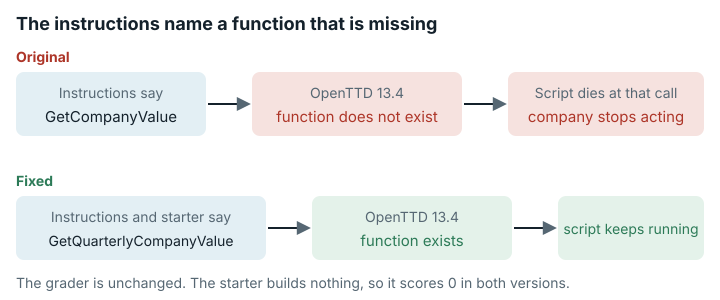

# OpenTTD Transport AI (`openttd_transport_ai`)

**结论：** 已修复。<mark>任务说明要求解题者最大化游戏函数 `AICompany.GetCompanyValue`，但固定的游戏版本里没有这个函数。调用它的脚本会崩溃，随附的初始程序第一次调用它就崩溃了。修复只改了任务说明和初始程序，没有改评分器。</mark>



*任务要求解题者调用一个不存在的游戏函数，因此初始程序在第一次调用它时就崩溃了；修复改动了任务说明和初始程序。*

## 任务要求

OpenTTD 是一款开源的运输公司模拟游戏。解题者要写 "a **Squirrel** AI in `my_ai/` that maximizes **company value** over 20 game-years, averaged across multiple random seed maps."（大意：在指定目录中编写一个 **Squirrel** AI，在多张随机种子地图上平均，使一段游戏年限内的**公司价值**最大化。）Squirrel 是 OpenTTD 里电脑玩家用的脚本语言。任务说明的目标一行写道 "Maximize **`AICompany.GetCompanyValue(AICompany.COMPANY_SELF)`**"。它还说 "A baseline AI that just logs company value is already in `my_ai/`; improve it"（大意：目录中已有一个只记录公司价值的基线 AI，请改进它）。类别：交互式游戏与模拟器。

## 问题出在哪里

**任务说明指定了一个不存在的函数。** NoAI API 是游戏提供给电脑玩家的接口，OpenTTD 13.4 的 NoAI API 里没有 `AICompany.GetCompanyValue`。随附的初始程序记一行日志，接着在主循环里（`main.nut` 第 5 行）调用它，随即崩溃。

```
dbg: [script] [0] [S] Your script made an error: the index 'GetCompanyValue' does not exist
dbg: [script] [0] [S] *FUNCTION [Start()] myai/main.nut line [5]
dbg: [script] The script died unexpectedly.
```

我们用原始评分器在初始程序上完整跑了一次。墙钟时间 **63 s**，退出码 0，请求的 5/5 个种子都有返回。

| 种子 | 公司价值 | 公司价值对应日期 | 资金 | 贷款 | 净资产 | 错误 |
|---|---|---|---|---|---|---|
| 0 | 0 | N/A | 54,191 | 100,000 | -45,809 | YES |
| 1 | 0 | N/A | 54,191 | 100,000 | -45,809 | YES |
| 2 | 0 | N/A | 54,191 | 100,000 | -45,809 | YES |
| 3 | 0 | N/A | 54,191 | 100,000 | -45,809 | YES |
| 4 | 0 | N/A | 54,191 | 100,000 | -45,809 | YES |

包装脚本打印出 `CASE 0000 WA score=0` 和 `TOTAL_SCORE 0`。

- 解题者照任务说明调用指定函数，预期能读到自己的公司价值。实际上脚本在这次调用处终止，公司不再行动。分数是它最后一个为正的季度价值，或者 0。
- 用任务提供的本地测试就能发现这个问题。出错的是任务说明，评分器本身没有错。

**任务说明对计分内容的描述也不对。** 目标一行把目标定义为 "vehicle value at 1.5× purchase + infrastructure value + cash − loans"（即车辆价值按购买价的一定倍数计，加上基础设施价值和现金，再减去贷款）。评分器读的是游戏自己算出的公司价值。按 OpenTTD 13.4 源码，这个值把车辆按其价值的 1.5× 计入，车站也计入，再加现金、减贷款，下限为 1。道路、铁轨等其他基础设施不计入。下表中的探测提交与此吻合。它有 8 个站点，没有车辆，现金减贷款为负，得分 4,975。按 [`METHOD.md`](../METHOD.md) 的判据，告诉智能体的规则与实际执行的规则不一致。解题者如果修铁轨或道路，指望它们增加价值，评分器计分时不会算上它们。我们没有测量影响大小。关于铁轨的结论来自阅读源码，没有专门跑过。

**评分器本身行为正确。** 它从游戏每月的存档文件里读公司价值。种子 0 的一次运行共有 239 个月度存档，从 1950-02-01 到 1969-12-01，可见游戏完整跑了 7,300 天。`old_economy[0].company_value` 在每个存档里都是 1，评分器的 `> 1` 过滤把它变成 0，所以什么都不做的公司得 0 分。有 239 个存档、最后日期为 1969-12-01 时，"最后的季度价值"对应 1969-10 这一季度。OpenTTDLab（运行游戏的库）给出的 `error` 标志会打印出来，但不影响分数。

**这次运行没有运行时间问题。** 单个种子耗时 55.4 s，约 **9,750 ticks/s**，远高于所需的约 150 ticks/s。5 个种子一共 63 s，而 `eval_timeout` 是 3600 s。

## 影响有多大

解题者如果照任务说明调用指定函数，可能丢掉全部分数。在本地测试过、改用其他函数的解题者不受影响。

## 修复

修复版位于 `repairs/openttd_transport_ai-v2/`（存放修复版的文件夹）。

- **任务说明。** `work.agent_query` 的目标段落现在写明，OpenTTD 13.4 没有 `AICompany.GetCompanyValue`，调用它脚本就会停止。取当前值用 `AICompany.GetQuarterlyCompanyValue(AICompany.COMPANY_SELF, AICompany.CURRENT_QUARTER)`，取当前季度开始时记下的值用季度 `1`。新文本改正了公式，车站计入，其他基础设施不计入，下限为 1。它还说明了分数的读法。每个种子取游戏结束前最近一个季度边界处的值（没有就退回更早的、大于 1 的季度，再没有就取 0），然后对 5 个种子求平均。
- **初始程序。** `my_ai/main.nut` 第 5 行改为调用 `GetQuarterlyCompanyValue(AICompany.COMPANY_SELF, AICompany.CURRENT_QUARTER)`。`Dockerfile.work` 以原始工作镜像的摘要为基础，构建修复版工作镜像（压缩后约 0.46 GB）。`work.image_tag` 改为 `f2e9a9fb0fff-ebv-v2`。
- **游戏代码里的依据。** 在 OpenTTD 13.4 源码中，`GetQuarterlyCompanyValue` 遇到 `CURRENT_QUARTER` 时返回 `CalculateCompanyValue(c)`，其他情况返回 `old_economy[quarter - 1].company_value`。缓存的 13.4 程序里有 `GetQuarterlyCompanyValue` 这个名称，没有 `GetCompanyValue`。一个探测脚本报告 `has_GetCompanyValue=false has_GetQuarterlyCompanyValue=true`。
- 评分器镜像、`eval_cmd`、解析器和分数刻度（`log_max`，参考点为 1e5 到 1e9）都不变，所以每份提交在原始版和修复版下得分相同。

下表是并排对照运行的结果（完全按原始 `eval_cmd`，5 个种子，20 个游戏年；摘自 `paired/results.md`）。`TOTAL_SCORE` 是原始结果（换算为 0–100 分之前）。

| 测试提交 | 随附于哪个任务版本 | 脚本是否崩溃？ | `TOTAL_SCORE`，原始版 | `TOTAL_SCORE`，修复版 | 每个种子的公司价值（评分器读到的） | 错误标志（5 个种子） |
|---|---|---|---|---|---|---|
| baseline_v1（随附的初始程序） | 原始版 | 是，在 `main.nut` 第 5 行 | 0 | 0 | 5 个种子均为 0 | 5/5 YES |
| probe_min（每月调用正确的函数） | 遵循修复版任务说明 | 否 | 0 | 0 | 5 个种子均为 0 | 0/5 |
| baseline_v2（修复版初始程序） | 修复版 | 否 | 0 | 0 | 5 个种子均为 0 | 0/5 |
| probe_value（价值为正的测试提交） | 遵循修复版任务说明 | 否 | 4975 | 4975 | 5 个种子均为 4,975 | 0/5 |

展示问题的测试提交就是随附的初始程序，它在同一评分器上的结果如下。

| 初始程序 | 脚本是否崩溃？（原始版） | 脚本是否崩溃？（修复版） | `TOTAL_SCORE`，原始版 | `TOTAL_SCORE`，修复版 |
|---|---|---|---|---|
| 随附的初始程序（原始工作镜像 vs 修复版工作镜像） | 是，在 `main.nut` 第 5 行 | 否 | 0 | 0 |

- 空闲的探测提交得 0 分，因为空闲公司的价值停在下限 1（现金减去 100,000 的贷款为负），评分器把它记为 0。这些提交只说明脚本活了下来，不说明能拿到正分。
- 两个探测提交在每个种子上最后记下的 `GetQuarterlyCompanyValue(SELF, 1)`，都等于评分器用的 `old_economy[0].company_value`。`probe_value` 的这个值是 4,975，而结束时 `CURRENT_QUARTER` 的当前值是 4,858。

**分数兼容性：** 作为同一测试框架下的测量，两版分数可以比较。但原始版的解题者如果照任务说明调用了那个不存在的函数，那么用分数衡量解题者能力时，两版不可比。

## 我们如何检查

- **在按摘要固定的原始镜像中运行原始评分器。** 原样的 eval_cmd，即 `cd /home/workspace/openttd_ai && OPENTTD_N_SEEDS=5 python3 /tmp/eval_openttd.py`，在评分器镜像中离线运行（`--network none --memory 6g`），外面套 `timeout 2600`。主机有 8 个 vCPU，5 个种子并行跑。提交是工作镜像里随附的初始程序 `my_ai/`。OpenTTD 13.4 和 OpenGFX 7.1（游戏的图形素材集）事先已缓存在镜像中。
- **存档文件检查。** 种子 0 的诊断脚本（`diag1.py`）用评分器自己的参数调用 `run_experiments`，打印每一行存档记录。
- **原始版与修复版的并排对照运行。** 结果见上面的表格。我们重复了三次，结论不变（[`data/paired-repeatability.md`](../data/paired-repeatability.md)）。

## 局限

- 没有运行任何 AI 模型或解题者。影响只在随附的初始程序和我们写的探测提交上演示过。
- 两个版本的评分器镜像相同，所以并排对照运行中每份测试提交只评了一次分，`TOTAL_SCORE` 的原始版和修复版两列填的是同一个分数。两版的区别只在解题者拿到的初始程序和任务说明。
- 原始结果为正的测试提交只有一个探测提交（4,975，远低于分数刻度的下参考点 1e5，所以在 100 分制下是 0 分）。公司价值不超过 1e5 时，100 分制下一律 0 分，所以从 0 分看不出脚本是崩溃了还是只是弱。我们没有测试上参考点 1e9 能否达到。
- 任务说明写的文档路径（`docs/noai_api_docs/`）和实际路径（`docs/openttd_reference_docs/noai_api_docs/`）不一样。随附的 HTML 文档看起来来自比 13.4 更新的 OpenTTD 版本（里面讲到了 `AIEconomyTime` 和经济季度）。解题者如果调用了文档里有、13.4 却没有的函数，脚本同样会停止，和原始初始代码一样。这两点都记为已知局限，没有改。要纠正它们就得改任务说明（`agent_query`），还需要再做一次并排对照运行。
- 我们在一台干净的机器上用修复包从零重建过工作镜像（`evidence/runs/materialize-check-g3`，`status: exit=0`）。在重建出的镜像里，修复后的 `main.nut` 的 sha256 与锁定值一致。
- ticks/s 数值来自一台主机上的空闲脚本。运营大量车辆的 AI 会更慢，我们没有测量慢多少。

## 复现

- 原始评分器镜像：`sha256:27167956fd00…`。
- `evidence/runs/openttd_transport_ai-native-baseline/run.sh`（完整运行）和 `evidence/runs/openttd_transport_ai-native-saves-diag/run.sh`（配合 `diag1.py`）。运行它们需要一台能拉取固定镜像的 Docker 主机。
- 审查：`evidence/reviews/openttd_transport_ai-native.md`。
- 修复与并排对照运行：`repairs/openttd_transport_ai-v2/`（先运行 `paired/stage.sh`，再运行 `tools/e2b_run.py`）。
