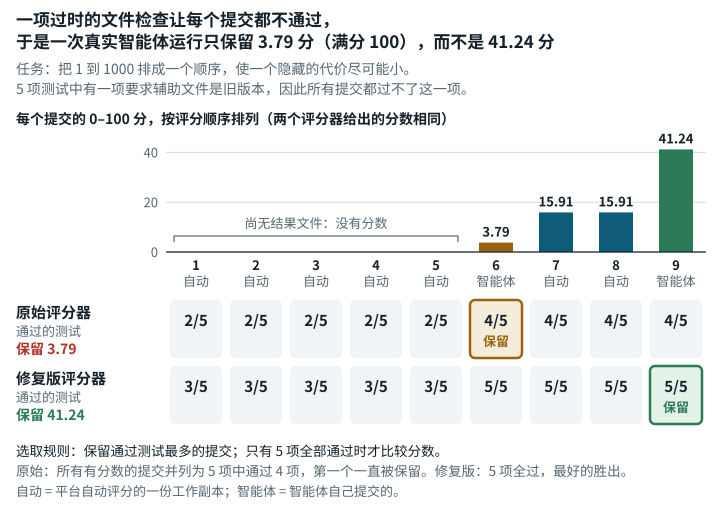

# Order Addition Permutation Optimization (`order_addition_permutation_optimization`)

**结论：** 已修复。<mark>一项文件完整性测试期望的是辅助文件的一个过时指纹，所以每份提交都有五项测试中的一项不通过。按本任务挑选一次运行最佳提交的规则，运行会一直停在第一份有分数的提交上，忽略之后更好的提交。</mark>

*一项过时的文件检查让一次真实智能体运行只保留了 3.79 分（满分 100），而后来的一份提交其实得了 41.24 分。智能体要把 1 到 1000 排成一个顺序，使一个隐藏的代价尽可能小。5 项测试中有一项要求辅助文件是旧版本，所以每份提交都过不了这一项。运行保留通过测试最多的提交，只有 5 项全部通过时才比较分数，因此所有有分数的提交都以 5 项过 4 项并列，运行一直保留第一份。修复版改正了所要求的文件版本后，有分数的提交都通过 5 项，各自分数不变，运行保留 41.24 分。*

## 任务要求

任务说明要求给出 1..1000 的一个排列（一种排序），让一个黑箱的响应尽量小。它列出了 "the evaluator will check"（评测器将检查）的几项，包括不访问私有内容；基线文件没有改动；`final_result.txt` 存在；`final_pai` 是有效排列；`final_cost` 与重新算出的成本一致。

连续分数则 "calculated using `score_cost_num(cost, num)` from the evaluator-side private `tests/score_vcpom_result.py`"（使用评测器一侧私有文件中的计分函数计算）。约定里没有一处提到辅助文件的指纹。解题者也左右不了它，因为 `tests/` 不在提交范围内。类别：组合优化。

## 问题出在哪里

**有一项测试总是失败。** `test_private_judge_files_are_available` 断言已安装辅助文件的 sha256 指纹等于 `3023b9a4…`。这是早先那版带中文注释的辅助文件的指纹。后来某个镜像层把辅助文件换成了英文注释的译本 `337837af…`，期望值却没有跟着改。两版辅助文件只在注释、一个文档字符串和示例标签上有差别，`parse_result_file` 和 `score_cost_num` 的行为完全一样。这项检查没有任何前提条件，每份提交都过不了。

- **每份提交的分数没有错。** 失败的只有这一项。其余四项照常运行，`TOTAL_SCORE` 也用已安装的辅助文件计算。
- **通过率有上限。** 完全正确的提交，通过率也只有 0.8，到不了 1.0。
- **一次运行的最佳提交不再更新。** 本任务的规则（`pass_rate_first`）保留通过测试最多的提交。两份提交的通过率都是 1.0 时，它才比较分数。否则，较晚的提交必须通过率严格更高才能胜出。每份提交的通过率最多 0.8，而有分数的提交都能达到这个上限，所以这次运行的 `best_score` / `best_round` 一直停在**第一份**有分数的提交上。

举一个原始评分器下的例子。两份有效提交，先交恒等排列，再交搜索结果。恒等排列得分 3.3e-09，搜索结果分数更高。本应选中搜索结果，评分器实际选中的却是恒等排列，忽略了后面更好的提交。

## 影响有多大

一次运行只要有不止一份有效提交，而且后交的得分更高，记下的分数就会变，因为这次运行的最佳分数不反映后来的改进。有些使用方取所有提交的最大值，结果就与顺序无关。所以某个已发布的数字是否有错，要看它是哪个使用方算出来的。每份提交自身的分数不受影响。

**真实智能体运行。** 我们取了第三方一次 Claude Opus 5.5 运行（四小时）的全部 9 份提交，用原始评分器和修复版评分器各重新评了一遍（`evidence/runs/opus55-regrade2-oa/`，`result/worker.json` 为 `status: exit=0`；汇总见 `evidence/runs/opus55-regrade2-summary/summary.json`）。每份提交在两种评分器下分数完全相同。有分数的 4 份提交在原始评分器下通过 4/5 项测试，在修复版下通过 5/5 项。较早的 5 份自动提交当时还没有 `final_result.txt`，在原始评分器和修复版下分别通过 2/5 和 3/5 项。结果，原始评分器保留了这次运行第一份有分数的提交，3.79 分（满分 100），修复版评分器保留了最后一份，41.24 分。

## 修复

修复版只改了 `tests/test_final_result.py` 里的一个值，把 `EXPECTED_SCORE_HELPER_SHA256` 改成已安装辅助文件的指纹 `337837af…`。辅助文件、`.so`、基线文件、任务说明、智能体的工作镜像、解析器、挑选最佳提交的规则和分数刻度都不变。任务 JSON 只改了 `judge.image_tag`。

| 提交 | 角色 | 评分器 | 通过的测试 | pass_rate | 原始 TOTAL_SCORE | 100 分制得分 | 失败的测试 |
| --- | --- | --- | --- | ---: | ---: | ---: | --- |
| identity | 有效 | 原始版 | 4/5 | 0.80 | 3.3e-09 | 3.3e-09 | 指纹 |
| identity | 有效 | 修复版 | **5/5** | **1.00** | 3.3e-09 | 3.3e-09 | – |
| search | 有效，更好 | 原始版 | 4/5 | 0.80 | 0.0093733018 | 0.0093733018 | 指纹 |
| search | 有效，更好 | 修复版 | **5/5** | **1.00** | 0.0093733018 | 0.0093733018 | – |
| badcost（谎报成本） | 无效的测试提交 | 原始版 | 3/5 | 0.60 | 无 | 无 | 指纹、成本不符 |
| badcost | 无效的测试提交 | 修复版 | 4/5 | 0.80 | 无 | 无 | 成本不符 |
| dup（不是排列） | 无效的测试提交 | 原始版 | 3/5 | 0.60 | 无 | 无 | 指纹、排列 |
| dup | 无效的测试提交 | 修复版 | 4/5 | 0.80 | 无 | 无 | 排列 |

下表是一次运行中最佳提交的选择结果（任务规则 `pass_rate_first`，用 EdgeBench 的 `select_best` 计算）。

| 提交顺序 | 原始评分器选中 | 修复版评分器选中 |
| --- | --- | --- |
| identity, search | **identity**（3.3e-09），卡在第一份 | **search**（0.00937） |
| search, identity | search（0.00937） | search（0.00937） |
| dup, identity, search | **identity**（3.3e-09） | **search**（0.00937） |
| badcost, identity, search | **identity**（3.3e-09） | **search**（0.00937） |

**分数兼容性：** 每份提交的原始结果和 100 分制得分逐位不变。通过率会变，合法提交原来是 4/5，现在是 5/5。一次运行只要有不止一份有效提交、且后交的得分更高，`pass_rate_first` 下这次运行的 `best_score` / `best_round` 就和原始版不可比。原始版保留第一份，修复版保留最好的一份。

## 我们如何检查

- **原始评分器。** 在按摘要固定的原始公开镜像里，算出已安装辅助文件的哈希，和测试期望的值比较。在 `--network none --memory 2g --cpus 2` 下，用原始 `eval_cmd`（`python -m pytest tests/test_final_result.py -s -v`）评有效和无效的测试提交。
- **最佳提交选择。** 把保存的日志依次交给 EdgeBench 测试框架（`sforge`，版本 `6e4e5f4`）自带的 `grade_output`、`rescale_score` 和 `select_best`。
- **形式化检查（TLA+）。** 我们为选取规则建了一个有界模型，逐行对应 `selection.py` 和 `grading.py`。模型检验遍历 5,421,361 个状态，没有违例。另外三个配置（`k1`–`k3`）如说明所述出现违例（`evidence/formal/tla/order_addition_permutation_optimization/`、`evidence/formal/notes/order_addition_permutation_optimization.md`）。
- **原始版与修复版评分器的并排对照运行。** 每份提交都在全新的 `--network none` 容器里经 TaskSpec 的 `eval.sh` 运行。我们事先确认过每个镜像都收集到 5 项测试。一共重复了三次，结论不变（[`data/paired-repeatability.md`](../data/paired-repeatability.md)）。

## 局限

- 除了上面重新评分的真实运行，影响只在我们写的测试提交和反例上演示过。这次真实运行只是一个模型的一次四小时运行，不是 12 小时的排行榜运行。
- 这些提交都很简单，即恒等排列和短时间的随机交换搜索（30 s 和 60 s），离参考成本很远。不过最佳提交的选择与分数高低无关。
- 最佳提交是用 EdgeBench 的 `select_best` 在保存的报告上算出来的，没有经过实际运行的 `judge_server`。我们没有运行智能体的工作镜像。
- 我们没有统计过去排行榜的运行里有多少次出现了后来更好的提交。
- 早先的辅助程序（`3023b9a4…`）没有保存在本仓库，所以“两个辅助程序只在注释上不同”这一说法依赖早先的提取结果。分数不受这一点影响，因为两版都用已安装的辅助程序评分。
- 修复版镜像没有发布到镜像仓库，用户要用修复包里的 `materialize.sh` 和 `Dockerfile` 自行构建。我们在一台干净的机器上从零重建过（`evidence/runs/materialize-check-g2`，`status: exit=0`）。
- 修复还改变了测试框架的一个回退行为。选中的提交没有分数时，`pass_rate_first` 报告 `best_score = pass_rate`（`sforge/harness/selection.py`，`_pass_rate_first`）。所以只有无效提交的运行（例如 badcost），原始版报告 0.6，修复版报告 0.8。两个版本里，这个值都高于这里测到的任何一份有效提交的分数（100 分制下 3.3e-09 到 0.0094，见上表），所以一次全部无效的运行报出的 `best_score` 反而比这些有效运行高。

## 复现

- 原始评分器镜像：`sha256:6d1a1506…`。
- 脚本：`evidence/scripts/order_addition_permutation_optimization/run_judge.sh`、`make_result.py`、`grade_and_select.py`。保存的日志位于 `observed/`。
- 并排对照运行：`repairs/order_addition_permutation_optimization-v2/paired/run.sh`（结果位于 `paired/results.md`）。
- 补丁：`repairs/order_addition_permutation_optimization-v2/repair.patch`。
- 支撑记录：`repairs/order_addition_permutation_optimization-v2/`（存放修复版的文件夹：source-lock.json、并排对照运行的输出记录）。
