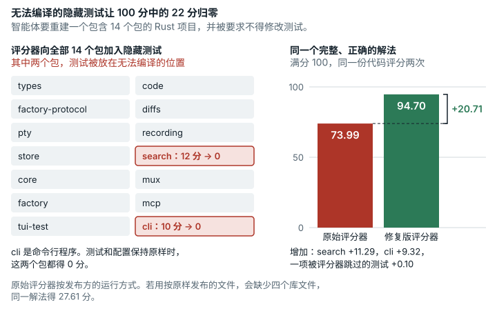

# Rust Multicrate Reconstruction (`rust_multicrate_reconstruction`)

**结论：** 已修复。<mark>原始评分器把隐藏测试插到了编译不过的位置。解题者只要按任务要求不动测试，cas-search（12 分）和 cas-cli（10 分）这两个 crate 就整个得 0 分。另外，Cargo 遇到第一个失败的测试文件就停下，评分器又把没跑的测试算作失败。在发布方的评分环境里，一份完整的解法得 73.99 分（满分 100），修复版下得 94.70 分。已发布的镜像还缺四个随附依赖（vendored）文件，直接用随附镜像评分，同一解法只得 27.61 分。发布方自己的评分不受这一点影响。</mark>

*只要解题者不改动测试和配置，无法编译的隐藏测试就会让 100 分中的 22 分归零。智能体要重建一个包含 14 个包的 Rust 项目，任务要求它不得修改测试。评分器向全部 14 个包加入隐藏测试，但在 search（12 分）和命令行程序（10 分）这两个包里，把测试放在了无法编译的位置，所以两者都得 0 分。同一个完整、正确的解法，在发布方运行的原始评分器下得 73.99 分（满分 100），在修复版评分器下得 94.70 分。修复版把隐藏测试放在能编译的位置，还会运行原始评分器在先前失败后跳过的测试。*

## 任务要求

任务写道 "Complete the missing Rust implementations in the unpacked CAS workspace."（在解压后的 CAS 工作区中补全缺失的 Rust 实现。）并补充说 "the hidden evaluator runs additional tests for the same public crate and CLI contracts"（隐藏评测器会针对同样的公开 crate 和 CLI 约定运行额外的测试）。crate 是 Rust 的包，工作区中共有 14 个。

分数是 10 个层级的加权和，每个层级按自己的测试贡献 `weight × passed / total`（`score.py` 第 29-38 行和第 390 行）。cas-search 单独成为层级 L5（权重 12，136 项测试），cas-cli 单独成为层级 L9（权重 10，1344 项测试）。cas-pty 和 cas-recording 两个 crate 合为层级 L3（权重 4，40 项测试）。任务禁止修改测试（"Do not edit … tests"，`TASK.md`；"Do not delete, weaken, or bypass tests"，`SPEC.md`；即不得修改、删除、削弱或绕过测试）。类别：系统与软件工程。

## 问题出在哪里

我们找到四个缺陷。前三个会改变发布方自己评分环境里的分数，因而也改变已发布的排行榜。第四个只影响用已发布镜像评分的人。

**1. 编译不过的隐藏测试（cas-cli 和 cas-search）。** 评分器把每段隐藏测试代码追加到测试文件末尾；如果是源文件，就追加到最后一个 `#[cfg(test)]` 模块的末尾（`score.py` 中的 `inject_hidden_tests`）。在两个 crate 里，这个位置不对。

- **cas-cli。** `cas-cli/tests/proptest/search_properties.rs` 里有四项隐藏测试，用的是 `proptest!` 语法（`fn search_never_crashes(query in search_query_strategy())`）。初始文件保留了这个文件的 `proptest! { … }` 块，只是去掉了这些测试。评分器把它们追加在块的后面，而这种语法在块外不合法。文件编译不过（`expected one of ':', '@', or '|', found keyword 'in'`；`functions used as tests can not have any arguments`），cas-cli 在 1344 项中得 0。
- **cas-search。** 有三项隐藏测试是 `#[tokio::test]` 异步测试，在上游代码里位于 `#[cfg(feature = "parallel")]` 模块内：`src/hybrid.rs` 和 `tests/hybrid_integration.rs` 里的 `test_async_hybrid_search`，以及 `src/bm25_tests/tests.rs` 里的 `test_async_remove`。评分器把它们放到了这些模块外面。在那里，它们要用可选依赖 `tokio`，还要用只有开启该 feature 才有的 `search_async` 和 `AsyncBm25Index`。cas-search 编译不过，在 136 项中得 0。

编译器信息见 `evidence/runs/rust_multicrate_reconstruction-v2-paired-r2-starter/result/out/origcc/diag.txt`。只有当文件里已经出现每个隐藏函数名时，评分器才会跳过这个文件。对 cas-cli，唯一的办法是写出隐藏测试的确切名称，而解题者不可能知道这些名称。对 cas-search，解题者还可以把该 crate 的 `parallel` feature 设成默认开启（`crates/cas-search/Cargo.toml` 声明了 `parallel = ["tokio"]`，且 `default = []`），不用改任何测试。这条路我们没有试，任务里也没有任何线索指向它。所以一个按规则作答、不动测试也不动 crate feature 的解题者，在 L5 和 L9 上得 0 分。

**2. Cargo 遇到第一个失败的测试文件就停下。** `run_crate_test` 运行 `cargo test --frozen -p <crate> -- --test-threads=4`，没带 `--no-fail-fast`（`score.py:266-268`）。一个 crate 的某个测试二进制失败后，Cargo 不再运行后面的任何二进制（集成测试文件、文档测试），评分器又把没跑的测试加进失败数（`:329-331`）。损失大小取决于失败出现在什么位置，与通过了多少测试无关。例如，cas-pty 库测试里有一项预期中的已知失败，它让 cas-pty 唯一的文档测试跑不起来，所以完整的解法只得 11 项中的 10 项，拿不到 11/11。

**3. 豁免测试的计分（早先的发现）。** 评分器给每个 crate 豁免一项已知会失败的测试。一个 crate 只要有至少一项失败，而被豁免测试的名字出现在测试输出的任何地方，评分器就把一项失败改记为通过，不检查那项测试是否真的失败了。所以，被豁免的 cas-pty 测试通过、另一项 cas-pty 测试（例如 `test_pty_config_default`）失败时，原始评分器报告 PASS，通过 11、失败 0，正确结果应是 TEST_FAIL，通过 10、失败 1。一份按规则作答、只是没做完的解法就可能碰上这种情况，因为被豁免的测试只检查参数是怎样构造的。

**4. 缺失的随附依赖文件（仅限已发布的镜像）。** 评分器解压的归档 `cas_rust_benchmark.tar.gz`（44,858 个条目）里，没有一条路径位于名为 `target` 的目录下。所以随附依赖中的 `cc` 1.2.55 crate 缺了 `src/target/{apple,generated,llvm,parser}.rs`，而它的 `.cargo-checksum.json` 列着这些文件。741 个随附依赖 crate 中只有 `cc` 缺文件。Cargo 拒收这个 crate，于是用 `cc` 构建的 9 个 crate 都得到 `TEST_CRASH`，它们是cas-code、cas-recording、cas-store、cas-search、cas-core、cas-mux、cas-factory、cas-mcp 和 cas-cli。`eval_cmd` 会替换提交中的 `vendor-deps/`，解题者没法补上这些文件，工作镜像里也同样缺（`cargo build --frozen -p zstd-sys` 失败，报 `failed to open file …/cc/src/target/apple.rs`）。

发布方的评分不受影响。只补回这四个文件，原始评分器给未改动的初始项目打 3.8189 分，与发布方记录的结果（归档中的 `judge/skeleton-score.json`）完全一致，总分、公开分（3.3913）、通过测试数（66），以及每个 crate 的状态和计数都对得上。用随附归档评分则得 1.4711。可见发布方评分时 vendor 目录是完整的。归档大概是后来打包的，打包时排除了 `target` 目录，`cc/src/target/` 也跟着删掉了（推断）。已发布的分数与此相符，最高到 57.8（`tasks/README.md:131`），比用随附镜像时完整解法能拿到的 27.61 还高。

**解题者自己加的测试也会计分（不算一项发现）。** 评分器原样复制解题者的工作区，追加隐藏测试，再统计 `cargo test` 输出里每个 `N passed;` 和 `N failed;`（`score.py:286-291`）。crate 的总数取 `max(listed tests, EXPECTED_TOTALS)`（`:263-264`、`:329`）。所以解题者自己写的单元测试或文档测试，既计入通过数，也计入总数，尽管任务 README 说分母是固定的（"The current fixed scoring denominator is `RAW_TOTAL=2611`"；`RAW_TOTAL` 确实固定，但各层级分数用的是每个 crate 的总数）。原始评分器和修复版在这一点上相同，我们没有测量它对真实提交的影响。两者还有一点相同，多出一项通过的测试可能掩盖一项缺失的预期测试。但这只在删除或重命名公开测试时才会发生，而任务禁止这样做。

## 影响有多大

**对已发布的排行榜。** 发布方评分时这四个随附依赖文件是在的（上文缺陷 4），所以该比的是“原始评分器加上这些文件”和修复版。下表是用任务的 `eval_cmd`、在相同的提交字节上测得的结果（`repairs/rust_multicrate_reconstruction-v2/paired/results.md`）。

| 提交 | 原始评分器 + cc 文件 | 修复版 | 变化 |
|---|---|---|---|
| 未改动的初始项目 | 3.8189 | 5.7236 | +1.9047 |
| 完整解法（上游代码） | 73.9926 | 94.7022 | +20.7096 |
| 同上，但有一个 cas-search 模块未完成 | 73.9926 | 93.9963 | +20.0037 |
| 错误对照：默认终端尺寸错误 | 73.8926 | 94.6022 | +20.7096 |

- 完整解法的增益为 cas-search 12 × 128/136 = 11.2941，加 cas-cli 10 × 1252/1344 = 9.3155，再加 Cargo 不再跳过的 cas-pty 文档测试 4 × 1/40 = 0.1000，合计 20.7096（`paired/results.md`，参考一节）。
- **单看 fail-fast 的影响**，我们用去掉 `--no-fail-fast` 的修复版给相同提交评分来测量。完整解法少 0.4348（94.7022 对 94.2674，来自 cas-pty 的文档测试，以及属性测试二进制因桩策略失败后才会运行的 45 项 cas-cli 测试）。部分解法少 3.2583（93.9963 对 90.7380，还要加上库测试失败后的 32 项 cas-search 测试）。初始项目少 0.9884（5.7236 对 4.7352）。
- **任何提交的最大可能增益：29.22 分。** 在原始评分器下，只要运行不改测试，cas-search 和 cas-cli 都是 0 分，所以修复版最多能补回它们的全部权重，即 12 + 10 = 22。在其他各个 crate 里，fail-fast 只会让位于第一个测试二进制（库测试，总会运行）之外、本来能通过的测试丢分。这些测试的数目来自一次把所有二进制都跑了的运行（`evidence/runs/rust_multicrate_reconstruction-failfast-paired-r3/result/out/raw/v2-*`），cas-mux 除外。被忽略的测试永远不会通过，所以不算在内。
  - cas-factory-protocol：45 项集成测试和 5 项文档测试，10 × 50/196 = 2.5510（层级 L2，196 项测试）；
  - cas-factory：38 项集成测试，8 × 38/171 = 1.7778（L7，171 项测试）；
  - cas-store：21 项集成测试，15 × 21/216 = 1.4583（L4）；
  - cas-tui-test：10 项集成测试和 3 项文档测试，5 × 13/121 = 0.5372（L8，121 项测试）；
  - cas-pty：1 项文档测试，4 × 1/40 = 0.1000（L3）；
  - cas-mux：`--list` 列出的 17 项集成测试（`raw/v2-cas-mux-19.stdout`；一项都没有运行，因为该 crate 在终端桩中崩溃，见 `raw/v2-cas-mux-20.stderr`），8 × 17/171 = 0.7953（L7）。

  其余 crate 没有别的含可通过测试的二进制。合计 22 + 7.2196 = 29.2196。在测过的每份完整解法里，cas-mux 都在终端桩中崩溃，这在评分器的预期之内，两个版本都得 0 分。扣掉它的份额，最大值是 28.4243。这些计数只算随附的测试，不含解题者自己加的测试。
- 反方向上，豁免修复每次评分最多让分数降 4/40 = 0.1000，也就是一项被错误放过的 cas-pty 失败。cas-cli 的豁免不变，最多能加 10/1344 = 0.0074。
- 一次运行在 cas-search 和 cas-cli 上做得越多，增益越大，所以排名可能改变。

**直接用随附的已发布镜像时**，有 9 个 crate 构建不了，完整解法得 27.6091 分，初始项目得 1.4711 分。这只影响用这些镜像评分的人。修复版也补回了这些文件。

## 修复

所有改动都在评分器镜像的 `cas_rust_benchmark.tar.gz` 里，由修复包的 `Dockerfile` 重写，`eval_cmd` 不变。修复包：`repairs/rust_multicrate_reconstruction-v2/`。

- **`judge/tools/score.py`**：测试改用 `cargo test --frozen --no-fail-fast -p <crate> -- --test-threads=4` 运行，每个测试二进制都会跑到。对 cas-pty，只有被豁免的测试确实在失败名单里，才算豁免（即前文说的单条件修复）。cas-cli 的规则不变。测试发现（`--list`）不变。
- **cas-cli 的隐藏测试**：把四项隐藏属性测试包进单独的 `proptest! { #![proptest_config(ProptestConfig::with_cases(20))] … }` 块，配置与初始文件中的块相同。
- **cas-search 的隐藏测试**：三项异步测试各加上 `#[cfg(feature = "parallel")]`，也就是它们在上游模块里带的条件。评分器用默认 feature，这些测试不会编译，与上游一致。
- **随附依赖文件**：补回四个 `vendor-deps/cc/src/target/*.rs` 文件，与 crates.io 上 `cc-1.2.55.crate` 里的完全相同，其 sha256 与随附 `.cargo-checksum.json` 中记录的包 sha256 一致。`Dockerfile.work` 也把它们放进工作镜像，解题者可以离线构建每个 crate。
- **`task.json.in`**：只改了两个镜像标签，改为 `…-ebv-v2`。

**分数与原始排行榜不可比。** 在发布方的环境里，完整解法从 73.99 变成 94.70。两个版本下，完整解法都到不了 100，因为被忽略的测试记为失败，cas-mux 也按评分器的预期在终端桩中崩溃。

## 我们如何检查

- **并排对照运行。** 每份提交用相同的提交字节、按任务的 `eval_cmd` 原样评分，每份提交占一个 E2B 工作节点（`--network none`，cargo/rustc 1.88.0），分别在三个镜像里运行。第一个是按摘要固定的原始评分器镜像，第二个是同一镜像只补上四个随附依赖文件（发布方的环境），第三个是在工作节点上用 `materialize.sh` 和 `Dockerfile` 构建的修复版。提交如下：
  - 初始项目；
  - 参考解法：把初始项目里 507 个含 `todo!()` 的文件换成上游 CAS v1.0.0（`github.com/codingagentsystem/cas`，版本 `a0a4b5ad`）。其中 182 个文件带有隐藏测试，我们删掉这些隐藏测试函数，让评分器像对待任何解题者那样把它们注入；
  - 部分解法：参考解法，但 `cas-search/src/metrics.rs` 保持初始文件的样子；
  - 错误对照：参考解法，但 `PtyConfig::default()` 返回 25 行（`test_pty_config_default` 期望 24）。

  | 提交 | 原始评分器 | 原始评分器 + cc 文件 | 修复版 |
  |---|---|---|---|
  | 初始项目 | 1.4711 | 3.8189 | 5.7236 |
  | 参考解法 | 27.6091 | 73.9926 | 94.7022 |
  | 部分解法 | 27.6091 | 73.9926 | 93.9963（cas-search 120/136，对比 128） |
  | 错误对照 | 27.5091 | 73.8926 | 94.6022（cas-pty 10/11，失败 = 1） |

  作业 `evidence/runs/rust_multicrate_reconstruction-v2-paired-r2-{starter,reference,partial,bad}` 都是 `status: exit=0`，我们收集了每一组的 `score-results.json`。在修复版里，部分解法和错误对照照样丢掉它们做错的测试（8 项 cas-search 测试、1 项 cas-pty 测试）。第 1 轮作业（`…-v2-paired-{starter,reference,partial}`）的原始分数和“+ cc 文件”分数与此相同。那一轮用的是第一版修复包，没有改 cas-search，我们正是在那一轮发现了 cas-search 的缺陷。
- **单独隔离 fail-fast。** 用去掉 `--no-fail-fast` 的修复版给相同的提交字节评分（作业 `…-v2-failfast-isolation-r2-{reference,partial,bad}`，初始项目取自 `…-v2-failfast-isolation-b`；作业 `…-isolation-a` 磁盘耗尽，没有采用）。
- **随附依赖文件。** 我们在固定的评分器镜像里列出归档内容，逐个核对全部 741 个随附依赖 crate 的校验和（只有 `cc` 缺文件），并按 `.cargo-checksum.json` 检查补回的文件。列表没有存进本仓库，可以从 `cas_rust_benchmark.tar.gz`（sha256 `5e2fb3e3…`，与 `repairs/rust_multicrate_reconstruction-v2/source-lock.json` 中一致）复现。`tar tzf` 列出 44,858 个条目，没有一条路径含名为 `target` 的组成部分。有 741 个条目匹配 `vendor-deps/*/.cargo-checksum.json`。把每个 crate 校验和文件里的文件列表和归档对照，只有 `vendor-deps/cc` 缺文件（`src/target/apple.rs`、`generated.rs`、`llvm.rs`、`parser.rs`）。
- **豁免，真实 Cargo。** 在原始公开镜像里，我们把原始评分器和修正后评分器中未经改动的 `run_crate_test`，放到一个名为 `cas-pty`、含 11 项测试的真实 crate 上运行（10 个真实的 cas-pty 测试名加一个占位测试）。

| 场景（真实失败数） | 原始评分器 | 修正后的评分器 |
| --- | --- | --- |
| S1 全部通过 (0) | PASS 11/0 | PASS 11/0 |
| S2 只有被豁免的测试失败 (1)，即预期的豁免 | PASS 11/0 | PASS 11/0 |
| **S3 被豁免的测试通过，`test_pty_config_default` 失败 (1)** | **PASS 11/0（错误）** | TEST_FAIL 10/1 |
| S4 被豁免的测试通过，另两项失败 (2) | TEST_FAIL 10/1（宽恕了一项） | TEST_FAIL 9/2 |
| S5 被豁免的测试和另一项都失败 (2) | TEST_FAIL 10/1 | TEST_FAIL 10/1 |
| S6 被豁免的测试通过，`…_with_teams_lead` 失败 (1) | **PASS 11/0（错误）** | TEST_FAIL 10/1 |

- **豁免，形式化检查（TLA+）。** TLA+ 是一种描述系统行为的语言，它的检验器 TLC 会遍历每个可达状态。有界模型 `KnownFailureCredit.tla` 描述一个含 4 项测试的 crate，每项测试的结果为 ok、FAILED、ignored 或 absent，被豁免的测试最多 2 项。模型检查不变式 `PassSound` 和 `CreditSound`。原始评分器上两者都不成立，反例是 `outcome=<<ok,ok,ok,FAILED>>, Ex={1}`，即被豁免的测试通过，另一项失败，crate 状态却是 PASS。修正后的规则（即修复版对 cas-pty 的豁免规则）上两者都成立，被豁免测试最多 1 项时有 2,304 个不同状态，最多 2 项时有 4,608 个。该模型不涉及另外三个缺陷，即隐藏测试的位置、Cargo 在失败的二进制处停下，以及随附依赖文件。
- **算术。** 上文每一项分数影响，都是我们用 `score.py` 里的层级权重和所引运行中的测试计数算出来的。

## 局限

- 没有运行任何 AI 模型或解题者。参考解法是上游代码，不是某个解题者写的。它替换的 507 个文件里还带着上游的测试辅助代码，而任务允许解题者自己实现这些代码。
- 两处编译失败影响每一份不改测试的提交。fail-fast 和豁免让真实提交损失多少，要看失败出现在哪里，我们没有测量。
- 发布方的评分环境是我们从精确复现其初始项目结果推断出来的，没有文档记载。
- 29.22 的上界只针对随附的测试。两个版本下，解题者加的测试都可能改变 crate 的总数。
- 用了 `--no-fail-fast` 之后，排在后面的测试二进制也会运行，而原始评分器下 Cargo 在它们之前就停了。如果其中某个二进制在前面的二进制报告结果之后崩溃，它的测试记为失败。只有所有二进制都没报告结果时，这个 crate 才标为 `TEST_CRASH`（`score.py` 中 `executed == 0` 的分支）。除 cas-mux 外，没有哪次运行出现这种崩溃。
- 修复版工作镜像（`Dockerfile.work`）在干净机器的重建检查中构建过一次（`evidence/runs/materialize-check-rust`，`status: exit=0`）。补回的四个 `cc/src/target` 文件出现在构建出的镜像里，sha256 与锁定值一致。还没有在里面跑过解题者的构建（`cargo build --frozen -p zstd-sys`）。
- 初始文件里的属性测试策略是桩（`Just("test")`）。解题者如果不改这个辅助文件，在修复版下会有几项属性测试失败。这里 cas-cli 得 1252/1344，用上游文件时得 1258/1344（`evidence/runs/rust_multicrate_reconstruction-failfast-paired-r3`），相差 0.045 分。
- 这些运行用了一个监视程序。评分器构建好合并后的工作区之后，它删掉公开阶段的 `target/`，否则两次构建会把 20.7 GB 的工作节点磁盘撑满。删除时公开阶段的结果已经确定。
- 豁免测试用的 crate 用的是真实的 cas-pty 测试名，但它本身不是真实的 crate。TLA+ 模型是有界的（4 项测试，最多 2 项被豁免），不包括编译失败、超时和崩溃分支、多个测试二进制，也不包括层级加权。
- 我们没有查明 `test_pty_config_claude_with_teams` 为何列为已知失败。

## 复现

- 修复版和并排对照运行：`repairs/rust_multicrate_reconstruction-v2/`（`README.md`、`repair.patch`、`materialize.sh`、`source-lock.json`、`Dockerfile`、`Dockerfile.work`）；结果见 `paired/results.md`，相关脚本为 `run-paired.sh.in`、`run-failfast.sh.in`、`build_sub.py`、`strip.py` 和 `diag.py`。
- 运行：`evidence/runs/rust_multicrate_reconstruction-v2-paired-*`、`…-v2-paired-r2-*` 和 `…-v2-failfast-*`；各二进制的测试计数见 `evidence/runs/rust_multicrate_reconstruction-failfast-paired-r3/result/out/raw/`。
- 用真实 Cargo 测试豁免：`evidence/scripts/rust_multicrate_reconstruction/run_native_fixture.sh`（输出在 `out/run.log` 和 `out/results.json`）。它需要源码导出文件 `rust_multicrate_reconstruction_nested-000.tar.gz`（`SRC_TGZ`），该文件不在本仓库中。原始的 `score.py` 也可以从评分器镜像中取得（sha256 见下）。
- TLA+ 模型：`evidence/formal/tla/rust_multicrate_reconstruction/run_tlc.sh`（输出在 `tlc_*.out`）。
- 固定标识：评分器镜像 `seededge/edgebench.judge.rust_multicrate_reconstruction@sha256:d1d18aed02e81e5f09938de0272a76a72fab174a784613aefa3eb51443f6e408`，原始 `judge/tools/score.py` 的 sha256 为 `d725dd934a01e40948267131d8ae91a075b4217d8012b41468cc9b38bb782b35`；修复版 `score.py` 的 sha256 为 `50707cd4d7e7256777fa806ba450d7185cd2d872806c4c915bd4bc119d09b545`。

支撑记录：`evidence/reviews/rust_multicrate_reconstruction.md`。
