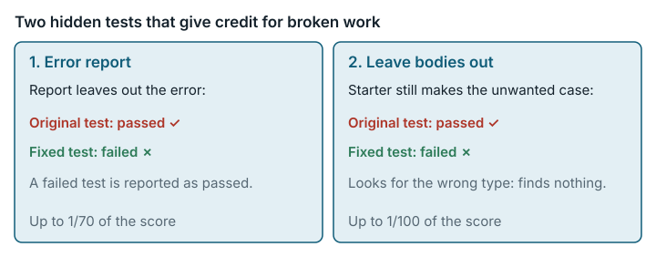

# Schemathesis reporting and observability (`schemathesis_reporting_observability`)

**结论：** 已修复。<mark>JUnit 报告写入器的隐藏测试连损坏的输出都接受；检查"某些生成场景中省略请求体"的测试则永远不会失败。两个漏洞加起来，错给了约占分数 2.4% 的分。</mark>



*两项隐藏测试为有缺陷的实现给了分，合计约占分数的 2.4%；修复版测试让这些有缺陷的版本失败。*

## 任务要求

Schemathesis 是一个自动测试 Web API 的工具。解题者要扩展 schemathesis 4.13.0 的报告和可观测性功能，任务要求 "Treat `/app/TODO.md` as the authoritative task specification."（把该文件视为权威的任务规格。）评分器用隐藏测试评分。这里涉及两个目标：

- Target 2：一个 "**`JunitXmlWriter`**: A context-manager class that writes JUnit XML reports"（写出 JUnit XML 报告的上下文管理器类），带有一个 "records a test error"（记录测试错误）的 `record_error` 方法。JUnit XML 是 CI（持续集成）系统读取的一种常见测试报告格式。
- Target 5 的第 2 项修复："The `allow-extra-parameters = false` configuration suppresses unexpected-properties coverage scenarios for query, header, and cookie parameters, but not for request bodies. Bodies should be included in this suppression."（该配置会为 query、header 和 cookie 参数抑制"意外属性"覆盖场景，但不会为请求体抑制；请求体也应纳入这一抑制。）

类别：系统与软件工程。

## 问题出在哪里

### 1. JUnit 测试接受损坏或不完整的报告

**规则。** `record_error` 必须在 JUnit XML 报告里记下一个错误。原始测试只看输出里有没有出现字符串 `"schemathesis"` 和 `"test_label"`。

**例子。** 我们写了四个测试用的写入器：`correct`（用初始文件的命令行工具本来就在用的 `junit_xml` 库）、`drops_error`（XML 格式没问题，但没有 `<error>`）、`unterminated`（XML 格式错误）和 `plaintext`（根本不是 XML）。应该只有 `correct` 通过。原始测试（"orig"）和修复版测试（"repaired"）下的实际结果：

```
correct      orig: 1 passed   repaired: 1 passed
drops_error  orig: 1 passed   repaired: 1 failed
unterminated orig: 1 passed   repaired: 1 failed
plaintext    orig: 1 passed   repaired: 1 failed
```

**为什么重要。** 写入器丢掉 `<error>`，失败的操作在 CI 里看起来就像通过了，而这个写入器照样拿到这项测试的分。反过来，正确的写入器如果给测试套件起了 `schemathesis` 以外的名字，原始测试就会判它失败，因为输出里根本没有字符串 `schemathesis`（见下文在 E2B 上的修订运行）；而 `TODO.md` 并没有规定套件叫什么。

### 2. 省略请求体的测试永远不会失败

**规则。** 在 `allow-extra-parameters = false` 下，请求体不能产生"意外属性"场景（生成的测试输入里带有额外的、未声明的字段）。

**例子。** 未改动的初始文件还没有请求体修复。在它上面要求抑制请求体，`cover_schema_iter` 会产生 12 个值，里面出现了本不该有的 `OBJECT_UNEXPECTED_PROPERTIES` 场景。这 12 个值都属于覆盖模块里的 `GeneratedValue` 类，测试却按另一个同名的类过滤，所以拿到的场景集合总是空的，检查永远不会失败。按测试自己头部注释的说法，它应当在初始文件上失败；实际上它在初始文件上通过了。换成一个无视该标志、总是省略请求体的实现，它也通过。

**为什么重要。** 这项测试给缺失或错误的行为打了分。查询参数那项对应测试同样永远不会失败，但它守着的只是初始文件已有的行为。

## 影响有多大

分数是五个阶段的 Σ wᵢ·passedᵢ/totalᵢ / 10，权重依次为 2、2、3、2、1（`/tests/test.sh`）。Phase 2 的一项测试值总分的 2/(14·10) = 1/70；Phase 5 的一项测试在原始版值 1/100，在修复版值 1/120。

- 原始版错给的分：JUnit 测试最多 1/70（100 分制下约 1.4 分），请求体测试最多 1/100（1.0 分）。
- 原始版错扣的分：输出不含字符串 `schemathesis` 的正确写入器，被 JUnit 测试扣掉 1/70（约 1.4 分）。
- 修复版下最多降 4.76 分。假设一份提交在原始版下全过，在修复版的 JUnit 测试和四项新覆盖测试上全不过：Phase 2 丢 1/70，Phase 5 丢 10·(1 − 8/12)/100 = 1/30，合计 1/70 + 1/30 = 4.76 分。测过的几个改动版本分别丢 1.43、0.83 和 1.67 分。
- 修复版下最多升 2.76 分。修订后的 JUnit 测试可能在原始测试失败处通过：输出里始终没有字符串 `schemathesis` 的正确写入器（比如套件起了别的名字），原始测试判失败，修订后的测试判通过，即 1/70 或 1.43 分。在 Phase 5，只要覆盖生成器能跑，两项原有的覆盖测试对任何提交都会通过；所以如果其他 Phase 5 测试一项没过，所占份额从 2/10 变成最多 4/12，即 1.33 分；两项合计 2.76 分。初始文件和桩实现各加 0.5 分。只有提交从 `schemathesis.specs.openapi.negative` 里删掉了 `GeneratedValue` 类（原有覆盖测试导入了这个类），升幅才可能到 4.76 分。
- 测过的错误实现没有一个得分高于正确实现；测过的唯一一个正确实现保持 1.0。

## 修复

修复版改了三个评分器文件：

- `/tests/test_02_reporting.py` 改为解析 XML。根元素可以是 `testsuite` 或 `testsuites`，并要求有一个名为 `test_label`（即传给 `record_error` 的标签）的测试用例，里面有一个 `<error>`，用文本或属性带上消息。这正是 `TODO.md` 写明的要点：一份 JUnit XML 报告，以及 `record_error` "records a test error"（记录测试错误）。测试名称和测试数量都不变。
- `/tests/test_05_email_coverage.py` 改用正确的 `GeneratedValue` 类，并要求得到类型正确、非空的值流。另外为请求体和查询参数各加了允许额外参数和拒绝额外参数的用例。
- `/tests/test.sh` 把 Phase 5 的测试数从 10 改为 12，权重不变。

`task.json.in` 只改了 `judge.image_tag`。

下表中，`fullref` 是一个完整的参考实现，作为正确的测试提交。`fullref_*` 各行在它的基础上各改一行，`stub_*` 各行用的是一个最小的桩实现。分数是 0–1 刻度上的原始结果（换算为 0–100 分之前）。

| 测试提交 | 角色 | 原始评分器 | 修复版评分器 | 变化 | 通过的测试，P2 = Phase 2，P5 = Phase 5（原始 → 修复） |
|---|---|---|---|---|---|
| fullref | 正确的完整实现 | 1.000000 | 1.000000 | **0** | P2 14/14 → 14/14；P5 10/10 → 12/12 |
| fullref_junit_drops_error | 看似合理的错误：`record_error` 创建了测试用例但丢掉 `<error>` | 1.000000 | 0.985714 | **−0.014286 (−1/70)** | P2 14/14 → 13/14 |
| fullref_no_body_fix | 看似合理的错误：省略了 Target 5 的第 2 项修复（BODY 未被抑制） | 1.000000 | 0.991667 | **−0.008333** | P5 10/10 → 11/12 |
| fullref_always_suppress | 看似合理的错误：抑制时忽略 `allow_extra_parameters` | 1.000000 | 0.983333 | **−0.016667** | P5 10/10 → 10/12 |
| stub_junit_correct | 审查者编写的桩，基于 `junit_xml` 的写入器 | 0.091429 | 0.096429 | +0.005000 | P2 5/14 → 5/14；P5 2/10 → 3/12 |
| stub_junit_drops_error | 审查者编写的桩，丢掉错误 | 0.091429 | 0.082143 | −0.009286 | P2 5/14 → 4/14；P5 2/10 → 3/12 |
| starter | 未改动的初始文件 | 0.020000 | 0.025000 | +0.005000 | P2 0/14 → 0/14；P5 2/10 → 3/12 |

每份测试提交在 Phase 1、3 和 4 上的结果都不变。变化的只有：

- JUnit 测试；
- 原先两项只测拒绝情形的覆盖测试，换成了四项允许/拒绝测试；
- 现在在 Phase 2 和 Phase 5 失败的那些改动版本的阶段汇总项（`test_phase_2`、`test_phase_5`）。

三个看似合理的错误版本，在原始评分器下都得 1.0，在修复版评分器下都丢了分。正确的测试提交保持 1.0。

**修复的修订（2026-10-12）。** 第一次发布的修复版还要求套件名必须是 `schemathesis`、测试用例和 `<error>` 都恰好一个，并且不能有 `<failure>` 或 `<skipped>` 元素。`TODO.md` 对这些都没有规定；`schemathesis` 只是初始文件里命令行 JUnit 处理程序用的套件名。修订后的测试去掉了这些要求。我们在全新的工作节点上把原始评分器、第一版修复和修订版修复并排对照跑了三次，之前每份提交的结果都和上表相同。另外新增三份提交：

| 测试提交 | 角色 | 原始评分器 | 第一版修复 | 修订版修复 |
|---|---|---|---|---|
| fullref_junit_other_suite | 正确：套件名为 `api-report` | 0.985714 | 0.985714 | 1.000000 |
| stub_junit_other_suite | 正确的桩写入器，套件名为 `api-report` | 0.077143 | 0.082143 | 0.096429 |
| stub_junit_unterminated | 错误：格式错误的 XML | 0.091429 | 0.082143 | 0.082143 |

套件名不同的正确写入器，输出里没有字符串 `schemathesis`，原始测试会判它失败，第一版修复也一样；修订版让它通过。丢掉 `<error>` 或写出格式错误 XML 的写入器，在两个修复版本下都失败。

**分数兼容性。** 完全正确的提交在两个版本下都得 1.0。Phase 2 或 Phase 5 只过了一部分时，原始分数和修复版分数不可比，因为 Phase 5 现在有 12 项测试，原来是 10 项。修复版下，未改动的初始文件和桩提交加 +0.005。新增的允许用例和查询参数的拒绝用例，检查的是初始文件的生成器本来就有的行为。所以初始文件在 Phase 5 的得分，不再来自那项永远不会失败的请求体测试，而是来自真正起作用的检查。更小的改法是只改 `GeneratedValue` 的导入、保留 10 项测试，但那样查不出总是省略请求体的实现。

## 我们如何检查

- **在按摘要固定的原始镜像中运行原始评分器。** 评分器镜像里是未改动的 schemathesis 4.13.0 初始文件。每份测试提交都在全新的 `--network none` 容器里，分别用完整的原始 `judge.eval_cmd` 和修复版评分器运行。
- **直接检查。** 查看了 `cover_schema_iter` 在初始文件上产生的每个值属于哪个类，由此看出原始覆盖过滤为什么总是空的。修复版覆盖测试分别在初始文件、一个正确的修复和一个总是省略请求体的修复上运行。
- **可重复性。** 原始版和修复版评分器的并排对照运行做了三次，结论不变（`data/paired-repeatability.md`）。这几次用的是第一版修复。修订版修复也跑了三次（`evidence/runs/schemathesis_reporting_observability-v2-paired-rev2`、`-rev2-rep2`、`-rev2-rep3`），分数和每项测试的结果都相同。

## 局限

- 没有运行任何 AI 模型或求解器。影响只在我们写的测试提交和改动版本上演示过。
- 能当作正确测试提交的完整实现只有一个，试过的正确 JUnit 写入器也都基于 `junit_xml`。修订后的 JUnit 测试仍然假定常见的 JUnit 写法：错误是 `<testcase>` 里的一个 `<error>` 元素，测试用例的 `name` 就是标签。把错误记成 `<failure>`、或者只把标签放在 `classname` 里的写入器会失败，根元素带 XML 命名空间（`<testsuites xmlns=…>`）的报告也会失败（本地探测；XML 声明、字节顺序标记、CDATA 或嵌套的 `testsuites` 都能通过）。`TODO.md` 对这些细节都没有说清楚。
- Phase 4 的测试计数有一处反常（预期 9 项，收集到 11 项），不在本次范围内，没有改。
- 修复包在一台干净的机器上从零重建过（`evidence/runs/materialize-check-g2`，`status: exit=0`）：3 个输出全部与锁定值一致，构建出的镜像里是锁定的测试文件。
- 更大范围的集成行为（xdist、有状态运行、一处 55/53 的测试计数反常）没有检查。
- `TODO.md` 取自工作目录树的云端导出（sha256 `097166d3…`），没有从工作镜像里重新提取。
- 隐藏测试没有存进本仓库。重新运行检查时，会从固定的评分器镜像里提取。

## 复现

- 原始评分器镜像：`sha256:b1e16633…`。
- **原始测试与修复版测试的对照。** 先运行 `evidence/scripts/schemathesis_reporting_observability/fetch_tests.sh`。然后运行 `run_junit_in_judge.sh`（配合 `reporting_overlay/`）、`run_coverage_in_judge.sh` 和 `run_coverage_variants.sh`。保存的输出在 `observed_junit.txt`、`observed_coverage.txt` 和 `observed_coverage_variants.txt` 中。
- **原始版和修复版评分器的并排对照运行。** `repairs/schemathesis_reporting_observability-v2/paired/run.sh`。结果在 `paired/results.md` 和 `paired/raw-summary.md` 中。
- **修复。** `repairs/schemathesis_reporting_observability-v2/repair.patch`、`Dockerfile` 和 `source-lock.json`。

支撑记录：`repairs/schemathesis_reporting_observability-v2/`（存放修复版的文件夹）和 `evidence/reviews/schemathesis_reporting_observability.md`。
