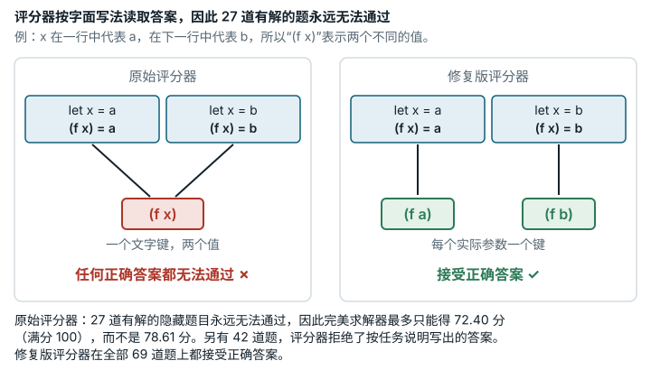

# SMT Solver (`smt_solver`)

**结论：** 已修复。<mark>答案检查器按字面文本查找函数的取值，结果有 27 个可满足的隐藏问题，无论哪个求解器都拿不到分。</mark>

*SMT Solver 的评分器按表达式的字面写法查找函数值，而不看参数实际代表什么，因此 27 道有解的隐藏题目永远无法通过。智能体要编写一个逻辑求解器，为每道有解的题目输出一个示例解。当同一段文字（例如 (f x)）代表两个不同的值时，评分器会拒绝所有正确的解；另有 42 道题，评分器也拒绝了按任务说明的写法给出的解。这使完美求解器的最高分从 78.61 降到 72.40（满分 100）。（正确的“无解”答案最多只得一道题五分之一的分数，所以即使是完美求解器，最高也只有 78.61 分。）修复版评分器先计算参数的值，在全部 69 道题上都接受正确的解。*

## 任务要求

智能体要写一个 SMT 求解器。这个程序判断一组逻辑约束能否同时满足（"sat"）；能满足的话，还要打印一组满足约束的取值（即一个模型）。求解器必须打印 "sat followed by a JSON model witness that validates the assertions"（sat，后接一个能使各断言成立的 JSON 模型见证）。

随附的 `smtlib_spec.md` 写道 "Keys are SMT-LIB symbols or canonical ground terms that appear in the assertions"（键是断言中出现的 SMT-LIB 符号或规范的基项）。关于未解释函数（UF，即含义由求解器自己选定的函数），它说取值 "for ground applications needed to evaluate the assertions, such as `"(f a)"`"（针对求值断言所需的基应用给出）。又说 "The evaluator checks every assertion under the witness and enforces congruence"（评测器在见证下检查每条断言，并强制同余）。同余的意思是：输入相同，函数输出也相同。还说 "an invalid or missing model receives 0 for that case"（无效或缺失的模型在该用例上不得分）。预期为 sat 的问题，模型有效才得分。类别：组合优化。

## 问题出在哪里

**规则。** 隐藏评分器的检查代码只按源文本读 UF 应用的取值，例如 `(f x)`，不代入 `let` 绑定（局部名称，例如"让 x 代表 a"）。同一段文本出现在不同的 `let` 绑定下时，每处出现只能共用一个值。

**例子。** 断言为 `(distinct a b)`、`(let ((x a)) (= (f x) a))` 和 `(let ((x b)) (= (f x) b))`。取 f = 恒等函数时它们可满足。在原始评分器下：

- 按规格的描述使用基项键 `(f a)` 和 `(f b)` 时，判定为 `invalid_model: missing model value for (f x)`。
- 加上文本键 `(f x)` 后，判定为 `invalid_model: assertion is false`。

两处应用读的是同一个键 `(f x)`，所以什么答案都过不了。

**在隐藏问题集中**（774 个文件：546 个 sat / 228 个 unsat）：

- **27 个 sat 的 QF_UF 文件（15 个 medium、12 个 hard）拿不到分。** 这些是拟群（quasigroup）文件，每条断言里都重新绑定 `?v_0 … ?v_n`。全部 27 个文件，按检查器的读法公式是 unsat，真实公式却是 sat。在原始镜像上，`QF_UF/79f4ca54c7f5a5f0.smt2` 无论用哪种键写法，都拒绝了一个真实的 z3 模型。
- **另有 42 个隐藏 sat 文件不接受规格里给出的那种键。** 在这些文件上，严格按规格输出基项键的求解器会被拒绝，只有文档里没写的文本键约定才行得通。

**方向。** 上面展示的键值缺陷让正确答案被拒。Lean `orig_sound` 和 `fixed_sound` 证明：在建模的单一 sort、一元函数 QF_UF 片段里，检查器接受就意味着公式可满足。它们没有对整个 Python 评分程序、也没有对所有受支持的 SMT-LIB 特性证明这一点；模型与实现的对应关系是靠论证和差分测试建立的，不是机器证明。另外，原始检查器可能接受一个根本不构成函数的见证：下文的 `unused_conflict` 让 f 在同一个参数值上取两个值，原始评分器照样接受。

**说明：评分器 CPU 数（不属于修复内容）。** eval_cmd 运行 `evaluate.py --timeout 60 --parallel 16`，超时按墙钟时间算（`proc.communicate(timeout=timeout)`，第 690 行），超时得 0 分。四个官方排行榜配置（EdgeBench 提交 6e4e5f4 中的 `examples/all-tasks-k8s/experiment*.yaml`）都给 `smt_solver` 设了 `judge_cpu_limit: 16`，16 个求解器进程各占一个 CPU。如果评分器 CPU 更少，比如配置的默认值 4，每个问题在 60 s 里分到的 CPU 就按比例减少。我们在原始评分器上，用评分器的原样参数和一个替身求解器，在隐藏集的一个 32 题子集（QF_LIA、hard、预期 unsat）上测了这一点：每题需要 20 s CPU 时间的求解器，4 个 CPU 时 32 题全部超时，8 个 CPU 时则能通过（`evidence/runs/smt_solver-cpu4v8-a`、`-b`；`evidence/runs/smt_solver-v2-paired-cpu`、`smt_solver-v2-paired-b-cpu`、`-c-cpu`）。任务文本自己也前后矛盾：任务说明写 "16 evaluator workers"，工作镜像里的 `smtlib_spec.md:118` 却写 "4 evaluator workers"。在官方的 16 个 CPU 下，这两点都不影响评分，所以只作为说明保留。

## 影响有多大

- 完美求解器的最高分从 78.61 降到 72.40，少了 6.21 分。15 个拿不到分的 medium 问题占 medium 档的 15/61。
- 同一段文本有多种含义的那 27 个文件，所有求解器都会丢分。按规格输出基项键的求解器，还会在同一段文本只有一种含义的那 42 个文件上丢分。

## 修复

修复版只改了 `evaluate.py` 一个文件。构建检查器时，把每个属于基应用的答案键求值，取值登记在"该函数 + 参数**求值后**的值"之下。检查时，检查器先在当前作用域里给 UF 应用的参数求值，再查这张表；查不到才退回原来的文本查找。同余检查覆盖所有表项和每个求值后的应用。解析、扰动、超时和计分都不变。任务 JSON 只改了 `judge.image_tag`。

下面是原始版与修复版评分器的并排对照结果。两个镜像都用官方参数和 `--network none` 运行，里面的隐藏 zip 完全相同。问题集为 69 个受影响的隐藏 sat 文件。"多上下文"文件在不同绑定下复用同一段文本，"单上下文"文件没有这种情况。

| 测试提交 | 文件 | 原始评分器 | 修复版评分器 | 预期 | 是否符合预期 |
| --- | --- | --- | --- | --- | --- |
| ground（正确，规格中的键） | 27 个多上下文 | invalid_model 27 | **correct 27** | 原始版出错，修复版接受 | 是 |
| ground（正确，规格中的键） | 42 个单上下文 | invalid_model 42 | **correct 42** | 修复版接受 | 是 |
| textual（正确的测试提交） | 42 个单上下文 | correct 42 | correct 42 | 不变 | 是 |
| textual（正确的测试提交） | 27 个多上下文 | unknown 27（无见证） | unknown 27 | 不变 | 是 |
| textual_true（正确的模型） | 27 个多上下文 | invalid_model 27 | **correct 27** | 修复版可以接受（真实模型） | 是 |
| textual_true（正确的模型） | 42 个单上下文 | correct 42 | correct 42 | 不变 | 是 |
| ground_wrong（无效，`-c`） | 27 个多上下文 | invalid_model 27 | invalid_model 27 | 两者都拒绝 | 是 |
| ground_wrong（无效，`-c`） | 42 个单上下文 | invalid_model 42 | invalid_model 42 | 两者都拒绝 | 是 |

用 ground 测试提交跑完整的原始 `eval_cmd`（全部 774 个隐藏文件，`--parallel 16`）。没有预备答案的 705 个文件，替身求解器一律回答 `unknown`。

| 评分器 | 原始分数（0–1） | 100 分制得分 | 通过 | 退出码 |
| --- | --- | --- | --- | --- |
| 原始版 | 0.0000 | 0.00 | 0/774 | 0 |
| 修复版 | 0.1249 | 12.49 | 69/774 | 0 |

任务的换算是从 0 到 1 的线性刻度（`tasks/smt_solver.json`），所以 100 分制得分 = 100 × 原始分数；评分器自己的汇总行是 `score=0.124948 (12.49/100)`（`repairs/smt_solver-v2/paired/evidence/b/fulleval_lines.txt`）。

在问题集上，没有哪份测试提交由正确变为被拒。13 个小型构造用例中只有 `unused_conflict` 这样变了，这在预期之中：这个答案借一个没用到的键，让 f 在同一个参数值上取两个值，所以它定义的不是函数。小型用例上的原始分数（0–1 刻度）：原始评分器 0.1615，修复版评分器 0.3231（100 分制下为 16.15 和 32.31）。

**分数兼容性。**

- **可比：** 答案只用文本键的求解器，修复版分数与原始分数可比，只有一个例外（已在 Lean 中证明）：如果 `let` 复用了某个已声明常量的名字，它下面的文本键可能被修复版检查器拒绝（同一模型改用基项键写就能通过）。774 个隐藏文件里没有一个含这样的 `let`（`evidence/formal/notes/smt_solver.md`）。
- **不可比：**
  - 对于输出基项键的求解器；
  - 在那 27 个多上下文文件上，原始评分器根本无法给分。
- **新增拒绝：** 让函数在相同参数值上取两个值的答案。规格里的 "enforces congruence"（强制同余）本来就不允许这种情况。

## 我们如何检查

- **原始评分器。** 构造的问题和真实的隐藏问题都交给原始评分器，用按摘要固定的原始公开镜像和官方参数（`--perturb --perturb-salt hidden-sebench`）运行。正确的求解器由一个打印固定答案的替身求解器代替。嵌套最深的 sat 文件（括号深度 2621）也被接受。
- **独立检查（z3）。** z3 是一个广泛使用的 SMT 求解器。我们把检查器的接受条件精确编码，在评分器之外交给 z3 求解。为了验证编码，在编码判为 sat 的全部 42 个隐藏文件上，把 z3 模型转成答案，原始检查器 42 个全部接受。对全部 774 个隐藏文件的扫描用的是原始的分词规则。z3 确认 69 个 ground 答案全是真实模型，并证明 69 个错误模型答案都不是模型。
- **算术。** 按任务的分档权重重新算出分数影响。
- **可重复性。** 并排对照运行重复了三次，结论不变（`data/paired-repeatability.md`）。

## 局限

- 没有运行任何 AI 模型或求解器。文中的影响只针对我们写的测试提交和反例，也没有估计对排行榜的影响。
- 答案是替身求解器回放的 z3 模型，并非为该任务写出的完整求解器的输出。
- "检查器编码拒绝的恰好就是检查器拒绝的"这一说法，依据是一个精确性论证和在原始镜像上的运行，没有经过机器证明。
- 错误模型测试提交"不是模型"这一点，依赖 z3 4.13.0.0 的判断。每个错误答案只改了一个 UF 取值，所以这些测试提交覆盖不了所有可能的错误模型。
- 据报告，公开的开发集里有 2 个拿不到分的 sat 问题；本页没有附上对它的扫描输出。
- 规格文本没有改写；其中 "canonical ground terms"（规范的基项）的说法现在与检查器一致了。
- 只深入查了 UF 的取键方式。扰动和预检扫描只做了抽查；超时随评分器 CPU 数变化这一点，是用替身求解器在一个 32 题子集上测的（见上文说明）。

## 复现

- 原始评分器镜像：`sha256:2bf3482a…`。
- 构造用例（原始镜像）：`evidence/scripts/smt_solver/run_mini_native.sh`；输出在 `evidence/scripts/smt_solver/mini_native_output.txt`
- 真实隐藏问题（原始镜像）：`evidence/scripts/smt_solver/run_corpus_native.sh` 和 `run_deep_native.sh`
- 问题集扫描和检查器编码：`evidence/scripts/smt_solver/scan_corpus.py --z3`；编码验证：`witness_roundtrip.py`；输出在 `evidence/scripts/smt_solver/results/`
- 分数影响：`evidence/scripts/smt_solver/score_impact.py`
- 原始版与修复版评分器的并排对照运行：`repairs/smt_solver-v2/paired/run.sh`（错误模型测试提交：`run_wrongarm_c.sh`）；补丁：`repairs/smt_solver-v2/repair.patch`；修复版 `evaluate.py` 的 sha256 为 `bbc730f8…2998`
- CPU 数说明：`evidence/runs/smt_solver-cpu4v8-a/run.sh`、`-b`（原始评分器在 4 和 8 个 CPU 下）

支撑记录：`repairs/smt_solver-v2/`（存放修复版的文件夹：README、`source-lock.json`、`paired/results.md`、`paired/evidence/`）。
