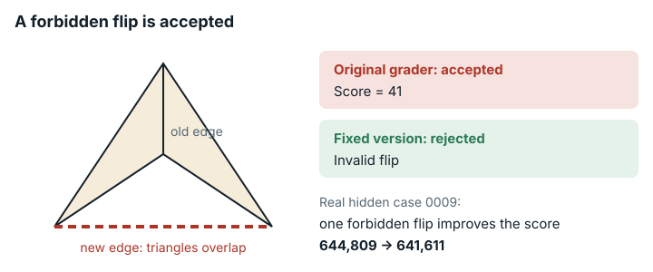

# Triangulation Coloring Optimization (`triangulation_coloring_optimization`)

**结论：** 已修复。<mark>评分器判断边能否翻转的规则漏了 README 里的凸性条件。十个隐藏输入全是用这条规则生成的，里面有重叠或折叠的三角形。评分器接受提交里的哪些操作，也由这条规则决定。另外，README 承诺每个用例 30 s，可在发布方 4 个 CPU 的评分器上，有效解法每个用例只要用了超过约 15 s CPU 就会超时，而只要一个用例超时，整份提交就没有分数。修复版还限制同时运行的用例数不超过评分器的 CPU 数。</mark>

现在的修复版是修复包 v2.2。它重新生成的输入都恰好覆盖各自的凸包，这是点集三角剖分的必要条件。一次精确普查在全部 13 个文件里查出 0 处空缺、0 处重叠。上一个修复版（v2.1）重新生成的 13 个文件中，有 12 个缺了 1–3 个凸包三角形。并排对照运行没有发现这些空缺导致分数出错或不可重复，v2.1 和 v2.2 对相同输入的评分也完全相同。

*原始评分器接受规则所禁止的翻转，其中一次甚至改进了分数（越低越好：在隐藏用例 0009 上从 644,809 降到 641,611）；修复版拒绝这些翻转。*

## 任务要求

输入是 N = 512 个点的 "a **triangulation**"（一个**三角剖分**），即一张以这些点为顶点的三角形网格。它覆盖这些点的凸包（包含它们的最小凸区域），没有空缺，也没有重叠。智能体靠给点重新着色和翻转边来压低分数。README 这样定义翻转 "if an edge is a diagonal of a **convex quadrilateral** formed by two adjacent triangles, replace it with the other diagonal. The result remains a valid triangulation."（如果一条边是由两个相邻三角形构成的**凸四边形**的对角线，就把它替换为另一条对角线；结果仍是有效的三角剖分。）

任务说明写道 "The local `tester` applies flips exactly like the judge"（本地测试程序应用翻转的方式与评测完全相同）。分数在 "on the **final** triangulation after all flips"（所有翻转之后的**最终**三角剖分上）计算。类别：组合优化。

## 问题出在哪里

只有凸四边形的对角线才能合法翻转。共享库里的 `Triangulation.is_flippable` 只检查两个顶点（两个三角形各自的远端顶点）分别在公共边两侧，从不检查公共边的两个端点是否分别在新对角线两侧。所以它会接受非凸四边形的翻转，而这种翻转会让网格折叠。

这条规则也决定了输入的样子。`gen.py` 按这条规则做 K 次随机翻转来生成每个用例。十个隐藏输入全都有重叠的三角形，每个用例 17 到 583 对不等。其中六个还有重复的三角形和非流形边（被两个以上三角形共用的边）。不做翻转（K=0）时，生成器的原始输出没有重叠。

官方评分器判断操作是否合法，用的也是这条规则，所以它也影响计分。

- 每个隐藏用例上都有 317–379 条内部边能通过官方规则，却不是凸四边形的对角线。README 禁止翻转这些边。
- 官方规则没有拒绝任何一次凸四边形翻转。文档规则允许的，官方规则全都允许，还允许得更多。
- 在原始评分器下的用例 0009 上，随附的什么都不做的输出得 `Score = 644809`（U=803）。加上一次 README 禁止的非凸翻转（边 39–52）后，评分器照样接受，得 `Score = 641611`（U=801）。一次违规操作反而让官方分数变好了（越低越好）。
- 最小的例子 N=4。输入是一个有效的两三角形网格，四边形有一个优角（向内凹的）顶点。原始测试程序接受了这次违规翻转（`Score = 41`），翻转后的两个三角形互相重叠。可见这个问题不依赖于有缺陷的输入。

在 4 个 CPU 的评分器上，每个用例承诺的 30 s 缩水成约 15 s CPU 时间。README 写明 "Time limit: **30 seconds per case**"（第 50 行）。评分器 `/tmp/eval_triangulation_coloring.py` 同时跑 8 个用例（`max_workers=min(8, len(case_files))`，第 44 行），墙钟时限 30 s（`TIME_LIMIT = 30`，第 9 行）。超时的用例得 `float('inf')`（第 36 行），整份提交因此没有 100 分制得分（`sforge/harness/score_rescale.py:75-76`）。任务没有规定 CPU 数。EdgeBench 的排行榜配置 `examples/all-tasks-k8s/experiment.yaml`（引文见 [`evidence/impact/edgebench-leaderboard-config.md`](../evidence/impact/edgebench-leaderboard-config.md)）（sha256 `d9d299794ba946cae8d2b7f68a7879a35bb8565d95e78107edf79802993643be`）里，评分器沿用 `judge_cpu_limit: 4`，所以前 8 个用例每个约分到半个 CPU。我们在原始评分器上用 `--cpus 4` 测了这一点（`evidence/runs/triangulation_coloring_optimization-cpu4v8-a/result/out/summary.txt`、`-b`），做法是在正常的 `greedy.py` 对照解法后面附加固定量的 CPU 计算。每个用例 12 或 14 s 时 10/10 通过。每个用例 20 s 时，两个工作节点上都是 2 个 OK、8 个 TLE，`TOTAL_SCORE inf`。换成 `--cpus 8`，20 s 的解法 10/10 通过，得 866,166（100 分制下 48.87 分）。按 25 s 墙钟截止时间停下的解法，4 个 CPU 时每个用例平均分到 15.00 s CPU（中位数 12.62 s；10 个用例中有 2 个在最后单独运行），8 个 CPU 时是 24.97 s。

有一点限制了危害。智能体的工作镜像里随附了同样的 `verifier.py`、`tester` 和样例，所以智能体本地测试看到的规则和评分器完全一样，分数前后一致、可以重复。问题出在实际计分的问题和文档描述的不一样。

## 影响有多大

在发布方的 4 个 CPU 下，有效解法如果每个用例用约 15–30 s CPU，在原始评分器下会丢掉全部分数（用每个用例 20 和 28 s 测得），在修复版下能得分。按墙钟截止时间停下的解法，在修复版下每个用例能分到约两倍的 CPU（截止时间 25 s 时，平均从 15.00 s 增至 24.91 s）。我们没有测量分数会因此变多少。

翻转规则改变了每个解题者能合法做的翻转，而隐藏输入对每个解题者都是折叠的。测到的分数影响只有一处，用例 0009 上一次违规翻转让这个用例从 644,809 降到 641,611（什么都不做的输出，10 个用例总分约 609 万）。正常的贪心测试提交，换了输入以后从 48.87 分变为修复版 v2.2 下的 48.66 分（满分 100；v2.1 下为 48.95）。我们没有测量强解题者在完整优化中会受多大影响。

## 修复

修复版在评分器镜像和智能体工作镜像里都改了 `tools/src/triangulation.py` 中的 `is_flippable`。现在它还要求 `a != b`、边 ab 尚不存在，且公共边的两个端点严格位于新对角线两侧。文件其余内容不变。

修复版还改了 `tools/src/delaunay.py`（修复包 v2.2）。随附的生成器在一个有限的“超级三角形”内构建 Delaunay 网格，所以多数输入都会漏掉凸包边上的 1–3 个三角形。得到的网格只铺满一个穿过这些点的多边形，不是这些点的三角剖分。现在 `delaunay_triangles()` 最后会调用 `complete_hull()`，先用耳切法补上每个空缺，再用 Lawson 翻转恢复 Delaunay 性质，定向检验和外接圆检验都用精确的整数运算。在 13 个种子上，它在任何预翻转之前补上 0–3 个三角形，已有的三角形一个不动（`v2/complete_hull_check.jsonl`）。

然后我们用随附的、未改动的 `gen.py`，加上 v2.2 的 `delaunay.py` 和修复后的规则，重新生成了 10 个隐藏用例和 3 个样例。

- 用例 0000 和样例保留原来的种子（9000000 和 1000001–1000003）。
- 用例 0001–0009 原来的种子不知道，改用新种子 9000001–9000009。K 按每个用例的缺陷模式推断。
- 用例 0000 没有凸包空缺，与上一个修复版（v2.1）逐字节相同。其余 12 个文件相对 v2.1 都是新实例。

修复版还改了 `/tmp/eval_triangulation_coloring.py`，让同时运行的用例数不超过评分器 CPU 配额允许的数量。新函数 `cpu_quota_workers()`（与 `repairs/grid_turing_robot-v2/` 中的相同）读取 cgroup 配额（`cpu.max`，或 cgroup v1 的配额和周期），向下取整成整数个 CPU，没有配额时退回 `os.cpu_count()`，结果限制在 1 到 8 之间。进程池改为 `ProcessPoolExecutor(max_workers=min(cpu_quota_workers(), len(case_files)))`。有 8 个或更多 CPU 时，它同时跑 8 个用例，和原始版完全一样。

`verifier.py`、`tester`、`gen.py`、各 README、任务说明、解析器、每个用例 30 s 的时限、1200 s 的 `eval_timeout` 和分数刻度的参考点都不变。

- 在 13 个修复后的输入上（v2.1 和 v2.2），修复后的规则在每条边上都与严格凸四边形检验等价。它允许的翻转，旧规则都允许过。README 允许的翻转，它一个也不禁止。Lean 证明覆盖所有有效的三角剖分。
- `v2/rule_check.py` 里的对照检验也带上了修复后规则的两个新防护条件（`a != b`，以及边 ab 尚不存在），所以光凭它说明不了这两个条件什么都不拦。去掉这两个条件后，每个原始隐藏用例上 `flip_rules.jsonl` 里的凸性计数（`convex_flippable`）都比 `rule_check.jsonl` 里的多。在隐藏用例 0000–0009 上，修复后的规则会分别拒绝 2、1、2、2、2、19、17、24、20 和 23 次严格凸的翻转，因为在折叠的网格里，另一条对角线已经存在（例如用例 0009 的边 79–156，顶点为 15 和 497）。有效的三角剖分里不可能出现这种边，而修复版随附的是重新生成的有效输入，所以修复版不受影响。可见，如果只在原始输入上套用规则修复，会禁止少数几次严格凸四边形翻转，这些翻转的结果会和一条已有的边重复。
- 在原始输入上，规则修复让每个隐藏用例少了 319–398 条可翻转的边（`rule_check.jsonl` 中原始计数减去修复后计数）。这比上文的 317–379 条非凸边稍多，多出来的就是刚才说的、被防护条件拦下的凸边。

下表是完整评分器（`eval_cmd`，10 个隐藏用例）在修复版 v2.2 上的结果（`evidence/runs/triangulation-v22-paired`；`--cpus 8`、`--cpus 4` 以及三次运行的结果完全相同）。原始结果越低越好。上一个修复版 v2.1 在前两行的结果是 6,092,622（0.054）和 863,058（48.95）（`paired/results.md`）。

| 提交 | 角色 | 原始评分器，原始结果 | 原始评分器，OK 的用例 | 原始评分器，100 分制 | 修复版评分器，原始结果 | 修复版评分器，OK 的用例 | 修复版评分器，100 分制 |
|---|---|---:|---|---:|---:|---|---:|
| 随附的 `solution.py`（什么都不做） | 正确的测试提交 | 6,092,430 | 10/10 | 0.055 | 6,108,380 | 10/10 | 0.000 |
| `greedy.py`（贪心重新着色 + 贪心地做 README 允许的凸翻转） | 独立的正常测试提交 | 866,166 | 10/10 | 48.87 | 874,742 | 10/10 | 48.66 |
| `nonconvex_flip.py`（什么都不做 + 每个用例一次 README 禁止的非凸翻转） | **展示问题** | 6,093,050 | 10/10 被接受 | 0.052 | inf | 0/10（WA "Invalid flip"） | 无（原始结果 inf） |
| `wrong_count.py`（给顶点 1 重新着色，却声称 C=0） | 无效的测试提交 | inf | 0/10 (WA) | 无（原始结果 inf） | inf | 0/10 (WA) | 无（原始结果 inf） |

下表用相同输入，只看规则。

| 输入 | 原始测试程序 | 修复版测试程序 |
|---|---|---|
| N=4 的有效 2 三角形输入，含优角四边形，翻转 1–2（来自审查的测试提交） | 被接受，`Score = 41`（结果重叠） | `wrong answer: Invalid flip (1,2)` |
| 每个修复后的（v2.2）隐藏用例 + 原始规则允许的第一条非凸边（10 个输入） | 10/10 被接受 | 10/10 `Invalid flip` |

下表是智能体的本地测试流程（工作镜像）。

| 提交 | 原始 SAMPLE_TOTAL | 修复版 SAMPLE_TOTAL |
|---|---:|---:|
| 什么都不做 | 1,780,251 | 1,817,733 |
| greedy | 263,500 | 237,515 |
| nonconvex_flip | 1,780,471（被接受） | 3 个全部 `wrong answer: Invalid flip` |

保存下来的用例 0009 输出里有那次让分数变好的违规翻转，原始验证器给它 `Score: 641611`。换上修复后的 `triangulation.py`，结果是 `INVALID: Invalid flip (39,52)`。13 个重新生成的输入全部是 0 对重叠、0 处交叉、0 处折叠、0 个重复或退化三角形、0 条非流形边。

下表是凸包覆盖的结果（精确普查，`evidence/scripts/triangulation_coloring_optimization/v2/hull_check.py`；整数定向检验和精确的有理数面积）。任意两个三角形内部都不重叠，且三角形面积之和恰好等于凸包面积，就说这个文件覆盖了它的凸包。

| 输入 | 有凸包空缺的文件 | 每个文件缺少的三角形 | 精确覆盖其凸包的文件 |
|---|---:|---|---:|
| 原始 | 13 个中的 12 个（全部 13 个还有重叠） | 0–4 | 13 个中的 0 个 |
| 上一个修复版 v2.1 | 13 个中的 12 个 | 0–3（面积空缺 3,042–93,674.5） | 13 个中的 1 个 |
| 修复版 v2.2 | 13 个中的 0 个 | 0 | 13 个中的 13 个 |

相同输入下，v2.1 和 v2.2 评分器的结果完全相同（例如 `greedy.py` 在 v2.2 用例上两者都得 874,742，在 v2.1 用例上都得 863,058），而原始评分器在 v2.2 用例上仍接受违规翻转（`paired/results.md` 的 "Convex-hull coverage, package v2.2" 一节）。

为检查 CPU 份额，我们用相同的解法在 `--cpus 4` 下（有一行是 `--cpus 8`）做并排对照，对比四个版本。它们是原始评分器、有修复后的规则和输入但没改 CPU 的版本（修复包 v1.0）、加上 CPU 改动的版本（v2.1）（这三个见 `evidence/runs/triangulation-v2-paired-cpu/result/out/summary.txt`），以及修复版 v2.2（`evidence/runs/triangulation-v22-paired/result/out/B/summary.txt`，其中原始版和 v2.1 也重跑了一遍，结果完全相同）。原始评分器评的是原始用例，各修复版评的是各自重新生成的用例，所以有效总分各不相同（866,166、863,058 和 874,742）。

| 解法（正常的 `greedy.py` 输出，之前附加固定计算量） | CPU 数 | 原始评分器 | 没有 CPU 改动（v1.0） | v2.1 | 修复版 v2.2 |
| --- | ---: | --- | --- | --- | --- |
| 没有额外计算 | 4 | 10 OK，866,166 | 10 OK，863,058 | 10 OK，863,058 | 10 OK，874,742 |
| **每个用例 20 s CPU** | 4 | **2 OK，8 TLE，`inf`（无分数）** | **2 OK，8 TLE，`inf`** | 10 OK，863,058 (48.95) | **10 OK，874,742 (48.66)** |
| **每个用例 28 s CPU** | 4 | **2 OK，8 TLE，`inf`** | **2 OK，8 TLE，`inf`** | 10 OK，863,058 | **10 OK，874,742** |
| 计算到 25 s 墙钟截止时间 | 4 | 10 OK，866,166；每个用例平均 15.00 s CPU | 10 OK，863,058；平均 15.00 s | 10 OK，863,058；平均 24.91 s | 10 OK，874,742；平均 24.93–24.98 s（三次运行） |
| 每个用例 40 s CPU（错误对照） | 4 | 10 TLE，`inf` | 10 TLE，`inf` | 10 TLE，`inf` | 10 TLE，`inf` |
| 每个用例 20 s CPU | 8 | 10 OK，866,166 | 10 OK，863,058 | 10 OK，863,058 | 10 OK，874,742 |

修复包 v1.0 和原始版一样让 20 s 和 28 s 的解法失败，可见救回它们的是并行度的改动，与翻转规则无关。v2.1 下，最慢的 28 s 用例耗时 28.03 s。错误对照的评分耗时 90.5 s（3 轮 × 30 s），在 1200 s 的 `eval_timeout` 以内。v2.2 的 OK/TLE 计数和耗时与此相同（错误对照为 90.6 s）。之前所有对照在 v2.1 上用 `--cpus 8` 和 `--cpus 4` 都完全复现（`evidence/runs/triangulation-v2-paired-cpu-controls`）。

修复版分数与原始分数不可比，原因有以下四条。

- 10 个隐藏输入中有 9 个是新实例（v2.2 的实例又和 v2.1 的不同，所以 v2.2 和 v2.1 的分数也不可比）。
- 现在所有输入都是各自凸包的有效三角剖分。
- 合法操作的范围变小了。
- 评分器 CPU 少于 8 个时，一直搜到墙钟截止时间才停的解法，每个用例能分到更多 CPU（4 个 CPU 时约为两倍）。

分数刻度原有的四个参考点全部保留，只当作一个固定的参照刻度，在修复版上它们不再对应排行榜名次。v2.2 里什么都不做的总分（6,108,380）比原始 `baseline`（6,102,378）高 0.1%，所以得 0.000 分，原来是 0.055 分。

## 我们如何检查

- 我们在按摘要固定的原始公开镜像里以 `--network none` 运行原始的 `tools/bin/tester` 和完整的原始 `eval_cmd`，原始版和修复版各跑一遍。
- 作为独立检查，我们在全部 10 个隐藏用例和 3 个样例上做精确的整数几何计算，不用浮点数。检查内容包括每对三角形的精确分离轴重叠检验、真正的边交叉、落在三角形内部的顶点、重复、退化和非流形的三角形与边、欧拉示性数和顶点链接（判断网格是不是正常曲面的两项标准检查）、超出凸包的面积，以及三点共线。我们还在每条内部边上，把官方规则和一个独立的精确凸四边形检验做了对比。
- 随附的 `gen.py` 用种子 9000000 能逐字节复现隐藏用例 0000，用种子 1000001–1000003 能逐字节复现三个样例。（我们把 O(N³) 的共线检查换成了一个完全等价、但更快的检验。）
- 为了检查凸包覆盖，`v2/hull_check.py` 用整数定向检验、外接圆检验和精确的有理数（`fractions.Fraction`）面积检查每个输入，确认内部没有重叠，三角形总面积等于凸包面积，边界边就是凸包边，三角形数为 2N−2−h。它在本地跑过，也用各镜像自带的 Python 在原始、v2.1 和 v2.2 镜像内的文件上跑过（`evidence/runs/triangulation-v22-geom`，`status: exit=0`），记录完全相同。`v2/complete_hull_check.jsonl` 检查生成器改动在任何预翻转之前的效果。
- 我们把原始版和修复版评分器的并排对照运行重复了三次，结论没有变化（`data/paired-repeatability.md`）。原始评分器、v2.1 和 v2.2 的 v2.2 并排对照运行（`evidence/runs/triangulation-v22-paired`、`-rep2`、`-rep3`）在全新的 E2B 工作节点上跑了三次，每次都是 `status: exit=0`，计数和总分完全相同。
- 在 E2B 上的 CPU 运行和并排对照运行中，固定计算量的解法（每个用例 12 到 28 s）、一个 25 s 墙钟截止时间的解法和一个 40 s 的错误对照，先在原始评分器上用 `--cpus 4` 和 `--cpus 8` 运行（`evidence/runs/triangulation_coloring_optimization-cpu4v8-a`、`-b`），再在原始评分器、上一版修复和修复版上并排对照（`evidence/runs/triangulation-v2-paired-cpu`、`-cpu-controls`）。每个作业都是 `status: exit=0`，参数为 `--network none --memory 4g`。每个解法都记下自己在每个用例上的开始时间、结束时间和 CPU 时间（`result/out/timing/`）。

## 局限

- 修复版评分器从 cgroup（`cpu.max`）读取 CPU 配额。这一点只用 `docker run --cpus` 测过，没有在 Kubernetes pod（EdgeBench 排行榜设置用的后端）里测。
- 没有运行任何 AI 模型或解题者。分数影响只在我们写的测试提交上演示过。
- 隐藏用例 0001–0009 原来的种子不知道，它们的 K 是推断的，没有真正恢复出来。
- 凸包补全只是一种可行的做法，即先用耳切法补每个空缺，再做 Lawson 翻转，所以预翻转之前的网格是 Delaunay 三角剖分（共圆情形除外）。覆盖普查只针对随附的 13 个文件，没有覆盖所有种子。
- 上一个修复版 v2.1 随附的 13 个输入文件中有 12 个有凸包空缺。并排对照运行没有显示这导致分数出错或不可重复，但它的分数与 v2.2 的不可比。
- 我们没有查阅 CodeChef TRICOL 的题面和检查器。
- 我们没有测量强解题者在完整优化中能从非凸翻转得到多少好处。
- CPU 的影响是在 4 和 8 个 CPU 下、用单线程的固定计算量和截止时间测试解法测的，多线程的解题者没有测试。在 4 个 CPU 下，按截止时间停的解题者在修复版中每个用例分到更多 CPU，所以分数不可比，我们没有测量变化多少。配额向下取整，2.5 个 CPU 时同时跑 2 个用例。
- 修复版镜像是为这次运行在本地构建和测试的，之后已删除，所以没有镜像仓库里的摘要（digest）。

## 复现

- 几何和规则分析：`evidence/scripts/triangulation_coloring_optimization/check_geometry.py`、`flip_rule_analysis.py`、`regen_compare.py`、`run_gen.py`
- 修复版的重新生成和规则检查：`evidence/scripts/triangulation_coloring_optimization/v2/regen_v2.py`（v2.2 的哈希见 `v2/regen_v22.out`）、`v2/rule_check.py`
- 凸包普查：`v2/hull_check.py`（`v2/hull_v21.jsonl`、`v2/hull_v22.jsonl`）、`v2/complete_hull_check.py`；v2.2 并排对照运行：`evidence/runs/triangulation-v22-paired/run.sh`
- 并排对照运行：`repairs/triangulation_coloring_optimization-v2/paired/run.sh`（结果在 `paired/results.md`）；CPU 份额：`paired/run-cpu4.sh`（实际运行版本：`evidence/runs/triangulation-v2-paired-cpu/run.sh`）；在原始评分器上的 CPU 运行：`evidence/runs/triangulation_coloring_optimization-cpu4v8-a/run.sh`、`-b`
- 修复版评分器 `/tmp/eval_triangulation_coloring.py`：sha256 `082d72b2…acb1`（原始版 `1c5100f5…c009`）；修复后的 `delaunay.py` 为 `ef137c0a…`（原始版 `2681c12e…`）；镜像标签 `convex-flip-v2.2`（已被取代：评分器 `convex-flip-v2.1`）
- 补丁：`repairs/triangulation_coloring_optimization-v2/repair.patch`
- 固定标识：评分器镜像 `seededge/edgebench.judge.triangulation_coloring_optimization@sha256:beeea763…dcf671`；`triangulation.py` 的 sha256 为 `32862fe5…`；`verifier.py` 为 `1f0c714a…`；`gen.py` 为 `67201f1e…`；`tools/bin/tester` 为 `01b6e17b…`；隐藏用例 0000 为 `8e0c5efc…`。

支撑记录：`repairs/triangulation_coloring_optimization-v2/`（存放修复版的文件夹：source-lock.json、并排对照运行的日志）。
