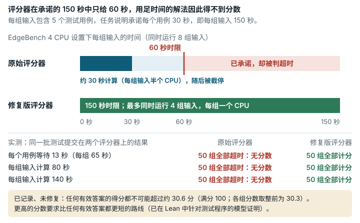

# Warehouse Forklift Routing (`warehouse_forklift_routing`)

**结论：** 评分器修复已经测试；EdgeBench 等待最后结果的方式也需要相应修改，这一部分只做了分部测试，尚未在完整运行中检验。<mark>评分器对每个含五个用例的输入只给 60 s，而任务说明承诺每个测试用例 30 s；而且在发布方 4 个 CPU 的评分器上，它同时运行 8 个输入，因此每个输入只分到约半个 CPU。修复版把时限提高到承诺的每个输入 150 s，让同时运行的输入数不超过评分器的 CPU 数，保持分数刻度不变，并在文档中写明约 30.6 分（满分 100；显示舍入前为 30.3）的上限，这一上限来自对原始总分的一个经 Lean 检验的下界。</mark>

*在 Warehouse Forklift Routing 中，用足任务说明所承诺时间的解法得不到分数。任务说明承诺每个测试用例 30 秒、每组五个用例共 150 秒，但原始评分器在每组输入运行 60 秒时就将其终止；在 EdgeBench 的 4 CPU 设置下，它还同时运行 8 组输入，因此每组只得到约 30 秒的计算时间；只要一次超时，整份提交就没有分数。每个用例等待 13 秒或每组输入计算 80 秒、140 秒的测试提交，在原始评分器上没有分数，在修复版评分器上 50 组输入全部计分；修复版允许 150 秒，并且同时运行的输入组数不超过 CPU 数（它还需要在 EdgeBench 的运行器中延长最终等待时间，这一部分只做了局部测试）。另一个上限已记录、未修复：任何有效答案的得分都不可能超过约 30.6 分（满分 100）。*

## 任务要求

该任务改编自 CodeChef 题目 WAREHOUS。解题者必须输出叉车指令串，把陆续到达的 R·C−1 件货物存放在一个 R x C 的网格上，然后按顺序发出。目标是 "Minimize the total instruction string length"（使指令串总长度最小）。任务说明写明 "T=5 test cases per input"（每个输入的测试用例数）和 "Time limit: 30 seconds per test case"（每个测试用例的时限）。README 写道 "Final score = sum of per-input average scores."（最终分数为各输入平均分之和。）原始结果越低越好。类别：组合优化。

## 问题出在哪里

### 1. 时限比承诺的更严

**规则。** 任务说明承诺每个测试用例 30 s，每个输入 5 个测试用例，即每个输入 150 s。评分器为整个输入设置 `TIME_LIMIT = 60`，并行运行 8 个输入。超时记为 `inf`，因此一次超时就会使 `TOTAL_SCORE` 为 `inf`。EdgeBench 的测试框架保留这样的结果（`valid: true`），原始分数为 `inf`，不给出 100 分制得分（对非有限的总分，`rescale_score` 返回 None，`sforge/harness/score_rescale.py:75-76`），并且在 `minimize` 下，任何完成了的提交都优先于它。因此一次超时就会让整份提交失去全部分数。

**原始评分器上的例子。** 一份带时间预算的测试提交（它会 sleep）在每个测试用例上花费 13 s，不到承诺时限的一半。它得到 50 个 TLE（超时）、总分 `inf`，没有分数。按任务说明的预期：全部 50 个输入都应计分。

**为什么重要。** 本地工具不会发出任何警告，因为 `tools/bin/tester` 只对输出文件计分。一个遵循承诺预算的解题者会失去全部分数。

**在发布方 4 个 CPU 的评分器上，原始版每个输入的 60 s 约相当于 30 s 的 CPU 时间（在同一版本中修复）。** 时限按墙钟时间计，而评分器无论 CPU 数是多少都运行 `ProcessPoolExecutor(max_workers=min(8, len(case_files)))`。EdgeBench 的排行榜设置给这个评分器 4 个 CPU（默认值，本任务没有单独覆盖；引文见 [`evidence/impact/edgebench-leaderboard-config.md`](../evidence/impact/edgebench-leaderboard-config.md)），因此同时运行的 8 个输入各得约半个 CPU。所以在原始评分器下，一个单线程解题者只要每个输入超过约 30 s 的 CPU 时间就会失去全部分数（半个 CPU 下 60 s 的墙钟时间；这是算术推算，实测的各组都超过了它）。仅把时限提高到 150 s，仍会在约 75 s CPU 处截断这样的解题者。在 `--cpus 4` 下用这个只改时限的版本（150 s，同时 8 个）测得：每个输入做固定 80 s 或 140 s CPU 计算的有效解法，得到 2 OK + 48 TLE，没有分数（`evidence/runs/warehouse_forklift_routing-v2-cpu4-b/result/out/summary.txt`、`-cpu4-a`）。原始评分器对两者都给出 50 TLE（`-cpu4-b`、`-cpu4-c`）。

### 2. 分数刻度的参考点无法达到

**规则。** 测试程序接受的每个指令串都满足 S ≥ 2RC(R+C−1) − 6(R+C−2) − 2。因此每个有效的单用例分数都 ≥ 20 − 6(R+C−2)/(R+C−1)。在 50 个评分输入上，每个有效的 TOTAL 都 ≥ 198283458104808536/278277680055375 ≈ 712.538。即使考虑显示时的舍入，它仍高于 "rank1" 参考点。

**例子。** TOTAL ≥ 712.538 > rank1 395.80。"super_anchor" 参考点（293.51）也低于它。在任务自己的分数刻度下，任何有效提交的得分都不可能超过约 30.3 分（满分 100；在精确下界处为 30.308；在显示舍入后可能的最低总分 710.2 处为 30.586）。

**为什么重要。** 0–100 刻度有一个远低于 100 的上限。提交之间的顺序得以保留。

### 已检查、且发现不会改变分数的部分

- **一项任务说明已披露的规则改动。** 测试程序允许空载叉车进入被占用的格子。这比原始 CodeChef 规则宽松，但任务说明写明了这一点。遵循任一规则的解题者都会被接受。
- 对角线构造恰好得 20.0 分。加上一次 E,W 绕行得 20.2 分。
- 测试程序把每个输入的分数打印到小数点后 1 位。这使 TOTAL 至多偏移 2.5 个原始分（可达到的最低显示 TOTAL 为 710.2），在上限处约为 100 分制下的 0.3 分（30.308 → 30.586，`evidence/scripts/warehouse_forklift_routing/lean_bound/recompute_total.out.txt`）。
- 失败会累加为 `inf`，因此该提交没有分数，这与 README 中的"求和"一致。
- 计分是确定性的。
- 数据格式正确。回放生成器种子 0..300,000 没有复现出 50 个评分文件中的任何一个，因此评分输入不在公开的种子范围内。

## 影响有多大

- **时限：** 一个在任一输入上耗时 60–150 s（在承诺预算之内）的解题者会失去全部分数。在发布方 4 个 CPU 的评分器上，一个在任一输入上使用超过约 30 s CPU 的单线程解题者也是如此，因为同时运行的 8 个输入各只得到约半个 CPU。更快的解题者不受影响。一直搜索到墙钟截止时间（低于 60 s）才停止的解题者，在 4 个 CPU 下每个输入只得到约半个 CPU；如果有整个 CPU，它能多得多少分，没有测量。
- **上限：** 每个解题者的 100 分制得分都被封顶在约 30.6（显示舍入前为 30.3）。这是一个上界；可达到的最佳分数未知，可能更低（见局限）。

## 修复

修复版在 `/tmp/eval_warehouse_manager.py` 中做了两处改动。第一，`TIME_LIMIT = 60` 改为 `TIME_LIMIT = 150`。这个值是任务说明承诺的每个测试用例 30 s × T=5。第二，新函数 `cpu_quota_workers()` 从 cgroup 读取评分器的 CPU 配额（`cpu.max`，或 cgroup v1 的配额和周期），向下取整为整数个 CPU，在没有配额时退回到 `os.cpu_count()`，并把结果限制在 1 到 8 之间；进程池变为 `ProcessPoolExecutor(max_workers=min(cpu_quota_workers(), len(case_files)))`。在 `--cpus 1/2/4/8` 下，修复版评分器分别同时运行 1/2/4/8 个输入（`evidence/runs/warehouse_forklift_routing-v2-cpu4-a/result/out/v2_workers.txt`）；在 8 个或更多 CPU 下，它与原始版一样同时运行 8 个。`eval_timeout` 保持为 3600。这一修复的早先版本只改动了时限（sha256 `eff6a69b…7b95`）；当前的修复版评分器 sha256 为 `afccb3bb…5a76`。任务 JSON 只改动 `judge.image_tag`。工作镜像、任务说明、README、测试程序、用例、解析器、选取规则和分数刻度都不变。

`piecewise_log_min` 的参考点予以保留，没有替换。已证明的下限是一个下界，而不是已知的最优值，因此把 100 分放在那里将是一种凭空捏造的重新校准。保留参考点能使分数与原始版保持可比。发布说明写明了上限（在精确下界处 ≈30.3，显示舍入后 ≈30.6）。

| 提交 | 角色 | 原始评分器 | 修复版评分器 |
| --- | --- | --- | --- |
| 通用的有效测试提交 | 正确 | OK 50/50，TOTAL 46676.8 | OK 50/50，TOTAL 46676.8 |
| 一个诚实的错误 | 无效 | 49 OK + 1 WA → inf | 49 OK + 1 WA → inf |
| 随附的初始文件 | 无效 | 50 WA → inf | 50 WA → inf |
| **每个测试用例 13 s（使用承诺的预算）** | **展示问题** | **50 TLE → inf** | **50 OK，TOTAL 46676.8** |
| 接近每个输入 150 s 的时限 | 展示问题 | 50 TLE → inf | 50 OK，TOTAL 46676.8 |

（WA = 答案错误，TLE = 超时。来源：`repairs/warehouse_forklift_routing-v2/paired/results.md` 的 "Paired run" 一节：在 `--cpus 2` 下、使用早先只改时限的修复版运行三次。全部五行都在 `--cpus 4` 下用当前修复版重新运行过，结果相同：`evidence/runs/warehouse_forklift_routing-v2-cpu4-c`、`-cpu4-d`。）

发布方 4 个 CPU 下的 CPU 份额（`evidence/runs/warehouse_forklift_routing-v2-cpu4-a` 到 `-d`，`result/out/summary.txt`）：

| 提交 | CPU 数 | 原始评分器 | 只改时限的修复（150 s，同时 8 个） | 修复版 |
| --- | ---: | --- | --- | --- |
| **每个输入 80 s CPU** | 4 | 50 TLE → inf | **2 OK + 48 TLE → inf** | **50 OK，TOTAL 46676.8** |
| **每个输入 140 s CPU** | 4 | 50 TLE → inf | **2 OK + 48 TLE → inf** | **50 OK，TOTAL 46676.8** |
| 每个输入 80 s CPU | 8 | 未运行 | 50 OK，TOTAL 46676.8 | 50 OK，TOTAL 46676.8 |

在修复版下，最慢的 140 s 输入从开始到结束耗时 140.58 s。4 个 CPU 下的评分至多耗时 1825.2 s，在 3600 s 的 `eval_timeout` 之内；最坏情况为 ⌈50/4⌉ = 13 轮 × (150 s + 30 s 测试程序超时) = 2340 s。

**分数是否可比？** 对于确定性的提交，只要其解题者在所用评分器上每个输入都在 60 s 内完成，修复版给出的分数就与原始版相同。对于在任一输入上耗时 60–150 s 的提交，两者不可比：原始版使整份提交作废，而修复版为其计分。在 CPU 少于 8 个的评分器上，一直搜索到墙钟截止时间才停止的解题者，在修复版下每个输入得到更多 CPU（在 4 个 CPU 下为 1 个 CPU，而不是约 0.5 个），因此其在两个评分器下的分数不可比。与任何计时任务一样，接近时限的运行也可能因机器速度不同而改变结果。由于参考点不变，0–100 刻度（包括 ≈30.3、显示舍入后 ≈30.6 的上限）在两个版本中相同。

## 我们如何检查

- **原始评分器，来自按摘要固定的公开镜像。** 原样的 `eval_cmd` 在评分器镜像中以 `--network none` 运行，解法以只读方式挂载，并由本仓库的测试框架评分。测试提交包括：一份通用的有效提交、它的一次重复、随附的初始文件、一份带诚实错误的提交，以及带时间预算的解题者。16 份手写输出在评分器镜像中通过测试程序运行，与参照程序的预测 0 处不一致。
- **独立参照。** 一个根据题面文字编写的模拟器，使用精确的 `Fraction` 计分和两种规则模式（任务说明的规则和更严格的 CodeChef 规则）。与原始测试程序的差分测试使用了 20,000 个随机指令串和 2,000 份测试提交的输出（其中一半做了单字符修改）；全部一致。极小网格的精确最优值来自在 2x2、2x3 和 3x2 上、两种规则集下的 Dijkstra 最短路搜索。数据检查覆盖了全部 50 个评分输入（250 个子用例）和生成器种子 0..300,000。
- **Lean 4 中的形式化检查。** 单用例的下界是 `formal/lean/ebv/Ebv/WarehouseBound.lean` 中的定理 `EbvWarehouse.lower_bound`。Lean 内核在 Lean v4.34.1 和 Mathlib `d13f23b7` 下检验了它，没有 `sorry`，也没有 `native_decide`，并且独立地重新编译过。它只依赖 Lean 的标准公理 `[propext, Classical.choice, Quot.sound]`。`EbvWarehouse.score_bound` 给出单用例的分数下界。在 `Ebv/WarehouseData.lean` 中，`totalLB_eq` 和 `totalLB_gt` 给出 TOTAL 的下界，`displayed_gt_rank1` 处理显示舍入。该定理不是空洞的：模型接受一个 42 个字符的最优解（`opt23_accepted`），而一个去掉 −6(R+C−2) 项的更强下界被证明为假（`too_strong_bound_false`）。那个更强的下界在暴力搜索找到的 248 个最优解中的 239 个上不成立。证明没有用到关于进入被占用格子的条件，因此它在任务说明的规则和 CodeChef 规则下都成立。
- **可重复性。** 原始版与只改时限的修复版在 `--cpus 2` 下的并排对照运行做了三次，结果没有变化（`data/paired-repeatability.md`）。在 `--cpus 4` 和 `--cpus 8` 下的 CPU 份额运行（`evidence/runs/warehouse_forklift_routing-v2-cpu4-a` 到 `-d`，每个都是 `status: exit=0`）各运行了三次（`-rep2`、`-rep3`），OK/TLE/WA/RE 计数和总分都相同（`repairs/warehouse_forklift_routing-v2/paired/results.md` 的 Repeatability 一节）。

## 局限

- 修复版评分器从 cgroup（`cpu.max`）读取其 CPU 配额。这只用 `docker run --cpus` 测试过，没有在 Kubernetes pod（EdgeBench 排行榜设置所用的后端）中测试。
- 没有 cgroup 配额时，修复版评分器回退到 `os.cpu_count()`，它统计的是主机的全部 CPU，而不是评分器可以使用的 CPU（`os.sched_getaffinity`）。在只有 CPU 集合限制、没有配额的情况下（例如 `docker run --cpuset-cpus`），或者 pod 看不到自己的 `cpu.max` 时，它仍可能同时运行多于 CPU 数的用例，与原版一样。改用亲和性计数需要一次新的并排对照运行，因此这里没有改。
- 上游评测框架为最终评分只等待 900 s，可能漏掉一次修复后的评分（实测 1,825.2 s）。请把单独的[最终等待评测框架叠加层](../repairs/harness-final-drain-v1/README.md)与本评分器修复包一起使用：它等到历史记录进入终态，使用考虑排队的截止时间，并在收集不完整时明确报错。确定性的补丁源码测试已通过；通过该叠加层的完整 Docker/Kubernetes 运行仍未验证。该叠加层会改变通过其物化评测框架运行的每个任务的最终收集，不只是 Warehouse，等待时间最长可达 `300 + n·(eval_timeout + 300)` s（一份未完成的 Warehouse 提交为 4,200 s），其间工作沙箱一直保持分配；详见其 README。只修改镜像的修复不能解决这一主机端的边界问题。此前关于每份原本计分的提交都能在 900 s 等待内完成的说法并未得到证实，现予撤回。
- 没有运行任何 AI 模型或解题者。影响只在我们编写的测试提交上展示。
- 有效的测试提交是通用且较弱的（100 分制下 0.0 分）。没有构建有竞争力的解题者。因此，在下限（原始分 712.5）与约 1000 原始分（对角线构造）之间可达到的最佳分数没有测量。
- 带时间预算的测试提交使用 `sleep`；它们表明时限确实按承诺对每个输入执行。CPU 争用是用每个输入做固定 80 s 或 140 s CPU 计算的单线程提交展示的。多线程的解题者没有测试，3、5、6 和 7 个 CPU 也没有测试。
- 在 4 个 CPU 下，修复版为每个输入 140 s 的 CPU 计算只留下约 9 s 的余量（最慢的输入为 140.58 s）。
- 评分器 CPU 少于 3 个时，3600 s 的 `eval_timeout` 会先于每个输入 150 s 的时限起作用：在 2 个 CPU 下，25 轮 × 150 s = 3750 s，因此每个输入只能用约 144 s。配额是向下取整的：2.5 个 CPU 时同时运行 2 个输入。
- Lean 模型与测试程序之间的对应是人工逐行映射，并有一个在 294 个指令串上 0 处不一致的运行时差分测试作为支撑。它不是经内核检验的证明。用例的假设（排列、最后到达的不为 1）和 (R,C) 的提取是在 Python 中检查的。0–100 刻度上的上限来自测试框架的浮点换算代码，而不是来自 Lean。
- 参考点的来源不明。
- 评分器隔离不在本次发布的范围之内（这是 EdgeBench 的设计选择）；影响诚实解题者的发现已在上文报告。

## 复现

- 评分器镜像：`sha256:ac7fdf03…`。
- 主机上的检查：`evidence/scripts/warehouse_forklift_routing/`（`oracle_sim.py`、`diff_fuzz.py`、`authored_cases.py`、`data_and_bound.py`、`tiny_optimum.py`、`native/run_native.sh`、`harness_grade.py`；校验和见 `SHA256SUMS`）。
- Lean 下界：`evidence/formal/lean/ebv/Ebv/Warehouse{Bound,Check,Data}.lean`，用 `evidence/scripts/warehouse_forklift_routing/lean_bound/compile_capped.sh` 编译。精确总分：`lean_bound/recompute_total.py`。暴力搜索：`lean_bound/brute_force.py`。
- 并排对照运行：`repairs/warehouse_forklift_routing-v2/paired/run.sh`（实际运行版本：`evidence/runs/warehouse_forklift_routing-v2-paired-b/run.sh`）。CPU 份额运行：`repairs/warehouse_forklift_routing-v2/paired/run-cpu4.sh`（实际运行版本：`evidence/runs/warehouse_forklift_routing-v2-cpu4-a/run.sh` 到 `-d`）。
- 固定标识：评分器镜像 `seededge/edgebench.judge.warehouse_forklift_routing@sha256:ac7fdf03…`；`/tmp/eval_warehouse_manager.py` 的 sha256 为 `c5ff0c26…`；`tools/bin/tester` 的 sha256 为 `277f4841…`；50 个评分输入（拼接后）的 sha256 为 `04b8cd29…`；任务 JSON 的 sha256 为 `78002570…`。
- 支撑记录：`repairs/warehouse_forklift_routing-v2/`（存放修复版的文件夹：README、`repair.patch`、`source-lock.json`）、`evidence/reviews/warehouse_forklift_routing.md`、`evidence/reviews/warehouse_lower_bound_lean.md`。
